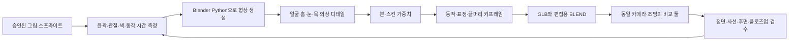

# 캐릭터를 만든 방법
작성: Codex · 2026-09-27  
기준 경로: `C:\xoox` · 도구: Blender 5.2.2, Python, three.js 0.185, Vite

## 1. 전체 제작 흐름



원본 그림의 기준점을 좌표로 옮겨 **Blender의 실제 메시와 본을 코드로 생성**했다. 2D 그림 한 장에서 숨은 뒷면이 자동으로 확정되는 과정은 없다. 제공된 정면·사선·후면을 함께 보고, 없는 측면은 그 사이 형태를 구성한다.

초기 Claude 제작본은 매끈한 부품을 뼈에 붙이고 런타임에 블록으로 샘플링했다. 현재 루온·리아는 제작 단계에서 블록과 얼굴 면을 만든 **nativeBlocks 스킨 메시**다. 두 방식은 파일과 런타임 처리가 다르다.

## 2. 정답 그림과 좌표

### 참고 자료

- 루온: `data/tools/unit_lab/character/A/reference_front.png`, `reference_threequarter.png`, `reference_back.png`, `reference_face.png`, `reference_measurements.json`.
- 리아: 같은 구조의 `character/D/reference_*.png`.
- 원본 동작: `data/ui/actor/wanderer/` 계열의 스프라이트와 JSON 프레임 시간. 툴은 `/ui/actor/wanderer/` 경로로 읽는다. 실제 파일 위치는 파일 목록을 함께 확인한다.
- 총쏘기2: `/ui/wanderer/test_clips/shoot`를 사용했던 별도 비교 자료.
- 초기 제작 기준: 로비 앞모습, 여정 뒷모습, 대기·걷기·뛰기·조준·던지기 프레임.
- 참고용 KayKit 모델과 유료 얼굴 조사도 있었으나, 현재 루온·리아 얼굴을 유료 모델에서 가져오지는 않았다.

### 단위와 축

제작 그림 좌표는 x=가로, d=깊이, y=그림 아래 방향이다. Blender는 **앞=-Y, 위=Z**.

```text
S = 0.0032 m / reference pixel
루온: X=(x-240)*S, Y=d*S, Z=(650-y)*S
리아: X=(x-248)*S, Y=d*S, Z=(650-y)*S
일반 블록 한 칸: CELL=8px → 0.0256m
루온 정수리 보정 부분: 4px → 원래 비율에서 0.0128m
```

GLB로 내보내면 three.js의 Y-up 좌표로 변환된다. Blender의 높이 Z를 브라우저 Y와 혼동하지 않는다.

루온 기준점: 정수리 y113, 턱 y365, 발 y651, 머리 본체 폭 274px, 눈 y277~328. 윗꼬리는 따로 측정한다. 깊이는 원본 사선·후면을 보고 정한 제작 치수이며 사진에서 실제 미터 단위를 측정한 값이 아니다.

## 3. 몸·의상·머리의 형상 생성

주요 제작기는 `scripts/unit_lab_a/build_a.py`, `scripts/unit_lab_d/build_d.py`다.

| 함수 | 하는 일 |
|---|---|
| fill | 범위 안 격자 중심이 조건을 만족하면 한 칸의 부위와 색을 기록 |
| box | 직육면체 부품 |
| ell | 타원체 또는 지수 조절된 둥근 상자 |
| loft | 높이별 중심·폭·깊이를 연결한 몸통, 망토, 다리 등 |
| curve / strand | Catmull-Rom 곡선 위 타원 단면으로 머리 다발·선 장식 생성 |
| panel / poly_inside | 그림에서 딴 2D 윤곽을 깊이 있는 패널로 생성 |
| voxel_meshes | 격자를 실제 면으로 변환하고 인접한 같은 부위의 내부 면 제거 |
| colored_mesh | 정점 코너 색·재질·부모를 지정 |
| cloth_panels | 양쪽 어깨 옷의 앞·뒤·가장자리 면 생성 |
| clean_head / neck_bridge | 얼굴 표면, 눈 홈, 턱과 목 연결 |
| detailed_face / costume_details | 눈·눈썹·입·장식·버클 등 정밀 형상 |

`VOX[(i,j,k)] = (part, color)`가 생성 단계의 공통 격자다. 나중에 넣은 부위가 같은 칸을 덮어쓴다. 이 순서 때문에 머리·옷 조각의 겹침 순서를 함부로 바꾸면 안 된다.

일반 표면은 보이는 면만 만든다. 서로 다른 부위의 경계에는 움직일 때 내부가 드러날 수 있어 필요한 면을 유지한다. 피부·눈·카라처럼 작은 요소는 전체 격자 크기에 맞춰 뭉개지지 않도록 별도의 정밀 메시로 만든다.

정점 색은 sRGB 팔레트를 선형색으로 변환해 저장한다. 머리의 국소 음영은 인접 격자 점유를 이용한 코너 AO다. 모든 색을 재질 수백 개로 나누지 않으며, 역할별 메시 병합으로 그리기 단위를 줄인다.

## 4. 얼굴을 맞춘 핵심

### 눈이 뜨거나 얼굴이 튀어나오는 문제

얼굴에 공유 표면 함수 `face_surface(x,y)`를 사용한다. 눈·입 윤곽을 딴 얕은 홈을 만들고 그 안에 세부 메시를 배치한다.

기본 얼굴 깊이는 약 -58px, 눈 표면은 -57.35~-57.84px, 눈 홈 바닥은 약 -56.3px다. 앞이 -Y이므로 눈 세부는 원래 피부 평면보다 약간 안쪽이면서 홈 바닥보다 앞에 있다. `colored_mesh`의 앞쪽 높이 보정도 얼굴·눈·머리에 일관되게 적용한다.

눈의 모양은 수평 윗선, 계단 외곽, 바깥쪽 흰자, 동공·홍채의 여러 색 면, 작은 십자 반사광으로 구성했다. 루온은 청록 홍채와 어두운 눈썹, 리아는 금색/갈색 홍채와 초록 눈썹이다. 현재 얼굴은 초기 `eye3d_*` 각막 실험과 다른 구조다.

### 볼·턱·목

- 아래 볼 좌우를 단계적으로 뒤로 접어 면 방향과 음영 차이를 만든다.
- 볼터치는 피부 색에 포함해 별도 판이 떠 보이지 않게 한다.
- 턱 아래 접히는 면과 얇은 음영 단계를 만든다.
- 목 메시를 턱 안쪽과 스카프 안쪽까지 연결한다.
- 스카프 중앙 윗선을 조절해 목이 조금 보이게 한다.
- 밝은 옷깃은 그림의 폭·높이·겹침을 다시 측정해 확대했다.

현재 얼굴 수정 시 눈·입만 앞으로 당기거나 얼굴 전체를 돌출시키지 않는다. 동일한 표면 함수와 홈 깊이 관계를 유지하며 정면뿐 아니라 사선과 측면을 확인한다.

### 얼굴 색과 그림자

루온은 `unitLabA/FaceShadows.ts`에서 얼굴 그림자 강도 0.18을 사용한다. 리아는 `unitLabD/FaceAppearance.ts`에서 피부·홍조 색 반응과 그림자 강도 0.22를 보정한다. 이 보정은 GLB 자체 색만으로 재현되지 않으므로 다른 뷰어에 옮길 때도 함께 적용해야 한다.

## 5. 머리카락과 이번 정수리 보정

원래 머리는 두피 덩어리, 앞머리 세 덩어리, 옆머리, 뒷머리 다발, 윗꼬리로 나누었다. 리아는 크림→민트 끝색, 루온은 남색과 가로 민트 띠를 쓴다.

루온의 큰 타원형 두피를 동일한 8px 격자로 만들면서 정수리에 닫힌 동심원 단차가 나타났다. 높은 시점에서 층을 쌓은 모양으로 보이는 원인이었다.

이번 `crown_a.py`는 **그림 y186 위의 정수리만** 처리한다.

- 앞머리·민트 띠·옆머리·뒷머리 끝·윗꼬리의 기존 윤곽을 보존한다.
- 정수리는 4px 격자로 만들어 큰 계단을 줄인다.
- 넓고 비스듬한 머리 다발 방향으로 작은 높이·색 변화를 준다.
- 코너 AO를 약하게 적용해 검은 원형 홈처럼 보이지 않게 한다.
- 새로운 정수리도 head 본을 따른다. 끝머리 본과 클립을 추가하거나 바꾸지 않는다.

`refine_ruon_crown.py`는 백업된 두 체형을 각각 열고 머리 메시만 교체한다. 나머지 메시의 정점·면·색·스킨 가중치·모양 키 해시가 동일한지 확인한다. 비교 툴에서는 수정 전후 모든 애니메이션 트랙 값의 차이도 검사한다.

## 6. 본과 스킨 가중치

현재 루온은 46본(끝머리 23본), 리아는 48본(끝머리 25본)이다.

| 영역 | 주요 본·방식 |
|---|---|
| 이동 기준 | root, hips, chest, head |
| 팔 | upperarm.L/R, forearm.L/R |
| 다리 | thigh.L/R, shin.L/R, foot.L/R |
| 무기 | gun, gunL, rifle, bomb |
| 연결 끈 | sling 계열 |
| 끝머리 | tip_hair_* |

`rig_a.py / rig_d.py`의 `region_weights()`가 이름·좌표·높이에 따라 가중치를 지정한다. 예를 들어 옷 어깨는 chest→upperarm, 팔 아래쪽은 upperarm→forearm으로 이어지고, 목은 chest→head로 이어진다. 그래서 팔을 들 때 옷도 함께 움직인다.

**주의:** `face_detail`에는 얼굴뿐 아니라 일부 의상 장식도 포함될 수 있다. 이름만 보고 전체를 head에 묶지 않고 좌표별 가중치 규칙을 유지한다.

초기의 팔 반전은 뼈의 로컬축을 반대로 가정한 것이 원인이었다. 실제 손끝 좌표로 전방을 확인하고 팔·다리 X/Z 부호를 변환했다. 현재 `set_body()`와 기존 동작 변환 규칙을 그대로 사용한다.

옷은 스킨으로 변형된다. 천 시뮬레이션·범용 충돌 방지가 들어간 상태는 아니다.

## 7. 애니메이션을 만든 방법

원본 스프라이트의 동작 단계와 JSON 시간에서 주기를 읽고, 몸·팔·다리 포즈 함수를 작성했다. Blender에서 30fps로 모든 본 위치·회전·크기를 키프레임에 굽는다.

| 클립 | 시간 | 내용 |
|---|---:|---|
| idle | 6.0초 | 호흡·작은 중심 이동·깜박임, 발 고정 |
| walk | 1.0초 | 걷기 |
| run | 22/30초 | 달리기와 짧은 공중 구간 |
| shoot | 8/30초 | 쌍권총 교대 반동 |
| shoot2 | 0.5초 | 바주카 단발 반동 |
| throw | 1.1초 | 들어 올리기→놓기→팔 따라가기 |
| walk_shoot | 1.0초 | 걷는 다리와 사격 상체 |
| walk_throw | 1.1초 | 걷는 다리와 투척 상체 |
| walk_gun | 1.0초 | 무기 든 이동 |
| draw / holster | 각 1.2초 | 쌍권총 꺼내기·넣기 |
| draw_launcher / holster_launcher | 각 1.2초 | 바주카 꺼내기·등 거치 |
| blink | 1.8초 | 눈 깜박임 |
| squint | 2.4초 | 눈 찡그리기 |
| bow | 2.8초 | 고개 숙여 인사 |
| wave | 3.2초 | 오른손 세 번 작게 흔들기 |
| victory | 3.2초 | 움츠림→두 번 폴짝→착지 |

### 손과 발

투척은 손 목표가 어깨 위를 지나도록 IK 궤적을 잡고, 놓는 시점에 소품 크기를 아주 작게 해 숨긴다. 사격은 팔만 움직이지 않고 골반·무릎·몸통의 짧은 반동을 함께 넣었다.

새 체형에서는 어깨·팔꿈치·손목 위치를 다시 만들고 무기 손잡이의 목표점에 두 관절 IK를 푼다. 솔버의 작은 잔차는 도달 범위로 제한한 목표에 대한 값이다. 모든 자세에서 무기·머리·옷이 절대 관통하지 않는다는 의미는 아니다.

발 접지는 발 본의 현재 변환으로 밑면 지지점을 계산해 root 높이를 보정한다. 루온 3.5등신은 실제 부츠의 가장 낮은 면에서 지지점을 얻도록 수정했다. 초기 원본 루온의 바닥 원점은 이전 형태 보존을 위해 그대로다.

### 끝머리

끝부분으로 갈수록 head→tip_hair 가중치가 smoothstep으로 늘어난다. 뿌리는 head에 고정한다. 부위별 위상을 다르게 한 사인파를 키프레임으로 굽고, 대기 약 0.55도, 걷기 1.15도, 달리기 2.1도, 승리 2.2도 수준의 프로파일을 사용한다. 동작에 따라 주기·세기가 달라지며 전체 머리를 크게 흔드는 방식은 아니다.

### 표정

`expressions_a.py / expressions_d.py`가 Basis·Blink·Squint 모양 키를 만든다.

- 눈 홈을 닫는 얼굴 변형, 눈 세부를 접는 변형, 감은 눈 선을 표시하는 메시를 함께 제어한다.
- 입·볼·목·얼굴 외곽은 기본형을 유지한다.
- 대기는 약 1.27초와 4.61초에 깜박인다.
- 같은 이름의 NLA 트랙으로 본 동작과 얼굴 모프를 묶는다.
- 최종 각 클립에 morphTargetInfluences 트랙 3개가 포함된다.
- 리아는 찡그림에 깜박임 선이 겹친 문제를 `refine_d08.py`로 고쳤다.

## 8. 무기와 총구 FX

`weapons_a.py / weapons_d.py`는 크림·민트·주황 블록으로 쌍권총과 앞뒤가 뚫린 사각 바주카를 만든다. 현재 바주카 길이는 29칸×0.024m=0.696m다.

`prop`, `muzzleLocal` 등의 사용자 속성을 GLB extras로 내보낸다. 무기 본은 손·몸에 맞춰 독립적으로 배치한다. 대기·쌍권총 사용 중에는 바주카를 등 뒤에 낮게 사선 거치한다. 꺼내기와 넣기는 머리 옆을 도는 경로이며 끈이 연결을 보완한다.

`WeaponMuzzleFx.ts`는 다음 순서로 처리한다.

1. 무기 메시의 prop 및 muzzleLocal을 읽는다.
2. 모델 축과 본 축 사이 변환을 적용해 실제 총구에 앵커를 붙인다.
3. AnimationAction.time과 루프 수로 발사 시점을 계산한다.
4. 쌍권총은 좌우 반주기 차이, 바주카는 단발 시작에 섬광을 낸다.
5. InstancedMesh 큐브 풀로 크림 섬광·주황 입자·민트 사각 파동·연기를 재사용한다.
6. 대기나 발도 전환, 낮은 애니 혼합 가중치, 생성/흩어짐 상태에서는 발사 FX를 억제한다.

후면에서도 머리 실루엣 밖에 보이도록 효과를 확장했다. 효과 시간을 독립 타이머로 돌리지 않아 일시정지·느리게 재생할 때 동작과 같이 멈춘다. 발사체 비행·적 충돌·대미지 시스템은 별도다.

## 9. 기존 비율에서 3.5등신으로 바꾸기

비율 스크립트는 완성된 Blender 원본을 열어 새 파일로 만든다. 얼굴과 머리는 균일하게 줄이고, 몸은 높이별 기준점 사이를 선형 보간한다.

```text
목표 등신 = 1 + 턱 높이 / (원본 정수리~턱 길이 × 머리 배율)
목표 3.5이면 턱 높이 = 2.5 × 머리 길이
머리 변환: (x*s, y*s, 새 턱 높이 + (z-옛 턱 높이)*s)
몸통: x*0.92, y*0.90, z는 발목/무릎/골반/가슴/목 기준점 보간
```

리아: 머리 배율 약 0.60812, 새 턱 높이 약 1.28434m.  
루온: 머리 배율 약 0.62831, 새 턱 높이 약 1.26667m.

같은 변환을 Basis와 모든 표정 모양 키에 적용한다. 본의 rest head/tail도 바꾸고, 무기·팔 목표와 발 지지점을 새 체형에 맞춰 18개 클립을 다시 계산한다. 금속 버클은 늘어지지 않도록 별도 보정한다.

스킨 가중치, 얼굴 모프, 원본 디자인을 보존한다. 전체 크기 조절만으로 3.5등신을 만들면 머리/몸 비율이 변하지 않으므로 이 절차가 필요하다.

## 10. 저장과 런타임

- 편집 원본: BLEND. 메시·본·스킨·모양 키·NLA를 모두 포함한다.
- 실행 자산: GLB. NLA_TRACKS 모드, force sampling, extras 포함.
- 메타데이터: metrics.json. 버전·삼각형·본·동작·파일 크기를 기록한다.
- 얼굴 모프가 있는 메시를 무리하게 합치지 않는다. 역할별 merge_draw_groups가 본 가중치를 유지하며 병합한다.
- CharacterLab은 nativeBlocks를 발견하면 원본 블록 메시와 스킨을 직접 사용한다.
- 과거 매끈 모델만 표면 샘플→뼈별 격자→블록 변환 경로를 쓴다.
- 등장·솟기·정화·피격은 NativeBlockEffects의 셰이더 uniform으로 제어한다.
- 카메라·노출·조명과 FaceAppearance/FaceShadows가 화면 결과의 일부다.

## 11. 고양이 펫 제작 방법

`scripts/unit_lab_cat/build_cat.py`는 방랑자와 독립된 네발 리그를 생성한다. 사각 몸통·관절·헤드셋·큰 귀·얼굴판·큐브 체인 꼬리를 만들고 작은 모서리 면을 준다. 정점 색과 공유 512×512 마모 텍스처를 사용한다.

BCAT02는 귀·이마판·눈·주둥이를 원본과 다시 비교해 수정했다. walk, idle_sit, idle_look, attack_laser에 stand_up, sit_down을 더해 6클립이다. 앉기↔서기는 골반·뒷발·꼬리 중간 자세를 실제 키프레임으로 만들었다.

툴은 앉은 동작에서 걷기/서기/공격으로 갈 때 stand_up을, 반대일 때 sit_down을 자동으로 거친다. 눈 레이저는 head 본 좌표의 두 눈 기준점에서 공격 0.18~0.30초에 발사한다. 최종 수치는 6,452삼각형, 29본, GLB 약 1.05MiB다.

## 12. 검수 때 반드시 비교할 것

정면의 눈·가르마·카라뿐 아니라 높은 사선의 정수리, 후면의 머리·무기 거치, 턱과 목 연결을 확인한다. 눈 깜박임·찡그림·투척 최고점·사격 반동·발도 중간·승리 착지를 시간 탐색으로 확인한다.

형태 수정 뒤에는 비대상 메시 해시, 본/클립 수, 모프 트랙, 루프 경계, 유한 좌표, 발 접지 표본, 총구 앵커, 브라우저 오류와 실패 요청을 검사한다. 본편 대량 배치와 모바일 성능은 별도 검증 대상이다.
