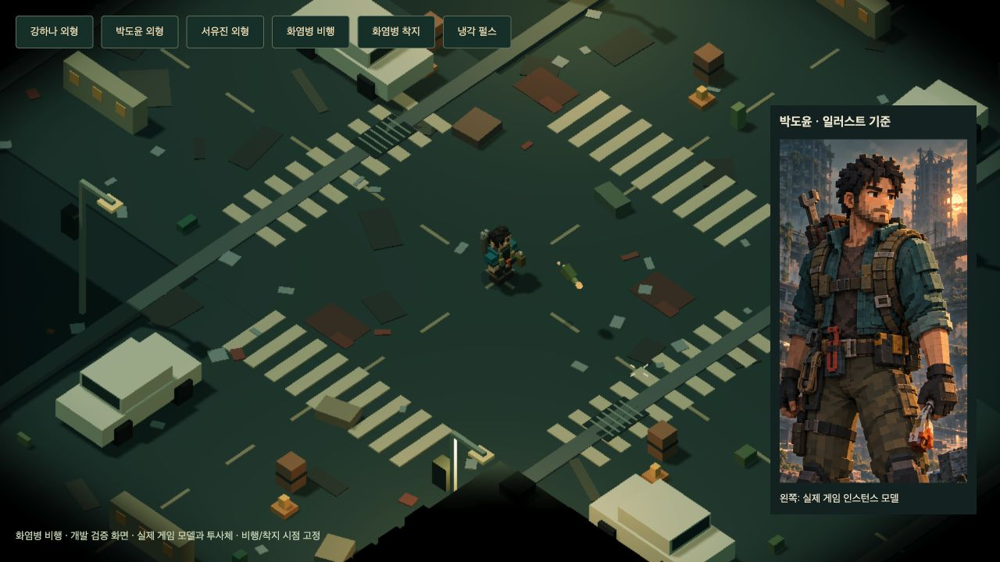
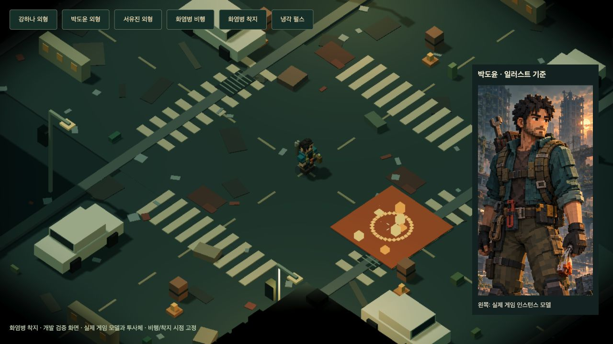
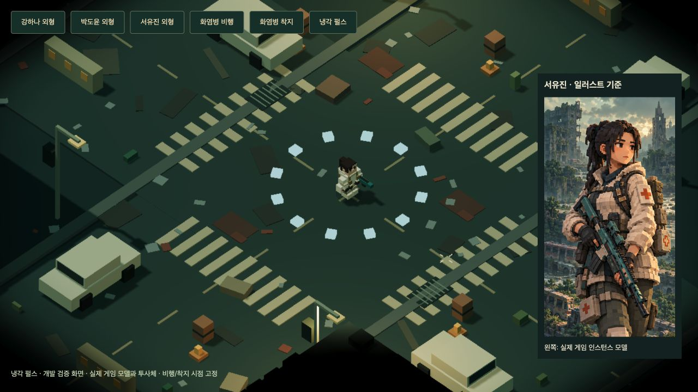
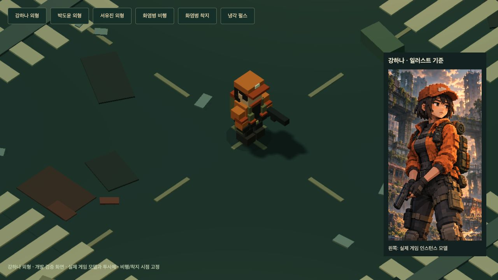
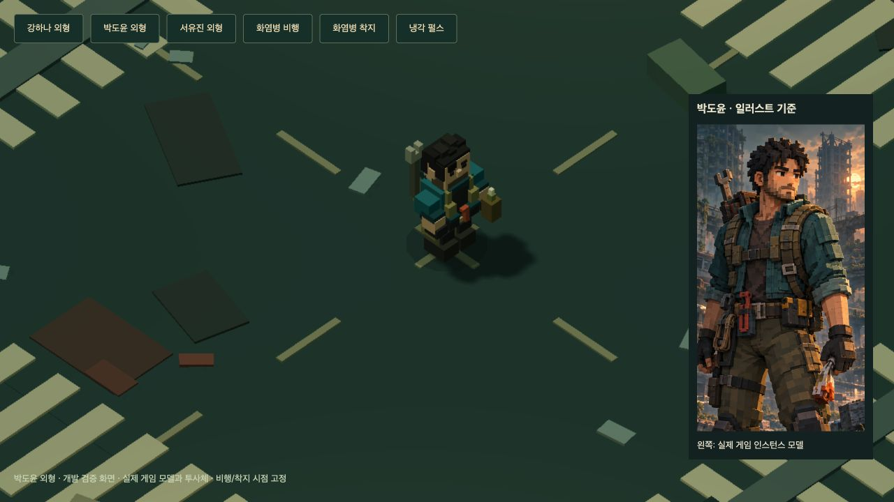
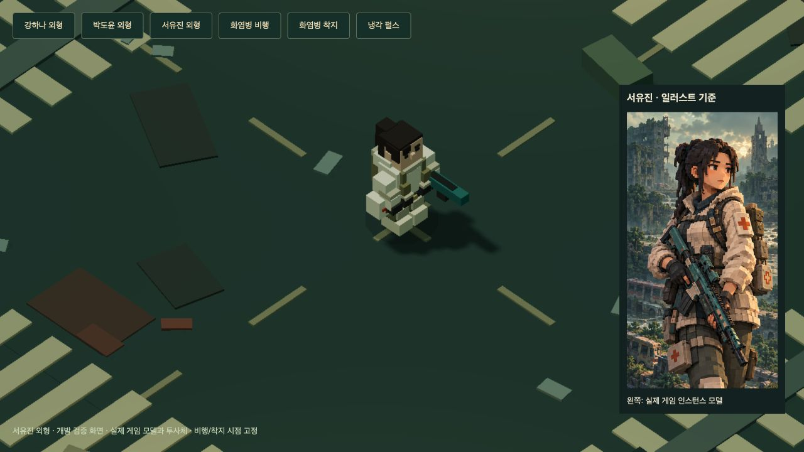
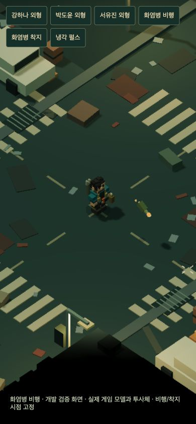

# DEAD GRID 1.6.3 · 화염병 비행과 생존자 외형

## 화염병

화염병이 마우스 방향으로 포물선을 그리며 날아갑니다. 녹색 병·갈색 연료·천 심지·불꽃을 복셀로 표시하고, 착지 또는 지형 충돌 시 파열 효과·유리 소리와 지속 화염을 생성합니다. 발사 순간에 바닥 불꽃이 생성되던 표현을 교체했습니다.

실제 투사체는 Koota의 기존 ProjectileState에 저장합니다. 비행 중에는 적에게 접촉 피해를 주지 않고, 충돌한 뒤 기존 화염 피해 주기로 피해를 줍니다. 비행 시간은 `0.18 + 던지는 거리/14`초를 0.25~1.45초로 제한합니다. 클릭한 목표와 피해·범위·지속시간을 발사 시점에 저장하므로 비행 중 마우스를 옮기거나 강화를 골라도 이미 던진 병의 목표와 수치가 바뀌지 않습니다.

사거리·범위·추가 투사체·진화는 유지됩니다. 건물·차량·차단물의 공통 충돌 형상에 막히며, 기존 화염 엄폐 판정과 차량 연소도 유지합니다. 비행은 레벨업·일시정지 중 멈추고 재시작 시 정리됩니다. 일반 탄환 700개와 장식 효과 250개가 이미 있어도 화염병의 비행과 착지 후 피해 지대는 생략되지 않습니다. 병의 수는 무기 주기·비행 수명·추가 투사체 한도로 제한됩니다.

동작 줄이기 설정에서는 병 회전과 작은 잔불 꼬리를 줄이며 공격 위치를 알려주는 비행은 유지합니다. 별도의 메시·물리 엔진·새 외부 의존성은 추가하지 않았습니다.

## 냉각 펄스

실제 피해 탄환과 별개로 생성되던 반경 3m의 작은 내부 냉기 링을 제거했습니다. 기존 냉기 탄환의 수·피해·감속·사거리·진화는 유지합니다.

## 일러스트에 맞춘 생존자 모델

기존 캐릭터 공통 모자·피부색 팔·단색 바지를 각 생존자 전용 복셀 파츠로 교체했습니다. `public/portraits/survivors-v14.png`의 세 패널이 색과 장비의 기준입니다.

| 생존자 | 재킷           | 바지             | 주요 외형                                                   |
| ------ | -------------- | ---------------- | ----------------------------------------------------------- |
| 강하나 | 주황 `#cb702d` | 차콜 `#4b4a45`   | 주황 모자, 검은 단발, 짙은 조끼, 올리브 파우치, 소형 총기   |
| 박도윤 | 청록 `#32696b` | 올리브 `#686347` | 짧은 검은 머리, 수염, 걷은 소매, 등 뒤 공구, 허리 공구와 병 |
| 서유진 | 크림 `#ded1b8` | 올리브 `#6a6b4e` | 묶은 머리, 크림 후드, 적십자 표식, 의료 파우치, 청록 총기   |

셋 모두 피부·장갑·부츠·가방 색을 별도로 지정합니다. 메뉴와 실제 전투는 `SURVIVOR_MODELS`의 동일 파츠를 기존 인스턴스 렌더러로 그립니다. 플레이어 충돌 반경이나 게임 카메라의 배율은 바꾸지 않았습니다. 비교 장면은 모델을 보기 쉽게 개발 전용 카메라로 확대했으며 일반 게임은 기존 배율을 사용합니다. 모델의 부츠가 노면에 묻혀 가림 외곽선이 표시되지 않도록 발 높이도 맞췄습니다.

## 검증

- **추가 6개, 전체 87개 회귀 테스트 통과. TypeScript 검사·배포 빌드 통과.**
- 화염병의 실제 이동·고도, 착지 전 무피해, 목표 고정, 지연 화염, 정지·재시작, 지형 충돌·엄폐, 진화·투사체 수·강화 스냅샷, 탄환·효과 포화와 가까운 투척을 검사했습니다.
- 기존 범위·엄폐 테스트를 착지 이후 시점에 맞췄고, 9종 무기 단계별 실제 피해와 1,805초 작전 일정도 검사했습니다.
- PC 1280×720과 모바일 390×844에서 비교 모델·비행·착지·냉기 탄환을 확인했습니다. 실제 모바일 크기의 생존자 선택→박도윤 출격과 투척도 확인했으며 콘솔 경고·오류가 없습니다.
- 개발 장면 `/qa.html?appearance`는 시점을 고정해 비교합니다. QA 페이지와 확대 배율은 개발용이며 배포 경로로 제공되지 않습니다.
- 디자인 검사에서 나온 새 병 재료색과 기존 개발 QA 색·13px 설명 크기는 의도된 애셋/검증 화면 값입니다. 일반 UI 팔레트와 글자 크기를 변경하지 않았습니다. 별도의 실기기 GPU 성능이나 사람의 30분 난이도 측정은 이번 검증에 포함하지 않았습니다.

