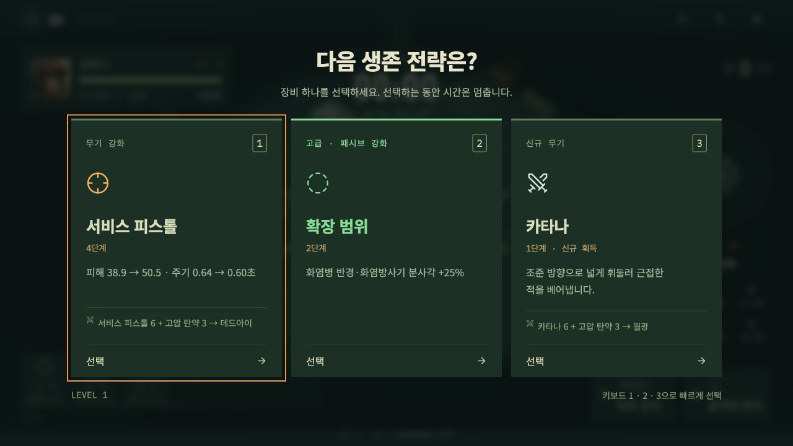
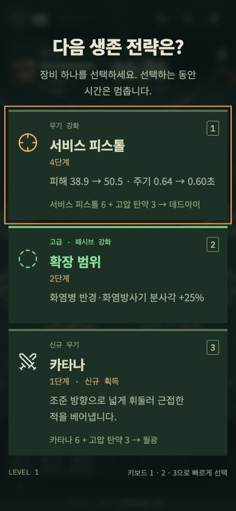

# DEAD GRID 1.6 · 성장 선택과 방향 회피

## 카타나 진화 후보 버그

무기 6칸이 모두 차고 고압 탄약이 3단계인 경우, 미장착 카타나도 진화 후보의 `else if`에 들어갈 수 있었습니다. 선택하면 `evolved` 표시만 추가되고 `weapons`에는 들어가지 않아 베기가 발사되지 않았습니다.

이제 **실제 장착한 6단계 무기 + 대응 패시브 3단계**일 때만 진화 후보가 생성됩니다. 선택 처리에서도 조건을 다시 검사하여 잘못된 후보를 거부합니다. 1단계 카타나는 ‘신규 무기’, 이후는 ‘무기 강화’, 월광은 ‘무기 진화’로 표시합니다. 신규 카타나를 선택하면 실제 장착되고 전방 베기가 발생합니다.

## 우클릭 회피

전투 중 우클릭하면 클릭 위치를 바닥 좌표로 투영하여 그 방향으로 회피합니다. 정지 중에도 작동하고 WASD와 독립적입니다. 클릭 이후 커서가 움직여도 최초 클릭 방향을 유지합니다. 클릭이 정확히 발밑이면 현재 바라보는 방향을 사용합니다. Space·모바일 회피와 기본 3초 쿨다운, 무적, 연구 효과를 공유합니다. 건물·차량·경계를 통과하지 않습니다. 메뉴·강화·일시정지와 UI 버튼에는 전투 회피를 적용하지 않습니다.

## 무기 성장

무기 1단계 기본 피해는 유지하고 **강화 단계마다 피해 ×1.30, 공격 주기 ×0.94**로 변경했습니다. 무기 자체 강화만으로 한 발당 피해는 6단계에서 약 3.71배입니다. 같은 탄환 수 기준 이론 DPS는 약 5.06배입니다. 실제 명중·범위·목표 이동·프레임 간격·탄환 수·진화·패시브에 따라 결과가 달라집니다. 화염방사기의 공격 주기는 최소 0.08초입니다.

카드는 이번 선택 전후의 실제 피해·공격 주기를 표시합니다. 무기별 탄환·연쇄 수, 베기·화염 반경, 사거리, 연소 피해의 변화도 표시하며 그대로인 탄환 수는 생략합니다. 1.6에서는 보유 무기 하나와 패시브 하나를 앞 두 칸에 보장했으나, 시작 무기가 첫 칸에 반복되는 문제가 확인되어 **1.6.2에서 강제 배치를 제거**했습니다. 현재는 전체 유효 후보에서 동일한 확률로 중복 없이 최대 3장을 뽑습니다. 무기 강화·진화·신규 획득·패시브는 모두 어느 칸에도 등장할 수 있습니다. 진화의 피해 배율·탄환 수도 조정했습니다.

## 패시브와 범위

기존 희귀도(일반 70% / 고급 25% / 희귀 5%, 효과 ×1 / ×1.25 / ×1.5)를 유지합니다. 추가 투사체는 항상 희귀이며 정수 +1발입니다.

| 패시브        | 일반 1단계 효과                                  | 고급 / 희귀                 |
| ------------- | ------------------------------------------------ | --------------------------- |
| 고압 탄약     | 기본 피해 보너스 +20%                            | +25 / +30%                  |
| 퀵 리로드     | 현재 공격 주기 12% 단축                          | 약 14.8 / 17.4% 단축        |
| 전투화        | 기본 이동 속도 +10%                              | +12.5 / +15%                |
| 회수 장치     | 획득 반경 +2m                                    | +2.5 / +3m                  |
| 방탄 플레이트 | 현재 받는 피해 12% 추가 감소                     | 약 14.8 / 17.4% 추가 감소   |
| 생존 키트     | 최대 체력 +30 · 초당 재생 +0.4                   | +37.5/45 HP · +0.5/0.6 HP/s |
| 전투 학습     | 기본 경험치 보너스 +12%                          | +15 / +18%                  |
| 확장 사거리   | 기본 무기 사거리 +15%                            | +18.75 / +22.5%             |
| **확장 범위** | **화염병 기본 반경·화염방사기 기본 분사각 +20%** | **+25 / +30%**              |
| 관통 탄두     | 관통 +10%p                                       | +12.5 / +15%p               |
| 추가 투사체   | +1발 · 항상 희귀 · 3단계 한도                    | 정수 +1발                   |

범위 패시브는 최대 5단계이며 화염병·화염방사기가 있을 때 후보에 들어갑니다. 관통·추가 투사체도 적용할 장비가 있을 때 제공됩니다. 공격 주기와 방어는 곱연산으로 누적하고 나머지 보너스는 기본값에 합산합니다. 피해 감소 상한은 70%, 관통 상한은 75%입니다.

화염방사기의 기본 전체 분사각은 약 **36.7°**(기존 약 63°)입니다. 범위 일반 5단계에서 약 **73.3°**, 희귀 5단계에서 약 **91.7°**가 됩니다. 진화 포함 최대 전체 분사각은 120°입니다. **사거리 패시브는 화염의 길이, 범위 패시브는 각도**를 늘리며 동시에 적용됩니다. 연소의 별도 0.5초 피해 주기·중첩별 3.2초 만료·8중첩 한도는 유지합니다.

화염병의 1단계 반경은 2.63m, 무기 단계당 기본 반경 +0.3m이며 여기에 범위 보너스를 곱합니다. 사거리 패시브는 던지는 거리에 적용됩니다. 화염 효과의 시각 반경·각도는 실제 타격 판정 값과 동일합니다.

## 보스와 검증

커진 최종 화력에 맞춰 보스 체력을 조정했습니다. 보스 출현 시각과 30분 최종 처치 승리 조건은 유지됩니다.

| 출현 | 체력    | 5초 뒤 체력 | 최대 장비 처치 시간 |
| ---- | ------- | ----------- | ------------------- |
| 5분  | 15,000  | 0           | 1.4초               |
| 10분 | 58,800  | 15,446      | 6.7초               |
| 15분 | 119,600 | 79,374      | 14.3초              |
| 20분 | 204,000 | 159,775     | 23.4초              |
| 25분 | 287,500 | 244,628     | 36.1초              |
| 30분 | 416,000 | 379,231     | 55.2초              |

최대 장비 검증은 피스톨·산탄·테슬라·카타나·저격·화염의 6종 진화, 일반 패시브 각 최대 및 희귀 추가 투사체 3단계, 빈 경기장·무적·정지·보스 조준·능력 미사용 조건입니다. 첫 보스 출현 시 실제로 이 장비를 완성할 수 있다는 의미나 사람의 생존 난이도 결과는 아닙니다. 플레이 체감은 추가 피드백으로 조정할 수 있습니다.

**59개 회귀 테스트·TypeScript 검사·배포 빌드 통과.** 잘못된 카타나 진화·장착과 베기, 우클릭 방향·쿨다운·벽 충돌·정지·재시작, 범위 전후의 실제 타격·효과 크기, 희귀도, 성장 카드, 1,805초 전체 일정과 최종 승리 조건을 검증했습니다. PC 1280×720 및 모바일 390×844 카드 렌더링, 실제 카드 선택·장비 반영과 우클릭 회피를 확인했으며 콘솔 오류가 없습니다. 별도의 사람 30분 플레이·실기기 GPU 성능 측정은 하지 않았습니다.

1.5와 달라진 전투 규칙 때문에 현재 엔진을 과거 수치와 직접 비교하는 동등성 테스트를 같은 시드·입력의 현재 엔진 반복 결정론 검증으로 바꿨습니다. 과거 ECS 동등성 검증의 소스와 기록은 `scripts/history/v1.5/`에 보관했습니다. 지형 판정과 기존 회귀는 그대로 검증합니다. 1.5의 CPU 성능 수치는 당시 버전의 기록이며 이번 성장 수치에서 재측정한 FPS가 아닙니다.

