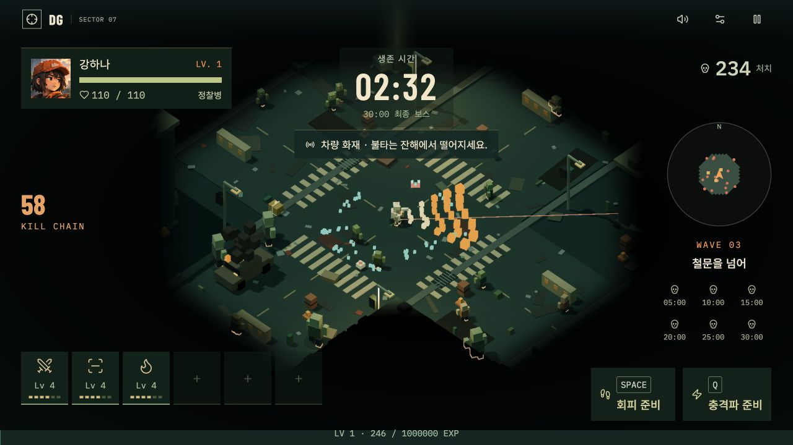

# DEAD GRID 1.5 · Koota 도입과 대량 개체 성능

이 문서는 1.5(`e9c7fbe`)의 CPU 측정 기록입니다. 1.6에서는 전투 성장 수치를 변경했으므로 동일 비교를 재현하려면 해당 버전의 코드를 사용하세요. 현재 버전에서 재측정한 FPS 결과가 아닙니다.

## 검토와 선택

[Koota 공식 문서](https://github.com/pmndrs/koota)를 검토하고 `koota@0.6.6`을 정확한 버전으로 고정했습니다. 공식 API의 World, Entity, Trait, 캐시된 `createQuery`, 배치 `useStores`, Trait 추가·제거·변경 이벤트를 사용합니다. 현재 React 19 / R3F 9 / TypeScript 구성에 호환되며, 패키지 라이선스는 ISC입니다.

기존 엔진은 객체 배열과 거대한 프레임 업데이트에 생명주기를 맡겼습니다. 프레임마다 배열 필터, 문자열 격자, 충돌 후보 객체가 만들어졌고 모든 지형에 회전 충돌 계산을 반복했습니다. 라이브러리 교체만으로 이 비용이 사라지지는 않으므로 저장소 이전과 반복 처리 최적화를 함께 수행했습니다.

## 적용 범위

- 적·탄환·드랍·효과·건물·차량·차단물은 Koota Entity와 각각의 상태 Trait으로 관리합니다. 플레이어 위치와 시뮬레이션 시간은 월드 Trait입니다.
- 연소 중인 적에는 `EnemyBurn` Trait을 붙이고 캐시 쿼리에서 배치 처리합니다. 만료·죽음·제거·재시작 시 Trait과 참조를 함께 정리합니다.
- 충돌·연소·인스턴스 렌더러가 기존 객체 참조를 공유하므로 상태는 Koota의 **AoS 저장소**를 채택했습니다. 별도의 기존 시뮬레이션 배열에 상태를 복제하거나 양방향 동기화하지 않습니다. 시간은 숫자 **SoA** Trait입니다.
- 렌더러와 일부 전투 시스템은 Trait 이벤트로 유지되는 동일 객체의 안정적인 배열 뷰를 읽습니다. 이는 멤버십 인덱스이며, 프레임마다 객체나 배열을 복사하지 않습니다. 적의 이동·공격과 투사체 처리는 별도 시스템 메서드로 분리했습니다.
- `Game`은 입력·웨이브·성장·구조물 연소를 조율하는 파사드로 남습니다. 모든 게임 규칙을 수치 SoA 컴포넌트로 분해한 순수 ECS는 아닙니다. `Game.start()`로 재시작하고 `Game.dispose()`로 월드를 해제합니다. 직접 `world.reset()`을 호출해 구독을 무효화하지 마세요.
- R3F의 기존 InstancedMesh를 유지합니다. 개체마다 React 컴포넌트·훅을 생성하지 않습니다. React 렌더 밖에서 게임 월드를 만들고 소유자 해제 시 파괴하여 StrictMode 재실행과 HMR의 월드 누수를 방지합니다.

## 함께 적용한 최적화

- 5m 공간 격자를 고정 크기 숫자 인덱스와 재사용 셀 배열로 변경했습니다. 근접 조회는 임시 버퍼 하나를 재사용합니다. 조회 결과를 다음 조회까지 보관하거나 중첩 조회에 사용하지 않습니다.
- 투사체 충돌 후보는 객체 풀과 정렬 버퍼를 재사용합니다. 거리순 판정·관통·보스 명중 제한은 그대로입니다.
- 사망·만료 개체는 쿼리 배치에서 제거하고, 시스템 경계에서 뷰를 안정적으로 압축합니다. 연속 제거가 다음 개체의 처리를 건너뛰지 않으며 살아 있는 개체의 순서가 유지됩니다.
- 이동 임시 좌표, 회수할 드랍 목록, 화재 피해 Map을 재사용합니다.
- 지형의 회전값·외접 AABB를 WeakMap으로 캐시합니다. 선분이 외접 범위에 닿지 않으면 먼저 제외하고, 남은 후보만 동일한 회전 OBB 판정을 수행합니다. 형상 변경은 캐시를 무효화하며 체력·화재·소각 상태는 매번 확인합니다.

## 측정 결과

| 조건                                                          | 기존 P50 / P95  | 적용 후 P50 / P95 | P50 감소 |
| ------------------------------------------------------------- | --------------- | ----------------- | -------- |
| 현재 한도: 적 520 / 탄환 700 / 드랍 900 / 효과 250            | 10.51 / 11.49ms | 2.15 / 2.43ms     | 79.5%    |
| 4배 스트레스: 적 2,080 / 탄환 2,800 / 드랍 3,600 / 효과 1,000 | 47.63 / 51.09ms | 11.41 / 12.47ms   | 76.0%    |

측정일 2026-10-04, Apple M4 Pro, macOS, Node v25.6.0. 비교 원본은 커밋 `4987254`이며 `scripts/history/pre-koota/`에 보존했습니다. 각 조건에서 구현을 번갈아 3회 실행하고, 매회 90프레임 준비 후 240프레임을 측정했습니다. 구현별·조건별 720개 샘플이며, 시뮬레이션 간격은 1/60초입니다.

동일 시드·무기·패시브·좌표를 사용하고 탄환·효과의 소멸분을 다시 생성하여 생성·제거 비용도 포함합니다. `Game.update()`와 실제 인스턴스 렌더러가 호출하는 `canSee()` 판정의 CPU 시간입니다. 스트레스 조건은 테스트 코드에서 일반 생성 한도를 넘긴 합성 부하이며 실제 게임의 한도는 늘리지 않았습니다. 각 구현의 최종 가시 개체 체크섬은 현재 한도 625, 스트레스 2,908로 3회 모두 일치했습니다.

**이 수치는 Koota와 위 최적화 전체의 결과입니다. Koota 단독의 개선율이나 실제 FPS가 아닙니다.** Three.js 행렬 갱신·드로콜·GPU·전체 프레임 시간을 포함하지 않으며 다른 기기·플레이 상황에서는 달라집니다. AoS 엔티티 인덱스와 재사용 버퍼도 메모리를 차지하므로 전체 RAM 사용량 감소를 주장하지 않습니다. 포그·실루엣 렌더 패스의 GPU 부하는 그대로입니다.

```sh
npm ci
npm run performance   # scripts/performance-final.json 생성
npm test              # 현재 회귀 테스트 실행
npm run build
```

원본 수치는 `scripts/performance-final.json`에 저장됩니다. 성능 비교 중에는 다른 CPU 부하를 종료하고, 같은 기기에서 재측정하세요.

## 검증

Koota 도입 시 전체 **48개 테스트 통과**, TypeScript 검사·프로덕션 빌드 통과. 1,805초의 전체 전투 일정, 보스 6회 출현·최종 승리 조건·개체 수 제한을 검증했습니다. 신규 테스트는 엔티티 생성·참조·변경·제거·ID 재사용·연소·재시작·월드 해제와 일시정지, 공간 버퍼 재사용, 20,000건의 기존 지형 판정 동등성을 확인합니다.

9종 무기를 두 조합으로 나누어 동일 입력과 시드로 기존 엔진과 각각 1,200프레임을 진행했습니다. 이후 응급키트 회복을 최대 체력 50%로 변경한 비교 테스트에서는 해당 규칙만 기준 엔진의 테스트 어댑터에 반영하며, 원본 소스는 수정하지 않습니다. 피해·처치·드랍·탄환·효과·보스·성장·연소·시야·탐험 상태를 주기적으로 비교하여 일치했습니다. 브라우저에서는 메뉴→선택→출격, 얼굴 HUD, 이동·마우스 조준·회피·충격파, 신규 무기와 전투 렌더링을 확인했습니다. 실제 사람이 30분 플레이한 난이도나 실기기 GPU 성능은 별도 측정하지 않았습니다.

Koota 도입 당시의 48개 테스트 기록은 `scripts/history/v1.5/test-results.txt`, 최신 기록은 `scripts/test-results.txt`입니다.


