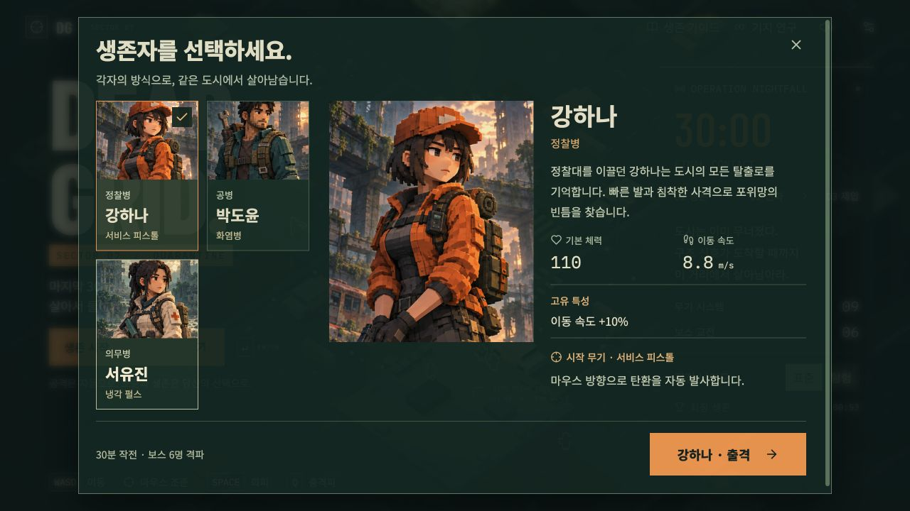
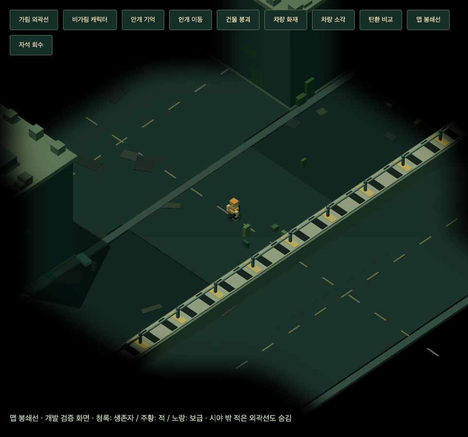
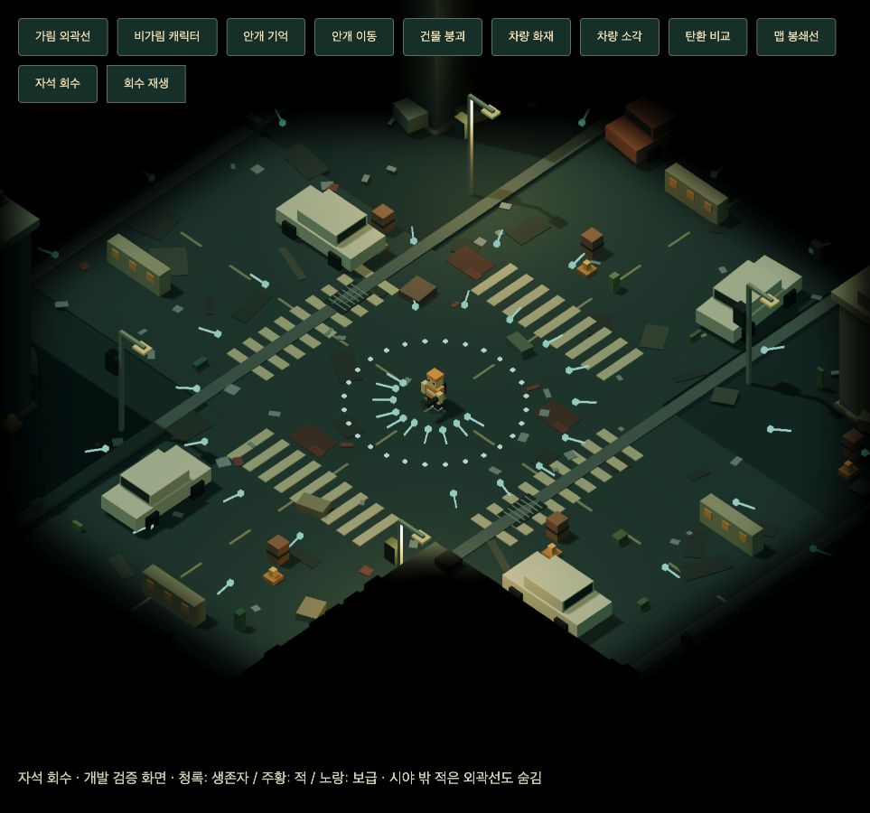

# DEAD GRID · 1.7.2

복셀 좀비 아포칼립스 탄막 서바이벌 게임. TypeScript + Vite + React Three Fiber로 제작했습니다. 공격은 자동이며 마우스 조준, 이동, 회피와 성장 선택으로 생존합니다.



성장·범위·방향 회피의 수치는 [밸런스 보고서](BALANCE.md), 변경 내역은 [CHANGES.md](CHANGES.md), Koota 도입 검토·대량 개체 측정은 [성능 보고서](PERFORMANCE.md)를 참고하세요.

부상 생존자를 찾아 3m 이내에서 치료하고 보급상자를 확보하는 [생존자 구조 시스템](RESCUE.md)을 추가했습니다. 미니맵 가장자리 방향 안내와 누적 구출 기록을 제공합니다.

## 실행

Node.js 20.19+ 또는 22.12+가 필요합니다. 프로젝트 디렉터리에서 실행하세요.

```sh
npm ci
npm run dev
```

브라우저에서 터미널에 표시된 주소를 여세요. 기본 주소는 http://127.0.0.1:5173 입니다. 현재 전달된 작업 폴더에는 의존성 설치가 완료되어 있습니다.

```sh
npm run build       # TypeScript 검사 + 배포용 dist 생성
npm run preview     # 생성된 dist를 로컬에서 실행
npm test            # 게임 엔진 회귀 테스트
npm run balance     # 무적 없는 6개 자동 플레이 시뮬레이션
npm run probe       # 최대 장비 보스 피해량 검증
npm run performance # 이전 엔진과 대량 개체 CPU 성능 비교
```

`dist/`는 정적 호스팅으로 배포할 수 있습니다. ES 모듈을 사용하므로 index.html을 file://로 직접 열지 말고 HTTP 서버로 제공하세요. 서버 기능이나 API 키, Blender 설치는 필요하지 않습니다. 글꼴, 도시와 캐릭터, 효과음 모두 외부 요청 없이 실행됩니다. 첫 npm 설치만 네트워크가 필요합니다.

## 조작

| 조작           | 기능                                     |
| -------------- | ---------------------------------------- |
| WASD / 방향키  | 화면 기준 이동                           |
| 마우스         | 방향성 무기의 발사 방향 조준             |
| Space / 우클릭 | 기본 3초마다 회피: 빠른 이동 + 짧은 무적 |
| Q              | 기본 18초마다 충격파: 피해, 밀치기, 둔화 |
| 1 / 2 / 3      | 강화 선택                                |
| Esc            | 일시정지 / 대화상자 닫기                 |
| M              | 음소거                                   |
| Enter          | 타이틀에서 생존자 선택 화면 열기         |

생존 시작 → 생존자 카드 선택 → 이름이 표시된 출격 버튼 순서로 시작합니다. PC의 방향성 무기는 화면 속 마우스 위치를 지면에 투영해 조준합니다. 모바일 터치 기기에는 왼쪽 가상 스틱과 오른쪽 회피·충격파 버튼이 표시되며, 이동 방향으로 조준합니다. Q와 Space의 기본 쿨다운은 연구로 줄일 수 있습니다. 창을 벗어나거나 탭을 바꾸면 자동으로 일시정지합니다. 레벨업·보급 강화 선택 중에는 작전 시간이 정지합니다.

## 작전과 콘텐츠

- 단일 폐허 도시 맵, 이동 가능한 130m 영역. 16개 건물의 이동·탄환 충돌, 내구도·붕괴·엄폐 파괴.
- 17m의 건물 차단 시야. 미방문 지역은 검정, 방문 후 시야 밖은 어둡게 기억하며 적은 숨깁니다.
- 화면 방향의 체력바와, 가린 부분에만 표시되는 화면 공간 실루엣. 내부 복셀 엣지는 표시하지 않습니다.
- 차량 9대의 충돌·내구도. 도로 차단물 4개·드럼통 6개는 파괴되지 않으며 이동·탄환을 계속 막습니다. 차량은 파괴 후 12초간 불타며 접촉 피해를 주고 소각되면 통로가 열립니다.
- 맵 사방에 끊김 없는 콘크리트 봉쇄선과 경계 철책. 플레이어·회피·탄환의 충돌 경계와 외관이 일치하며 파괴되지 않습니다.
- 안개는 등장 약 0.18초 / 소멸 약 0.38초 시정수의 지수 보간과 공간 필터로 부드럽게 전환됩니다.
- 서로 다른 시작 무기와 특성을 가진 생존자 3명. 일러스트에 맞춘 주황 정찰병·청록 공병·크림 의무병 복셀 모델. 중앙 선택 화면의 왼쪽 카드 그리드와 오른쪽 복셀 일러스트·상세 설명, 모바일의 세로 상세 화면과 고정 출격 버튼.
- 1분마다 바뀌는 30분 공세와 최종 교전 편성, 6종 일반·정예 적 유형.
- 05:00 / 10:00 / 15:00 / 20:00 / 25:00 / 30:00의 보스 6종. 돌진·회전 탄막·오염 지대·소환 패턴.
- 무기 9종 중 최대 6종 장착, 무기별 6단계 강화와 9종 진화. 패시브 11종: 추가 투사체는 3단계, 나머지는 5단계.
- 화염병은 실제 병이 포물선 비행 후 지면·지형 충돌 시 화염을 생성합니다. 냉각 펄스는 중복 내부 링 없이 피해 탄환만 표시합니다.
- 카타나의 방향성 근접 베기와 궤적, 저격총의 엄폐에 막히는 긴 조준선, 화염방사기의 넓은 원뿔 화염과 연소 효과. 신규 무기는 아래 수치를 참고하세요.
- 경험치, 응급키트, 보급 상자, 자석 아이템. 일반 적·보스의 응급키트는 동일하며 습득 시 현재 최대 체력의 50%를 회복합니다(최대 체력까지). 강화 카드의 응급 처치는 40 회복입니다. 보급은 처치 수와 무관하게 120초마다 1상자(강화 1회). 자석은 적 처치 시 0.6% 확률, 최소 75초 간격, 바닥에 최대 2개 드랍됩니다. 습득 시 기존 경험치 구슬이 벽을 넘어 플레이어를 추적하며 흡수됩니다.
- 일반 투사체와 진화 투사체의 기본 관통 확률은 0%. 관통 탄두 패시브는 일반 +10%p / 고급 +12.5%p / 희귀 +15%p씩 증가하며 최대 5단계, 75%까지 가능합니다. 명중마다 판정하고 지형은 관통하지 못합니다.
- 추가 투사체를 제외한 패시브 선택지는 일반(흰색, 70%) / 고급(초록색, 25%) / 희귀(파란색, 5%). 효과는 각각 1 / 1.25 / 1.5배이며 진화 조건은 효과량과 무관하게 강화 3단계입니다.
- 정예는 보급 상자를 드랍하지 않습니다. 보스는 각 1상자. 상자에 회복 효과가 없으며 일반 응급키트는 최소 60초 간격으로 제한됩니다.
- 표준 / 탐험 난이도. 탐험은 적 체력 20%, 받는 피해 35% 감소 및 피해량 15% 증가.
- 미니맵, 보스 체력, 처치 연쇄, 장비·능력 HUD.
- 재도전, 작전 결과, 영구 기지 연구 7종, 최고 기록과 자원 저장. 연구 가격은 첫 단계 8~12 자원으로 인하했고 기존 생존 프로토콜 연구는 자동 이전합니다.
- 그래픽 품질, 음소거, 모션 줄이기, 전체 화면. 키보드 대화상자 포커스 관리.





**승리 조건:** 실제 게임 시간 30:00에 마지막 보스가 출현합니다. 마지막 보스를 포함해 보스 6명을 모두 처치해야 작전이 완료됩니다. 30분에 자동 종료되지 않으며 보스가 남아 있으면 전투가 계속됩니다. 사망하면 작전이 종료됩니다. 진행 중인 작전은 새로고침 이후 재개되지 않지만, 완료한 작전의 최고 기록과 연구는 브라우저 localStorage에 저장됩니다.

## 무기 진화

실제 장착한 무기 6단계 + 대응 패시브 3단계 이상이면 다음 강화 선택에서 진화가 등장할 수 있습니다.

| 무기          | 패시브        | 진화          |
| ------------- | ------------- | ------------- |
| 서비스 피스톨 | 고압 탄약     | 데드아이      |
| 산탄총        | 퀵 리로드     | 브리치 캐논   |
| 회전 톱날     | 방탄 플레이트 | 아이언 헤일로 |
| 화염병        | 생존 키트     | 지옥불        |
| 테슬라 코일   | 회수 장치     | 폭풍 회로     |
| 냉각 펄스     | 전투화        | 절대영도      |
| 카타나        | 고압 탄약     | 월광          |
| 저격총        | 확장 사거리   | 롱샷          |
| 화염방사기    | 퀵 리로드     | 헬파이어      |

피스톨·산탄총·화염병·카타나·저격총·화염방사기는 마우스 방향으로 공격합니다. 전기 공격은 현재 시야의 적에게 연쇄하고 회전 톱날·냉각 펄스는 전방위 무기입니다. 초반에는 시작 무기부터 강화하고 진화 조건을 맞추세요.

## 신규 장비와 연구

- **카타나:** 1단계 기본 피해 54, 사거리 3.22m, 공격 간격 0.95초. 전방의 넓은 호를 베며 엄폐 뒤에는 피해를 주지 않습니다.
- **저격총:** 1단계 기본 피해 270, 사거리 45m, 공격 간격 3.8초. 조준선과 탄환은 첫 장애물에서 멈추며 기본 관통은 0%입니다. 추가 탄환의 보스 명중은 한 사격당 1발로 제한됩니다.
- **화염방사기:** 1단계 사거리 5.25m. 기본 0.2초마다 원뿔 안의 여러 적·파괴 가능한 엄폐에 타격합니다. 공격 속도 강화 후에도 0.08초보다 빨라지지 않습니다. 연소는 최대 8중첩, 중첩별 3.2초 지속, 0.5초마다 피해 판정입니다. 새 타격은 다른 중첩의 만료를 갱신하지 않으며 최대 중첩에서는 가장 오래된 중첩을 교체합니다. 사격을 멈추면 각각 만료되어 해제됩니다.
- **전투 학습:** 일반/고급/희귀 단계당 경험치 +12/+15/+18%.
- **확장 사거리:** 일반/고급/희귀 단계당 사거리 +15/+18.75/+22.5%.
- **확장 범위:** 일반/고급/희귀 단계당 화염병 반경·화염방사기 분사각 +20/+25/+30%, 최대 5단계. 화염방사기는 기본 약 36.7°이며 사거리 강화도 동시에 적용됩니다.
- **추가 투사체:** 항상 희귀, 단계당 정확히 +1발, 최대 3단계. 피스톨·산탄총·화염병·저격총·냉각 펄스에 적용됩니다.

수치는 연구·등급·진화를 적용하기 전의 기본값입니다. 무기 강화마다 피해 ×1.30, 공격 주기 ×0.94입니다. 카드에 실제 전후 수치를 표시합니다. 강화 선택지는 전체 유효 후보에서 중복 없이 무작위로 최대 3장을 뽑으며, 보유 무기나 패시브가 특정 칸을 차지하도록 강제하지 않습니다. 패시브 전체 수치는 [BALANCE.md](BALANCE.md)를 참고하세요.

| 연구          | 단계당 효과         | 첫 가격 / 단계당 증가 | 최대 단계 |
| ------------- | ------------------- | --------------------- | --------- |
| 생존 프로토콜 | 체력 +5, 피해 +2.5% | 10 / +6               | 10        |
| 충격파 제어   | Q 쿨다운 -6%        | 10 / +6               | 5         |
| 회피 훈련     | Space 쿨다운 -6%    | 12 / +8               | 5         |
| 무기 정비     | 피해 +3%            | 10 / +6               | 5         |
| 회수 센서     | 획득 반경 +0.5m     | 8 / +5                | 5         |
| 전투 분석     | 경험치 +5%          | 10 / +6               | 5         |
| 기동 훈련     | 이동 속도 +3%       | 8 / +5                | 5         |

연구는 다음 출격부터 적용됩니다. Q는 최대 연구 시 12.6초, Space는 2.1초입니다.

## 구조

- `src/rescue.ts`: 구조 규칙·도로 탐색·탈출 경로·미니맵 방향 좌표. `src/RescueObjective.tsx`, `src/Minimap.tsx`: 구조 목표와 미니맵. `src/save.ts`: 기존 저장 마이그레이션과 즉시 구출 기록.
- `src/enemy-projectiles.test.ts`: 스피터·전 보스의 작은 투사체와 느린 발사 주기, 돌진 주기 유지 검증.
- `src/rescue.test.ts`: 13개 구조·치료·출혈·경로·저장·보상 회귀 테스트.
- `src/engine.ts`: 렌더링과 독립된 시드 기반 전투·웨이브·성장 엔진. 적 이동·공격과 투사체 시스템을 분리하고 재사용 버퍼로 충돌 후보를 처리합니다.
- `src/ecs.ts`: Koota 0.6.6 월드와 적·탄환·아이템·효과·지형 Trait, 연소 상태 쿼리 및 엔티티 생명주기. 기존 객체를 authoritative AoS 저장소로 사용하고 InstancedMesh에는 동일 객체의 안정적인 뷰를 제공합니다.
- `src/spatial.ts`: 고정 크기 숫자 격자, 재사용 셀·근접 후보 버퍼.
- `src/terrain.ts`: 건물·회전 차량·차단물의 공통 충돌 형상과 선분 충돌·시야 판정.
- `src/fog.ts`: 시간 보간·공간 필터가 있는 탐험/현재 시야 텍스처와 전장의 안개 셰이더.
- `src/Silhouette.tsx`: 배우별 ID 마스크·장면 깊이로 가린 외부 윤곽만 합성하는 렌더 패스.
- `src/World.tsx`: R3F 장면. 건물, 차, 도시 소품과 캐릭터를 복셀 큐브로 생성. InstancedMesh로 도시·적·탄환·경험치 배치 렌더링.
- `src/App.tsx`: 메뉴, HUD, 대화상자, 키보드·터치 입력, 저장과 기지 연구.
- `src/SurvivorPicker.tsx`, `src/expansion.css`: 중앙 생존자 선택 화면, 복셀 일러스트와 반응형 연구 목록.
- `src/research.ts`: 연구 메타데이터, 가격·한도, 기존 저장 데이터 이전과 구매 검증.
- `src/audio.ts`: Web Audio API로 합성하는 전투 효과와 앰비언스.
- `src/style.css`, `src/ui-scale.css`, `src/fonts.css`: 반응형 스타일과 프로젝트에 포함된 글꼴.
- `src/engine.test.ts`: 일시정지, 연속 레벨업, 회피·충격파, 진화, 적 수 제한 시 보스 출현, 1,800초 전체 일정, 6회 보스 출현, 최종 처치·재시작, 회전 차량·화재·소각과 안개 보간 검증.
- `scripts/balance.ts`: 경험치 회수, 위협 회피, 장비 선택을 수행하는 자동 플레이 검증. 실제 게임의 적·피해 규칙을 그대로 사용하며 무적은 사용하지 않습니다.
- `scripts/history/v1.3/`: 이전 관통·희귀도·자석 빌드의 회귀·피해량 기록.
- `scripts/history/v1.2/`: 이전 빌드의 자동 플레이·보스 피해량·회귀 테스트 기록.
- `src/ecs.test.ts`: ECS 생성·제거·교체·재시작·월드 해제, 기존 엔진과 결정론적 전투 동등성, 회전 충돌 형상 20,000건 비교.
- `scripts/performance.ts`, `scripts/performance-final.json`, `PERFORMANCE.md`: 동일 시드의 대량 개체 CPU 비교와 측정 한계.
- `scripts/history/pre-koota/`: 비교용 4987254 엔진 원본. 브라우저 번들에는 포함하지 않습니다.
- `src/progression.test.ts`: 카타나 진화 조건·방향 회피·범위·성장 수치 검증.
- `src/survivor-model.ts`: 일러스트 기준 생존자 모델과 화염병 복셀 파츠.
- `src/molotov.test.ts`: 비행·착지 후 피해·목표 고정·엄폐·정지·강화·포화와 냉기 내부 링 제거 검증. [외형·투사체 변경 기록](APPEARANCE.md).
- `src/upgrade-selection.test.ts`: 생존자별 시작 무기 강제 반복 방지, 6,000회 추첨의 칸별 분포, 조건과 고갈 시 회복 선택 검증.
- `src/weapons.test.ts`: 9종 무기 모든 단계·진화·실제 피해, 엄폐와 회전 지형, 보스 반경, 이펙트 포화 검증. [무기 점검 보고서](WEAPON-AUDIT.md).
- `scripts/test-results.txt`: 1.7.2 전체 회귀 테스트 결과. `scripts/history/v1.4/`: 이전 회귀·보스 피해량 결과.
- `concept.png`: 구현 전에 built-in ImageGen으로 생성한 시안. 런타임은 시안 이미지를 배경으로 사용하지 않고 실제 3D 지오메트리를 렌더링합니다.

## 검증 범위

엔진 회귀 테스트 **103개 통과**, TypeScript 검사와 배포 빌드 통과. 마우스 우선 조준·우클릭 방향 회피와 모바일 방향 조준, 카타나의 전방·거리·엄폐 판정, 저격탄 최종 이동 구간, 화염 타격 주기와 연소의 별도 피해·개별 만료·8중첩 제한, 희귀 투사체의 정수 증가, 6종 장착 한도, 저장 이전과 구매 한도를 검증합니다.

1.6 무적 1,805초 일정 검증 기록에서는 보스 6회 출현, 보급 15회, 최대 적 279 / 탄환 376 / 바닥 드랍 927를 확인했습니다. 이 검증은 콘텐츠 일정과 엔티티 제한을 측정하며 사람의 생존 난이도 결과가 아닙니다.

1.6 최대 장비 피해량 검사는 진화 무기 6종(피스톨·산탄·테슬라·카타나·저격·화염), 일반 패시브 최대 강화와 희귀 추가 투사체 3단계, 빈 경기장·보스와 소환물만·무적·정지·마우스 보스 조준·능력 미사용 조건입니다. 보스 처치 시간은 1.4 / 6.7 / 14.3 / 23.4 / 36.1 / 55.2초. 10분 보스는 5초 후 체력 **15,446/58,800**, 최종 보스는 **379,231/416,000**이 남았습니다. 실제 성장·이동·공세의 생존 난이도는 별도 측정입니다. 상세 수치는 [BALANCE.md](BALANCE.md)에 기록했습니다.

무적 없는 자동 플레이의 과거 결과는 `scripts/history/v1.2/`에 있습니다. 당시 탐험/의무병이 31:52에 보스 6명을 처치한 실행이 있었지만 현재 빌드의 승률을 의미하지 않습니다. 1.6에서 해당 자동 플레이 묶음 전체를 재측정하지 않았습니다. 실기기에서 30분 동안의 GPU 성능과 사람의 장시간 밸런스 체감도 아직 측정하지 않았습니다.

1.4 브라우저 검증에서는 1280×720 PC와 390×844 모바일 생존자 선택 화면, 생존자별 상세 정보와 실제 출격, 양방향 마우스 조준, 카타나 궤적·저격 조준선·연소 효과를 확인했습니다. 콘솔 경고·오류는 없었습니다. 기존 실루엣·차량 소각·희귀도·경계·자석 검증 기록은 이전 변경 내역에 보관합니다.

개발 서버 `/qa.html?rescue`에서 치료·출혈·방향·탈출 보상을 재현합니다. `/qa.html?appearance`에서 생존자 일러스트 비교·화염병 비행/착지·냉각 펄스를 확인합니다. `/qa.html`에서 가림·안개·붕괴·차량·경계·자석 및 신규 세 무기를 재현합니다. `/?qa=arsenal`은 실제 마우스로 신규 무기를 조준하는 무적 개발 장면, `/?qa=rarity`는 등급 카드, `/?qa=upgrade`는 강화 화면, `/?qa=final`은 최종 교전 HUD입니다. 배포 빌드는 이 개발 기능을 제공하지 않습니다.

## 애셋과 글꼴

도시, 캐릭터와 전투 효과는 코드로 생성한 원본 애셋입니다. 이미지 시안과 생존자 선택용 3인 일러스트는 내장 ImageGen으로 제작했습니다. 선택용 원본은 `public/portraits/survivors-v14.png`, 정확한 제작 프롬프트는 [제작 기록](prompts/survivors-v14.txt)에 저장하고 PNG 메타데이터에도 포함했습니다. Blender MCP는 사용하지 않았습니다.

Barlow Condensed, IBM Plex Mono, Noto Sans KR의 UI에 필요한 글리프를 포함했습니다. 각 글꼴의 SIL Open Font License와 출처는 `public/fonts/`에 있습니다. 재배포 시 해당 라이선스를 유지하세요.

우클릭은 클릭한 방향으로, Space는 이동 입력 방향으로 회피합니다. 같은 쿨다운을 사용하며 건물·차량·경계에 막힙니다.
