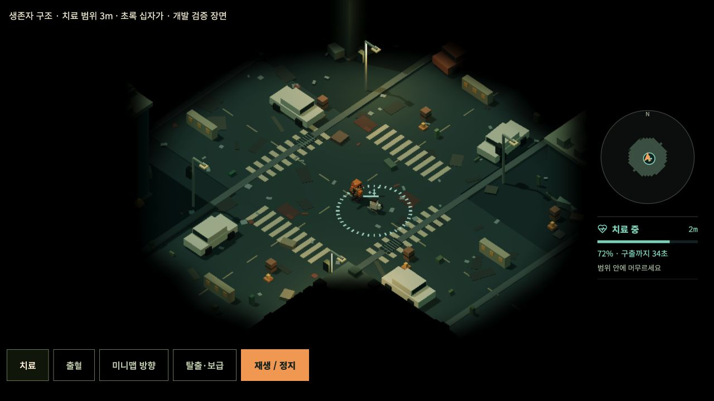
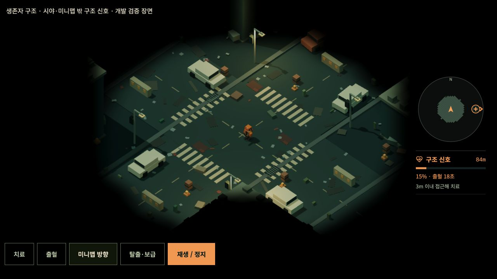
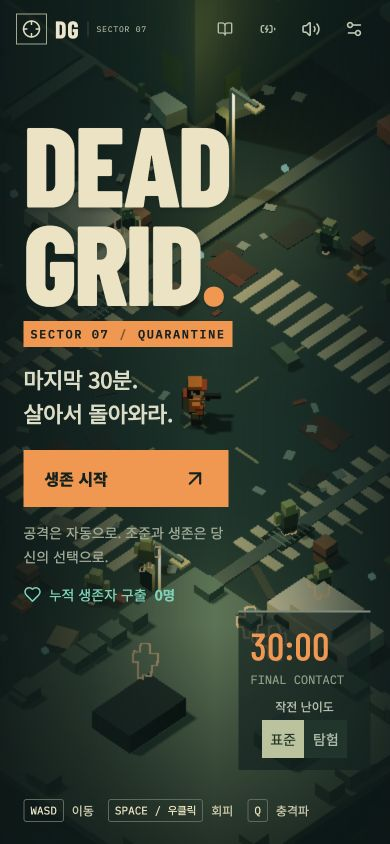
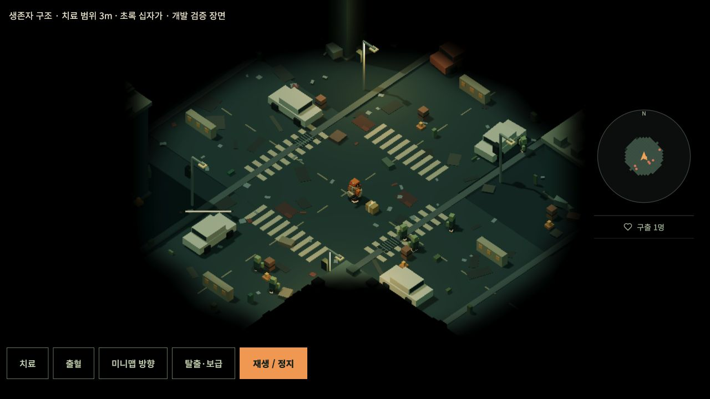

# DEAD GRID 1.7.1 · 생존자 구조

거리의 구조 신호를 찾아 치료하는 이동 목표를 추가했습니다. 기존 30분 작전과 여섯 보스 격파 조건을 유지합니다.

## 규칙

| 항목           | 동작                                                                               |
| -------------- | ---------------------------------------------------------------------------------- |
| 첫 출현        | 작전 시작 45초                                                                     |
| 다음 출현 검사 | 100~150초 사이 무작위 간격, 처치 수와 무관                                         |
| 출현 위치      | 플레이어로부터 직선거리 20~48m, 장애물 밖의 접근 가능한 도로                       |
| 출혈           | 최대 체력 100, 시작 50. 초당 50/60 감소, 60초 방치하면 사망                        |
| 치료           | 생존자 중심 3m 이내, 건물·차량·소품·불타는 차량에 가리지 않아야 함                 |
| 치료 속도      | 초당 100/60 회복. 이전의 2배로, 50→100에 30초, 10→100에는 54초                     |
| 치료 중단      | 회복한 체력은 유지되고 기존 속도(초당 50/60)로 출혈 재개                           |
| 구출           | 체력 100%에서 한 번만 판정. 강화 1회의 실제 보급상자 1개 드랍                      |
| 탈출           | 초당 9m로 장애물을 피해 가장 가까운 연결된 외곽 도로까지 달리고 경계 밖으로 사라짐 |
| 누적 기록      | 구출 즉시 저장. 작전 종료·사망·재시작·페이지 새로고침 뒤에도 유지                  |

치료 대기 중인 생존자는 동시에 한 명입니다. 탈출 중·사망 후 짧게 남는 모델을 포함해 전체 NPC는 최대 세 명입니다. 출현 검사 시 대기 환자가 있으면 중복 출현하지 않고 다음 검사로 넘어갑니다. 접근 가능한 후보가 없거나 외곽까지 연결된 도로가 없으면 그 신호는 생략합니다. 사망한 생존자는 8초 후 정리됩니다.

구출 수는 실패·종료 여부와 관계없이 누적됩니다. 진행 중 작전은 저장되지 않지만 구출 기록은 저장됩니다. 저장 기능이 차단된 브라우저에서는 현재 세션의 기록과 게임 실행을 유지하며 재접속 영속 저장을 보장하지 않습니다. 환자는 무기·좀비의 타격 대상으로 추가하지 않았으며 출혈과 치료로 체력이 변합니다. 플레이어에게 별도 치료 효과나 입력 버튼은 추가하지 않습니다.

## 표시

- 부상 생존자는 붕대를 감고 앉아 있으며 바닥에 3m 범위를 표시합니다.
- 환자 머리 위 체력바는 카메라를 향합니다. 치료 중에는 초록 십자가가 떠오릅니다. 동작 줄이기에서는 작은 고정 십자가로 표시합니다.
- 미니맵 십자가는 미방문·시야 밖에서도 구조 신호를 알려줍니다. 미니맵 밖이면 가장자리에 고정하고 화살표로 방향을 표시합니다. 적의 시야 규칙은 유지합니다.
- 미니맵 아래에는 거리, 체력, 출혈 또는 구출까지 남은 시간, 근접 치료 안내를 표시합니다.
- PC 메뉴의 작전 패널과 모바일 시작 버튼 아래에서 누적 구출 수를 확인합니다. 작전 결과에도 이번 작전·누적 구출 수를 표시합니다.

아래 비교 캡처는 1.7.0 기록입니다. 현재 1.7.1에서는 치료 시간만 절반으로 줄었으며 출혈 시간은 동일합니다.

## 구현과 검증

`SurvivorState`와 Koota ActorPool이 NPC의 권위 저장소입니다. 별도 React NPC 메시 대신 기존 인스턴스 렌더러와 외곽선·체력바 풀을 사용합니다. NPC 체력바와 십자가를 먼저 배치해 대량 적 체력바보다 우선합니다. 치료 시각 효과는 장식 이펙트 풀 포화에 영향받지 않습니다.

2m 간격의 작은 도로 그래프를 지형 변경 시에만 다시 만들고, 연결된 도로 중 위치를 뽑습니다. 도로 연결과 탈출 경로는 건물·차량의 회전 형상을 포함하는 기존 충돌 함수를 사용합니다. 외곽에 도달한 탈출 NPC만 봉쇄선 밖으로 이동할 수 있습니다. 구조물 붕괴·차량 소각으로 지형 버전이 바뀌면 탈출 경로를 갱신합니다. 레벨업·일시정지·종료에서는 NPC의 시간도 멈추며 재시작·기지 복귀에서 정리합니다.

추가 **13개**, 전체 **100개** 테스트가 통과했습니다. 초기 체력과 정확한 60초 출혈·30초 회복 및 HUD 남은 시간, 낮은 체력의 긴 치료, 이탈·치료 재개, 3m 경계, 차량·지형 너머 치료 차단, 출현 간격·상한·접근성, 도로 탈출과 갱신, 미니맵 방향 계산, ECS 정리, 실제 보급상자 회수·강화, 누적 저장·기존 저장 마이그레이션·저장 차단을 검사했습니다. 기존 1,805초 작전 일정과 전 무기 회귀 검사도 포함합니다. TypeScript 검사와 Vite 배포 빌드가 통과했습니다.

PC 1280×720·모바일 390×844에서 메뉴·치료·방향 안내를 확인했습니다. 실제 UI로 재생해 체력 72→100% 치료 완료와 구출 수 1명·보급상자 생성도 확인했으며 콘솔 경고·오류가 없습니다. `/qa.html?rescue`는 생산 코드의 World·Minimap·RescueObjective를 공유하는 개발 재현 장면이며 배포 진입점에 포함되지 않습니다. 실기기 GPU 측정이나 구조 목표가 있는 30분의 사람 플레이 밸런스 측정은 별도로 수행하지 않았습니다.
