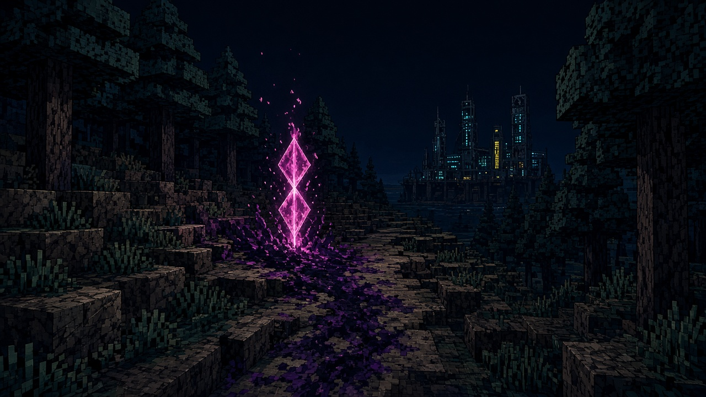
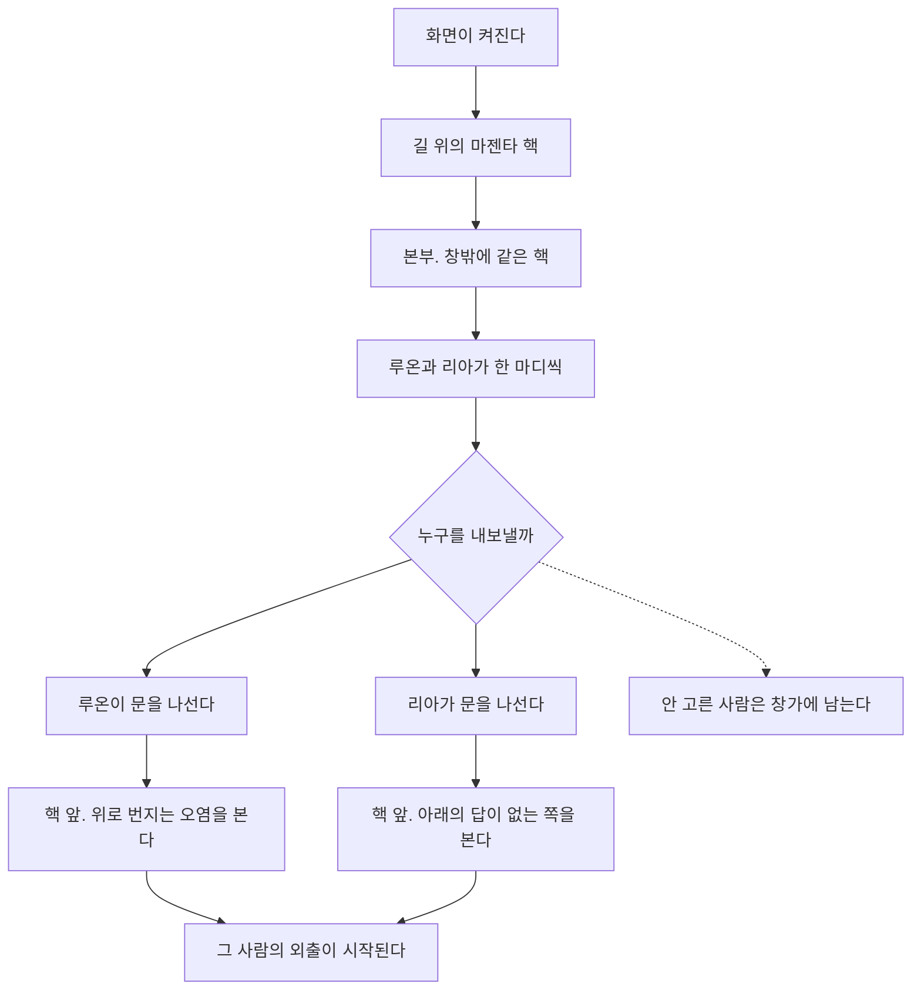
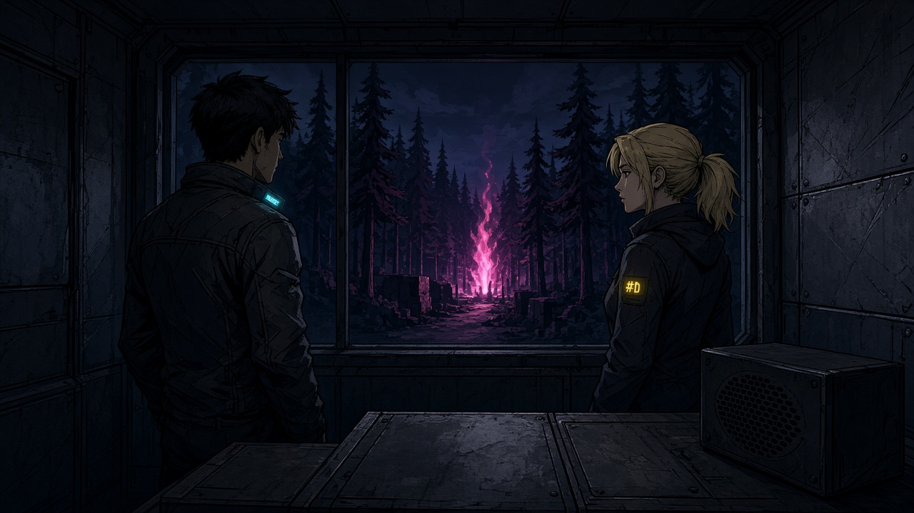
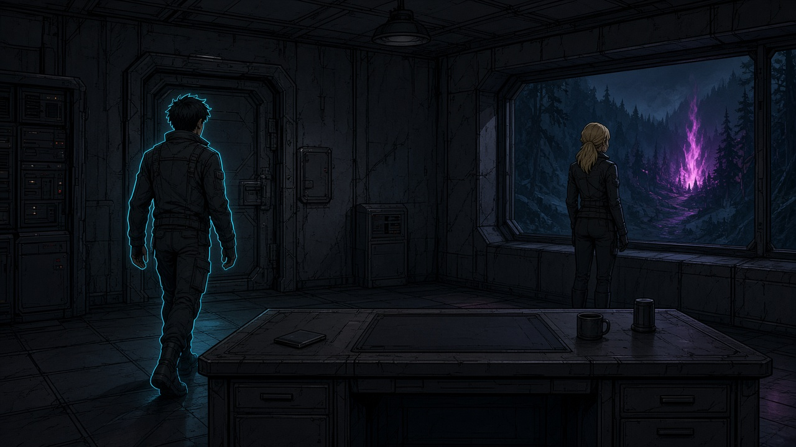
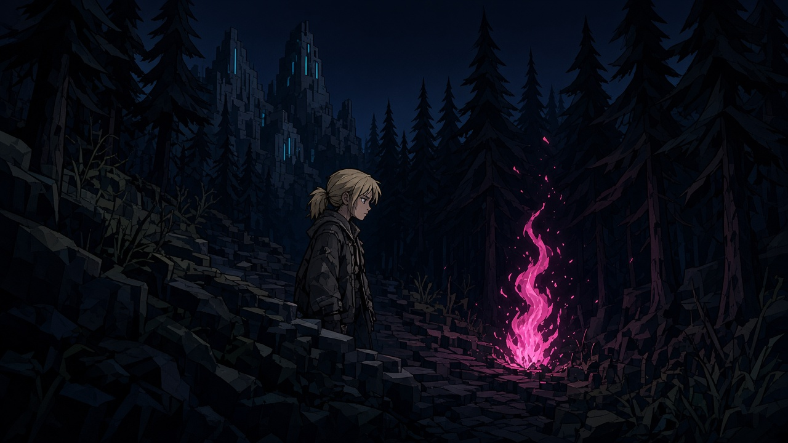

# 54. 시작 — 사건이 보이고, 한 사람을 보낸다

> 작성: 2026-10-09 · 상태: **【보관】**
> 현행 시작은 [`55_게이트와층.md`](./55_게이트와층.md)다. 이 문서는 본부에서 한 사람을 보내는 안이고, 그 안은 접었다.
> 게임 코드는 아직 이 문서대로 바뀌지 않았다. 이 문서는 시작을 이렇게 연다는 기획이다.
> 그림 원본: `C:\수스이미지 생성\2026-10-09-시작장면기획\`
> 그림은 자리만 보여 준다. 본편 캐릭터는 복셀이라, 그림 속 얼굴의 긴장감은 만들지 않는다.
> 옛 60일 일정·사건 사슬·필러 표는 삭제하지 않는다. 이 장면의 현행은 아니다. 보관은 맨 아래.

## 1. 한 장

게임이 켜지면 고르는 화면이 아니다. 길이 먼저 막혀 있다.

마젠타 핵이 길 위에 서 있고, 오염이 그 핵에서 본부 쪽으로 올라온다. 그 다음에 본부다. 루온과 리아가 창밖을 보고 한 마디씩 한다. 플레이어는 숫자도 카드도 없는 사람 하나를 누른다. 그 사람이 문을 나가고, 같은 핵 앞에 선다. 누르지 않은 사람은 창가에 남는다.

복셀은 얼굴을 찡그리지 않는다. 긴장감은 핵, 빈 길, 문에 선 한 사람, 창에 남은 한 사람에서 난다. 서는 것, 걷는 것, 남는 것만 한다.

## 2. 플레이어가 하는 일

누르는 것은 한 번이다. 서 있는 사람.

| 구간 | 화면 | 플레이어 |
|---|---|---|
| 실행 | 길. 핵이 두 번 흔들리고 자리를 잡는다 | 없음. 끝나면 화면을 눌러 본부로 |
| 본부 | 좁은 방. 창밖에 방금 그 핵 | 없음. 둘의 말을 듣는다 |
| 결정 | 본부가 묻는다. 누구를 내보낼까 | 사람 하나를 누른다 |
| 문 | 고른 사람이 문을 연다 | 없음. 화면이 그 사람을 따라간다 |
| 착지 | 같은 사람, 같은 핵 앞 | 여기서부터 그 사람의 외출 |

능력 카드, 체력 숫자, 장비 창은 이 구간에 없다.

## 3. 흐름

같은 지역 안에서는 다시 묻지 않는다. 다음 지역이 열릴 때, 같은 모양이 한 번 더 온다. 고장만 그 지역의 것으로 바뀐다. 게임의 첫 실행이 그 첫 번째다.

## 4. 장면

### 장면 1. 핵

숲 입구. 길 한가운데 마젠타 핵. 십자로 선 불꽃이고, 둘레에 분홍 점이 뜬다. 발밑 오염이 길 위쪽, 시안 불이 켜진 본부 쪽으로 번진다. 무전 잡음만 난다. 버튼은 없다. 핵이 자리를 잡은 뒤 화면 아무 곳이나 누르면 본부로 들어간다.

이 고장은 새로 만든 등이 아니다. 게임에 이미 있는 원흉의 밝은 핵이다.

### 장면 2. 본부

좁은 철판 방. 빈 책상. 목소리는 책상 옆 스피커에서 난다. 본부에는 사람 얼굴을 붙이지 않는다.

창밖에 방금 그 길이 멀게 보이고, 핵만 켜져 있다. 루온과 리아는 서로를 보지 않고 창을 본다. 이름은 어깨 옆에 작게 뜬다.

말하는 순서.

- 본부: 「핵이 켜졌어. 얼룩이 이 길로 올라온다.」
- 루온: 「내가 간다. 길이 막히기 전에.」
- 리아: 「아래쪽에 아직 답이 없다. 그쪽부터.」
- 본부: 「둘은 못 보낸다.」
- 본부: 「누구를 내보낼까.」

여기까지는 누르는 것이 없다.

### 장면 3. 결정

책상 너머로 두 사람이 서 있다. 누른 사람이 한 걸음 나온다. 다른 사람은 창가에 그대로 선다. 아래 그림은 루온을 눌렀을 때다. 리아를 누르면 자리가 바뀐다. 리아가 문으로 걸어가고, 루온이 창에 남는다.

### 장면 4. 문

고른 사람이 문을 연다. 돌아보지 않고 한 마디 하고 나간다.

- 루온: 「여기서 끊는다.」
- 리아: 「응답이 있으면 움직여.」

### 장면 5. 착지

같은 사람, 같은 핵 앞. 오염은 이미 길 위에 있다.

루온은 길 위로 번지는 오염을 본다. 본부로 올라오는 얼룩을 끊으러 온 사람이다.

리아는 길 아래, 아직 답이 없는 쪽을 본다. 사람을 먼저 찾으러 온 사람이다.

싸움의 자리와 핵은 같다. 누가 서 있는지, 어디를 먼저 보는지가 바뀐다.

## 5. 고르면 바뀌는 것

| | 루온 | 리아 |
|---|---|---|
| 문을 나서는 사람 | 루온 | 리아 |
| 문에서의 말 | 여기서 끊는다 | 응답이 있으면 움직여 |
| 핵 앞에서 먼저 보는 곳 | 위로 번지는 오염 | 아래의 답이 없는 쪽 |
| 창가에 남는 사람 | 리아 | 루온 |

무기, 자리, 포탑은 이 장면에서 고르지 않는다. 핵 앞에 선 다음, 그 사람 손으로 이어진다. 지금 본편의 외출 조작은 이 문서에서 바꾸지 않는다.

정화는 오염된 것을 되살리는 일이다. 핵 앞에 선 순간이 정화의 끝은 아니다. 그 사람의 외출이, 그 자리를 되살리는 도전이다.

## 6. 고른 뒤의 반복

사람을 고르기 전의 핵은 필러의 첫 박자가 아니다. 본부에서 이미 본 사건이다.

그 사람이 칸에 발을 디딘 뒤부터, 보관 문서의 박자가 반복된다.

B1 오염 발견 → B2a 촉매 → B2b 도중 → B3 정화 완료 → B4 탐방 → B5 스킬 → B6 조우 → B7 전투 → B8 다음 지역.

정화가 끝나야 그 다음 칸이 열린다. 날짜에 붙이지 않는다. 칸 하나에 붙는다. 표의 본문은 [`44_인수인계_필러시나리오.md`](./44_인수인계_필러시나리오.md)에 둔다. 이 문서는 그 표를 시작 장면 앞으로 끌어오지 않는다.

다음 지역이 열리면 3절의 흐름이 한 번 더 온다. 창밖의 고장만 그 지역의 핵으로 바뀐다. 둘의 말은 그 고장에 맞춰 다시 쓴다. 고르는 방식은 같다.

## 7. 이 문서가 정한 것

- 첫 고장은 마젠타 핵이다.
- 보내는 후보는 루온과 리아 둘이다. 둘 다 이미 본편에 있는 사람이다. 몸은 복셀이다. 표정으로 긴장하지 않는다.
- 안 고른 사람은 그 화면의 창가에 남는다.
- 고르는 대화는 지역이 열릴 때마다 한 번이다. 같은 지역에서는 다시 묻지 않는다.
- 첫 실행의 핵은 필러 B1이 아니다. B1은 도착한 칸부터다.
- 60일 섬 일정, 능력 카드, 장비 창은 이 장면의 현행이 아니다.

## 8. 보관. 이 장면에 넣지 않는 것

문서는 지우지 않는다. 시작 장면의 현행만 이 파일로 옮긴다.

| 문서 | 처리 |
|---|---|
| [`33_시나리오_진행플로우.md`](./33_시나리오_진행플로우.md) | 무지개섬 60일 진행. 보관. 실행 직후 흐름은 이 파일이 대체한다 |
| [`38_시나리오_작성룰.md`](./38_시나리오_작성룰.md) | 하루는 칸 하나, 사건 사슬. 보관. 시작 대사로 쓰지 않는다 |
| [`39_게임시스템_확정.md`](./39_게임시스템_확정.md) | 배, 두 섬, 실패. 보관. 이 장면은 그 일정의 맨 앞을 바꾸지 않고, 그 앞에 한 장면을 둔다 |
| [`44_인수인계_필러시나리오.md`](./44_인수인계_필러시나리오.md) | 도착 뒤의 박자. 유지. 시작 장면과 겹치지 않게 칸 뒤에 둔다 |
| `data/scenario_step_config.csv` | 비어 있다. 이 문서의 대사를 아직 넣지 않는다 |
