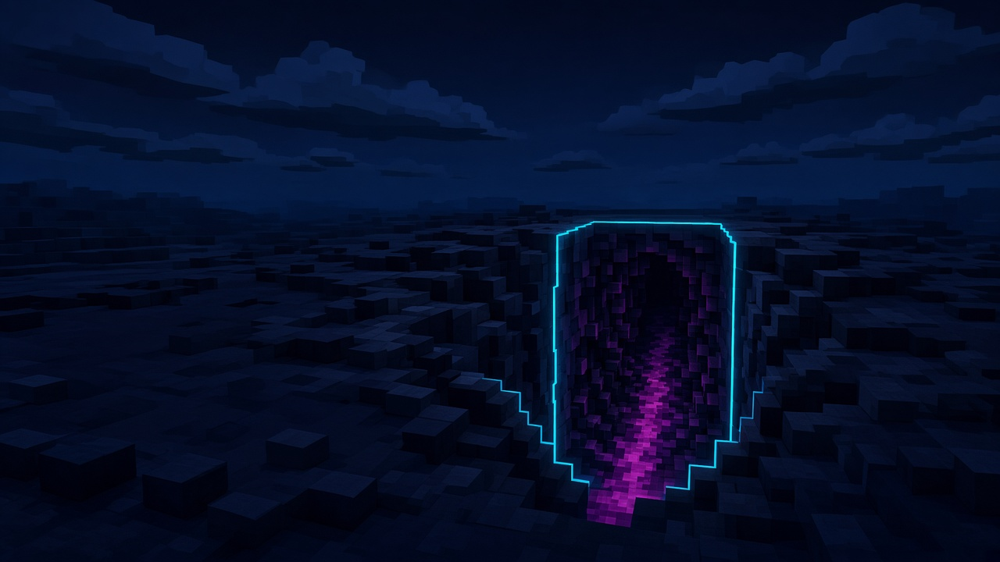
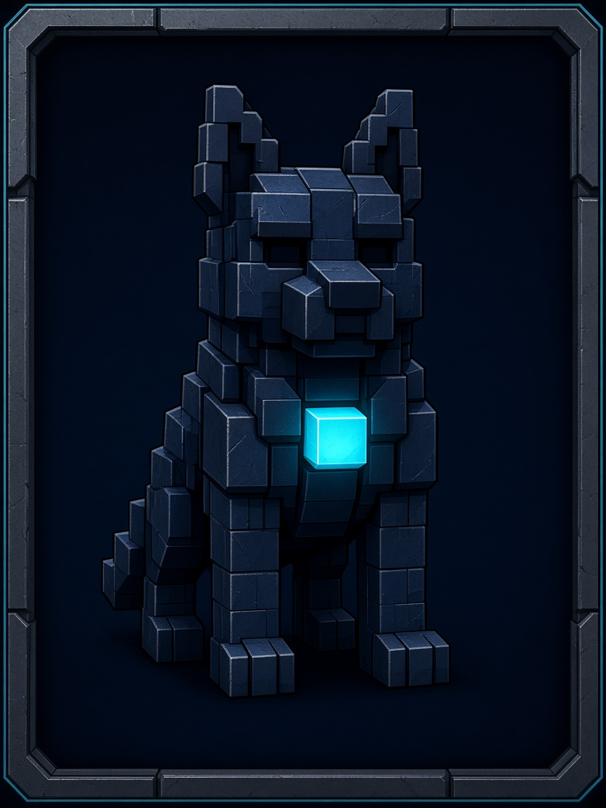
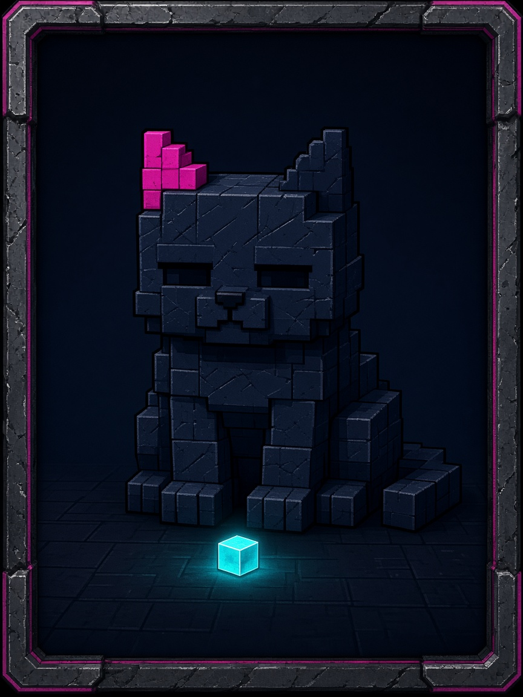
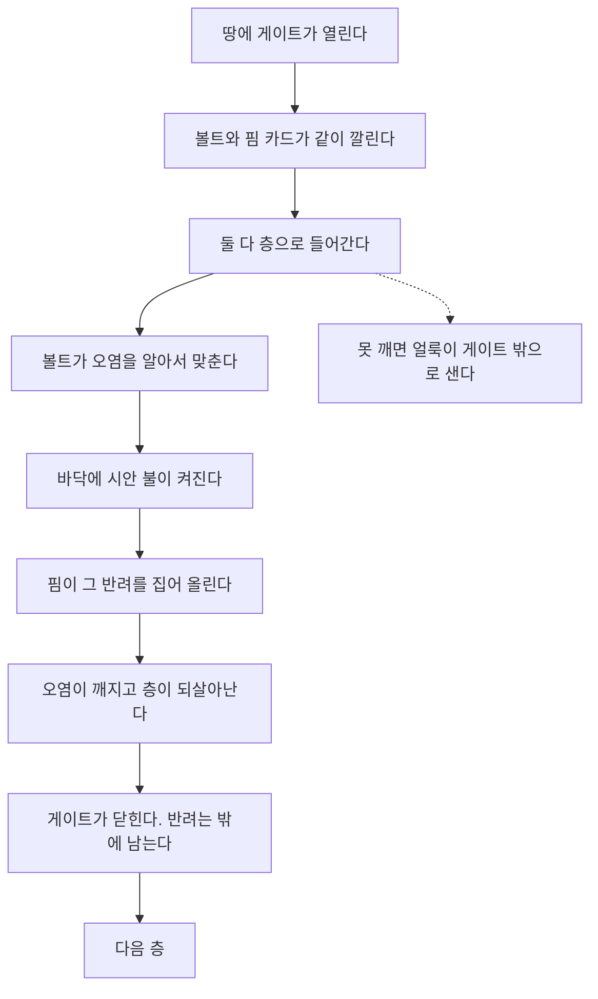
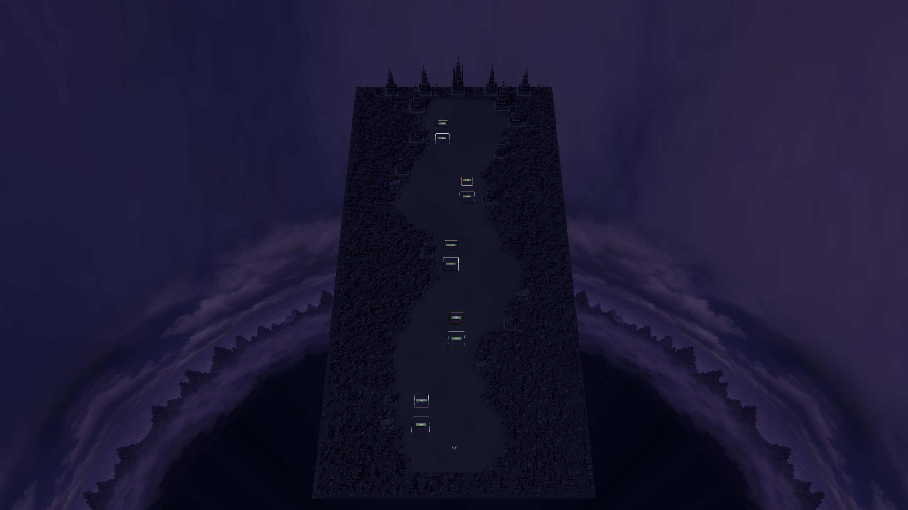
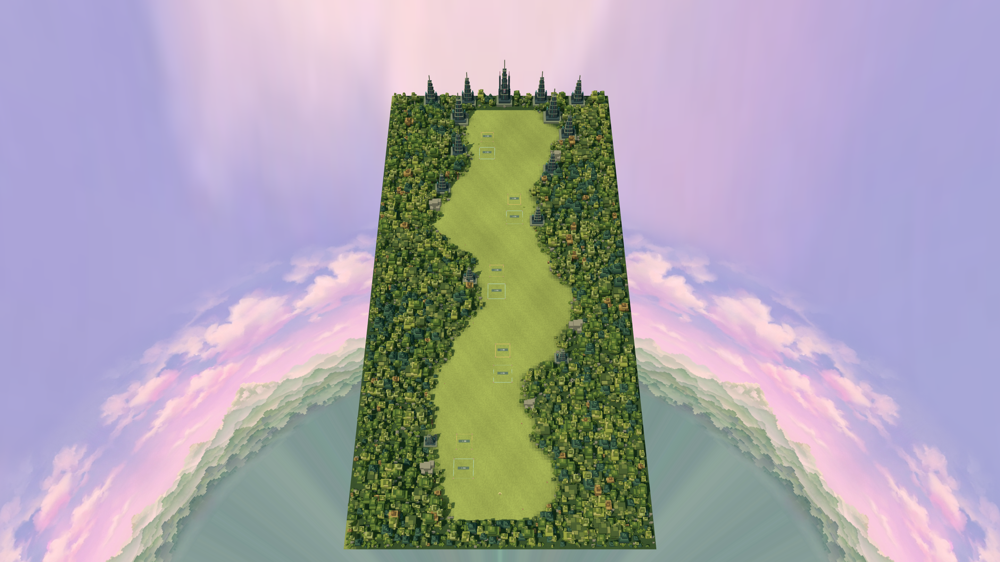
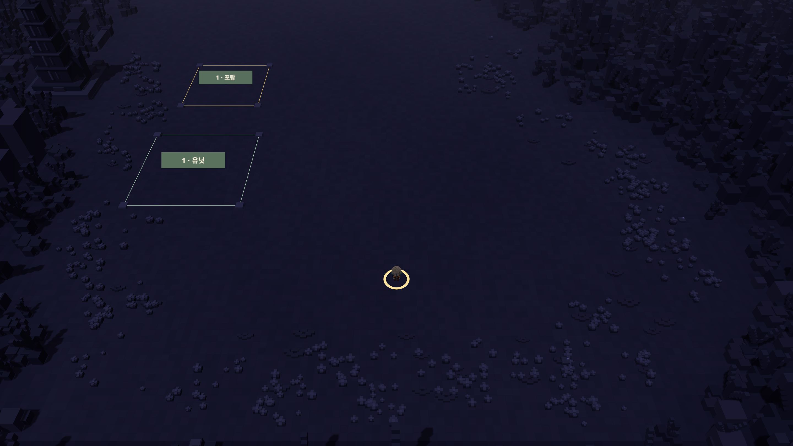
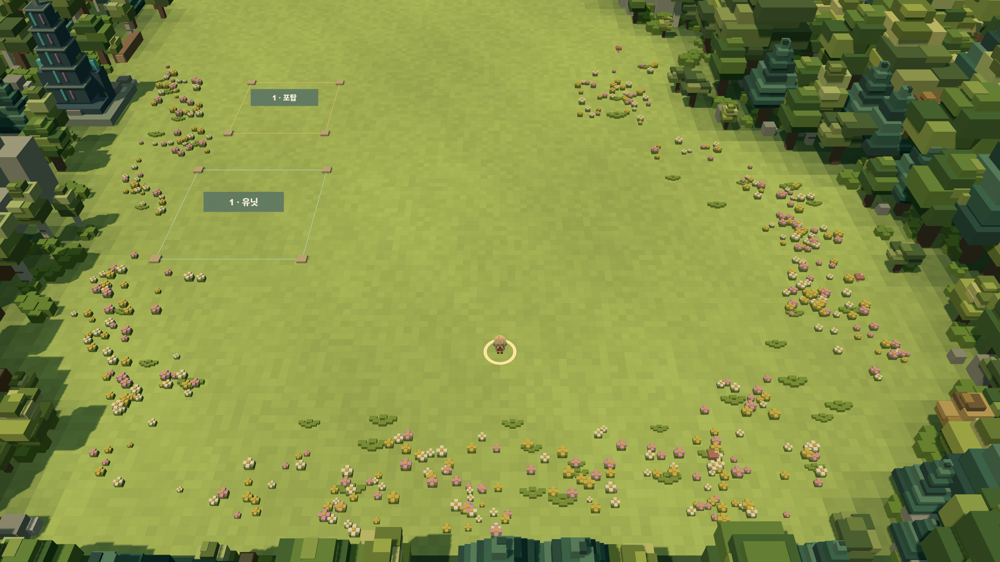
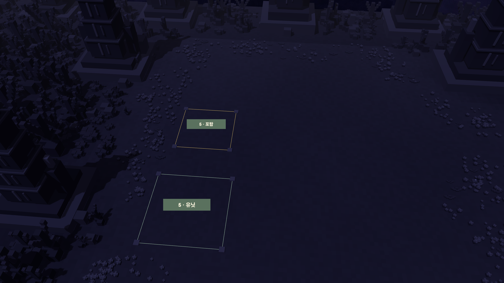
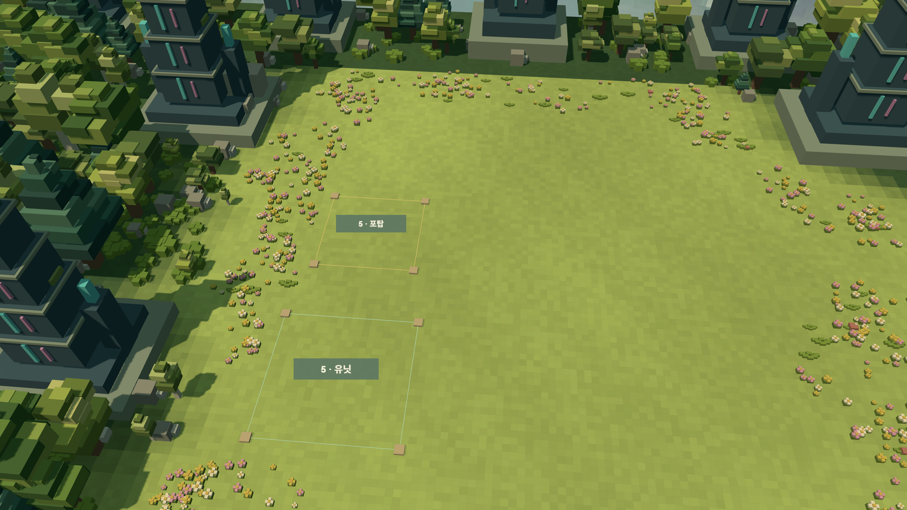

# 55. 게이트와 층 — 둘이 들어가 깨고, 반려를 집어 올린다

> 작성: 2026-10-09 · 상태: **【현행 세계】**
> 게임 코드는 아직 이 문서대로 바뀌지 않았다.
> 그림 원본: `C:\수스이미지 생성\2026-10-09-게이트카드\`
> 배경 사진은 2026-10-09, 정화 숲 툴의 `forest150x300-v7`이다. 카드 그림은 아직 게임에 없는 볼트·핌이다.
> 루온·리아의 3D는 쓰지 않는다. 영상으로 긴장시키지 않는다.
> [`54`](./54_시작_사건과선택.md)의 「누구를 보낼까」는 접었다.

## 1. 한 장

땅에 게이트가 열린다. 안은 층이다. 카드 두 장, 볼트와 핌이 같이 들어간다. 고르지 않는다. 둘은 이미 이 파티다.

층 안에서 둘은 알아서 싸운다. 플레이어는 조준하지 않는다. 바닥에 시안 불이 켜지면, 그 불이 쓰러진 반려동물이다. 핌이 집어 올려 문 밖으로 낸다. 오염이 깨지고 층이 되살아나야, 그 게이트는 닫힌다. 동물만 두고 나오면 층은 안 깨진 것이다.

## 2. 어디서 빌려 왔나

빌려 온 것은 구조다. 이름, 줄거리, 대사는 가져오지 않는다.

| | 빌려 온 것 | 가져오지 않는 것 |
|---|---|---|
| 픽 미 업 | 층이 있고, 카드가 들어가 깨고, 싸움은 자동이다 | 뽑기, 합성으로 버리는 영웅, 죽은 영웅이 사라지는 규칙, 마스터가 누구를 던질지 고르는 일 |
| 나 혼자만 레벨업 | 세상에 게이트가 열리고, 안을 못 깨면 밖이 오염된다 | 헌터 등급, 그 작품의 인물 |

우리 층이 깨진다는 말은 두 가지다. 오염이 되살아나는 것. 그리고 그 층의 반려동물이 밖으로 나오는 것.

「집어 올려」는 마스터에게 뽑아 달라는 말이 아니다. 층 바닥에 쓰러진 동물이 켜는 불이다.

## 3. 카드 둘

카드가 이 둘의 얼굴이다. 표정으로 긴장하지 않는다. 블록으로 서 있고, 가슴이나 귀에 불만 켜져 있다. 층 안에서는 이 카드와 같은 블록 몸이 움직인다. 그림 파일을 게임 배경으로 깔지는 않는다.

둘은 항상 같이 입장한다. 한 장만 고르는 화면은 없다.

### 볼트

개. 블록. 가슴에 시안 큐브 하나. 층에 들어서면 오염을 알아서 맞춘다. 조준은 없다.

### 핌

고양이. 블록. 왼쪽 귀에 마젠타. 발밑의 시안 불로 쓰러진 쪽을 찾는다. 맞추는 역할이 아니다. 집어 올려 나르는 역할이다.

## 4. 흐름

누르는 것은 입장, 그리고 불이 켜진 반려를 주워 올리는 확인이다. 「누구를 보낼까」는 없다.

같은 두 카드가 다음 층에도 들어간다. 구한 동물은 밖에 남는다. 이 문서에서는 세 번째 전사로 만들지 않는다.

## 5. 실제 숲

게이트를 새로 그린 구멍이 아니다. 이미 있는 숲 한 장이 탑이다.

맵 이름은 `forest150x300-v7`. 가로 150m, 세로 300m. 가운데 길이 구불거리고, 양옆은 블록 나무다. 길을 따라 자리가 다섯이다. 아래가 1층, 위 끝이 5층이다.

| 층 | 숲에 적힌 이름 | 이 층 |
|---|---|---|
| 1 | 출발 방어 | 입구 공터. 여기서 못 집으면 숲 입구 밖까지 어두워진다 |
| 2 | 오른쪽 굴곡 | 길이 오른쪽으로 휜다 |
| 3 | 중간 방어 | 길의 한가운데 |
| 4 | 긴 진입 구간 | 나무가 길게 벽을 친 구간 |
| 5 | 마지막 공터 | 맵 끝. 여기까지 깨야 숲 전체가 아래 초록 사진이 된다 |

한 층의 끝은 그 자리의 땅이 바뀌는 것이다. 같은 카메라, 같은 자리다. 어두운 사진이 층 안이고, 꽃 핀 사진이 깨진 뒤다.

툴이 그려 둔 「포탑」「유닛」네모와, 땅의 노란 고리는 편집 표시다. 게임 문장이 아니다. 고리 안의 작은 점은 지금 툴의 위치 표시다. 볼트도 핌도 아니다. 둘은 아직 이 숲에 없다.

### 숲 전체

위가 5층, 아래가 1층이다.

층 안. 아직 한 자리도 안 깨진 숲.

다섯 층을 다 깬 뒤.

### 1층. 출발

입구에서 발을 디디는 공터다.

### 5층. 마지막 공터

맵 끝이다. 여기가 닫혀야 게이트가 닫힌다.

2층, 3층, 4층은 같은 길 위의 다음 자리다. 이번엔 1층과 5층, 그리고 전체만 찍었다.

## 6. 한 층에서 일어나는 일

1층을 기준으로 적는다. 2층부터 5층은 자리만 바뀌고 순서는 같다.

1. 플레이어는 어두운 공터 앞에 선다. 앞길이 그 층의 게이트다. 새 그림을 깔지 않는다. 위 오염 사진이 그 화면이다.
2. 볼트와 핌 카드가 같이 깔린다. 한 장을 고르지 않는다. 입장을 누르면 둘 다 그 공터의 블록으로 선다.
3. 복셀 몬스터가 길 위에서 내려온다. 볼트는 가슴의 시안으로 알아서 맞춘다. 조준 막대는 없다.
4. 공터 한곳에 시안 큐브가 켜진다. 그게 이 층의 반려동물이다. 얼굴로 말하지 않는다. 불로 있다. 한 층에 하나다.
5. 핌은 쏘지 않는다. 그 불까지 걸어가 집어 올린다. 플레이어가 누르는 것은 그 확인 한 번이다.
6. 몬스터가 정리되고, 동물이 공터 밖에 내려져야 그 자리의 땅이 꽃 사진으로 바뀐다.
7. 싸움만 하고 불을 두고 나오면 땅은 어두운 채로 남는다. 얼룩은 한 층 아래로 번진다. 1층에서 그렇게 되면 숲 입구 밖까지 어두워진다.
8. 구한 동물은 그 층이 깨진 자리에 남는다. 다음 층의 전사로 들어가지 않는다. 다섯 층을 깨면 밖에 다섯이 남는다.

누르는 것은 층마다 둘이다. 입장. 그리고 불을 집어 올리는 확인. 「누구를 보낼까」는 없다. 무기를 고르는 창도 이 문서에는 없다.

## 7. 이 문서가 정한 것

- 게이트의 바닥은 `forest150x300-v7`이다. 1층부터 5층은 그 길의 다섯 자리다.
- 층이 깨지면 그 자리는 정화 후 숲으로 바뀐다. 사진은 그 전환이다.
- 캐릭터는 볼트와 핌, 카드 두 장이다. 루온과 리아의 3D는 쓰지 않는다. 둘은 아직 숲에 세워져 있지 않다.
- 둘은 같이 들어간다. 한 명을 고르지 않는다.
- 싸움은 자동이다. 적은 복셀 몬스터다.
- 층을 깨는 조건은 그 자리의 오염이 걷히고, 그 층의 반려 하나가 밖으로 나오는 것이다.
- 구한 동물은 그 자리에 남긴다. 다섯을 넘지 않는다.

## 8. 보관

| 문서 | 처리 |
|---|---|
| [`54_시작_사건과선택.md`](./54_시작_사건과선택.md) | 누구를 보낼까. 접음 |
| [`33`](./33_시나리오_진행플로우.md) [`38`](./38_시나리오_작성룰.md) [`39`](./39_게임시스템_확정.md) | 60일·사건 사슬. 삭제하지 않음. 이 층의 현행은 아님 |
| [`44_인수인계_필러시나리오.md`](./44_인수인계_필러시나리오.md) | 칸의 박자. 이 게이트 문서와 겹치지 않게 둠 |
| `docs/handoff/20261005_본게임_10분외출_비트.md` | 지금 외출의 버튼 23개. 그대로 둔다. 이 문서는 그 길이 왜 다섯 칸인지 정한다. 버튼을 여기서 바꾸지 않는다 |
