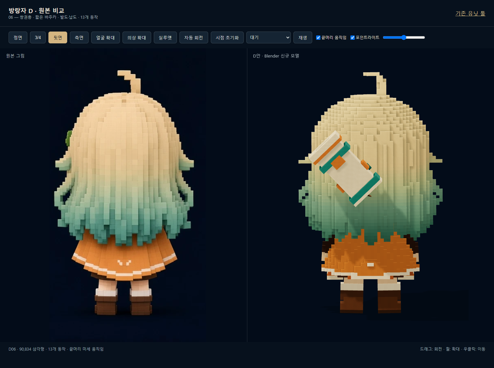
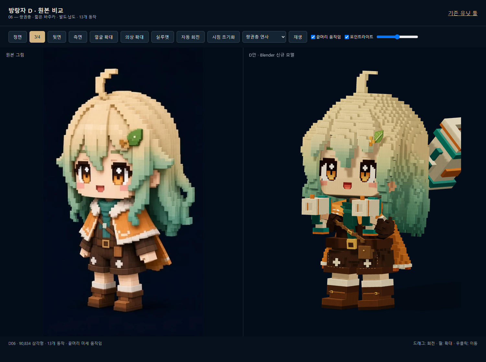
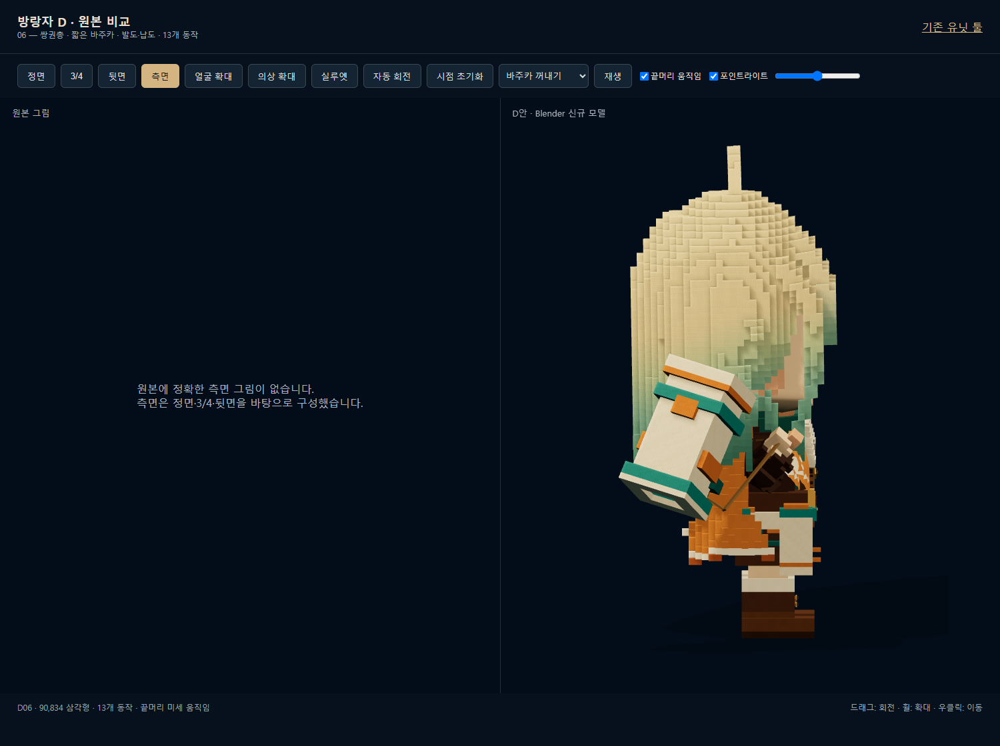
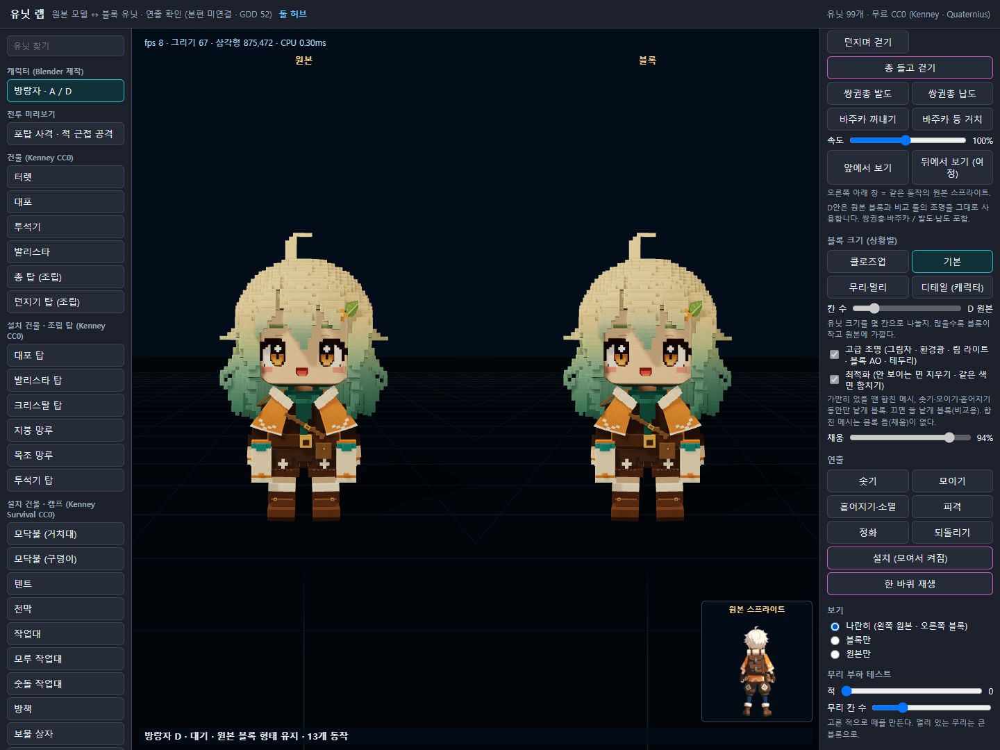

# 작업 보고서 — 20260926 D안 무기·애니메이션·조명 통합

작성: **Codex**  
완료 시각: 2026-09-26 09:39 (KST)  
작업 위치: `C:\xoox`  
구분: 캐릭터 제작 / 로컬 미리보기 툴

## 한 줄

D안에 블록 쌍권총·짧은 사각 바주카, 대기/쌍권총 사용 중 뒷머리 뒤 사선 거치, 발도·납도 포함 13개 동작을 넣고, 어깨 옷·윗머리와 두 툴의 조명을 보정했다. 캐릭터 선택지는 A와 D만 남겼다.

## 이번 지시와 작업 순서

1. 이전 D05의 머리·브로치 디테일, 얼굴 하단 모서리, 머리 끝 미세 움직임과 기존 툴 등록을 마무리.
2. 사용자가 지정한 `docs/directives/WANDERER_WEAPONS_BLOCK.md`와 참조 이미지 3장을 확인.
3. 채팅의 제작 요청을 착수 지시로 받아 **GLB 수정 시작을 먼저 알린 후** 작업.
4. 블록 무기 제작 → 손 위치·반동·장비 이동 동작 → 의상 가중치·윗머리 → 조명 통일 → 실제 브라우저 검증.
5. 과거 보고서나 Grok 봇 명령 확인·주기적 폴링은 수행하지 않았다.

## 바꾼 파일

| 파일 | 내용 |
|---|---|
| `scripts/unit_lab_d/build_d.py` | D 머리·얼굴·브로치, 두꺼운 윗머리, 움직이는 머리 경계 면, Blender 내보내기 |
| `scripts/unit_lab_d/rig_d.py` | D 체형의 팔·다리, 옷과 팔의 연결, 머리 끝 25개 본, 무기·끈 본, 13개 클립 |
| `scripts/unit_lab_d/weapons_d.py` | 크림/티얼/주황 블록 쌍권총과 앞뒤 관통 사각 바주카 |
| `scripts/unit_lab_d/legacy_gait.py`, `legacy_actions.py` | 기존 동작의 시점·박자를 참고하는 복사본. 원본 제작 파일은 수정하지 않음 |
| `data/tools/unit_lab/character/D/wanderer_D.glb`, `metrics.json` | 최종 D06 모델과 수치 |
| `src/tools/unitLabD/ReferenceLighting.ts` | 원본 비교 툴과 애니 툴이 함께 사용하는 조명 설정 |
| `src/tools/unitLabD/NativeBlockEffects.ts` | D 원본 블록·스킨 보존, 등장·정화·피격 등 표시 및 포인트 라이트 |
| `src/tools/unitLabD/main.ts`, `wanderer-d-tool.html` | 원본 비교, 13개 애니 선택, 끝머리/포인트 라이트 조절 |
| `src/tools/unitLabTool/CharacterLab.ts` | D 원본 블록 직접 재생, 기존 A 로딩 유지, 애니·스프라이트 전환 경합 보정 |
| `src/tools/unitLabTool/main.ts`, `unit-lab-tool.html` | A/D만 노출, 새 동작 버튼, D 조명 및 동일 조명의 나란히 보기 |
| `scripts/unit_lab_d/verify_d06.mjs`, `verify_lighting.mjs`, `check_weapon_views.mjs`, `check_oneshot.mjs` | 화면·동작·조명 검증 스크립트 |

## 핵심

### 무기와 착용

- 권총 두 자루: 짧은 L자 블록 형태, 사각 총구, 크림 몸통·민트/티얼 띠·주황 장식. 양손에 각각 한 자루.
- 큰 총: 전체 길이 약 0.528m, 가장 넓은 사각 테두리 0.288m. 앞과 뒤가 열린 관통 터널. 원통·바퀴·야전포·긴 총신 사용 안 함.
- `idle`, 일반 이동, 쌍권총 동작에는 큰 총을 뒷머리 뒤에 사선으로 거치. 팔과 독립된 무기 본이 몸통의 움직임을 따라간다.
- 바주카 꺼내기/등 거치는 머리 옆을 돌아가는 경로. 연결 끈이 어깨·손·무기를 잇는다. 큰 머리와 짧은 팔에 맞춘 연출로, 꺼내는 전체 구간 내내 손잡이를 직접 쥐는 방식은 아니다.
- `shoot`는 D에서 쌍권총 연사, `shoot2`는 바주카 단발로 표시. A의 원래 무기·동작 GLB는 수정하지 않았다.

### 동작

| 클립 | 표시 | 길이 | 재생 |
|---|---|---:|---|
| `idle` | 대기 | 1.500초 | 반복 |
| `walk` | 걷기 | 1.000초 | 반복 |
| `run` | 뛰기 | 0.733초 | 반복 |
| `shoot` | 쌍권총 연사 | 0.267초 | 반복 |
| `shoot2` | 짧은 바주카 단발 | 0.500초 | 반복 |
| `throw` | 던지기 | 1.100초 | 반복 |
| `walk_shoot` | 쌍권총 쏘며 걷기 | 1.000초 | 반복 |
| `walk_throw` | 던지며 걷기 | 1.100초 | 반복 |
| `walk_gun` | 쌍권총 들고 걷기 | 1.000초 | 반복 |
| `draw` | 쌍권총 발도 | 1.200초 | 1회, 끝 자세 유지 |
| `holster` | 쌍권총 납도 | 1.200초 | 1회, 끝 자세 유지 |
| `draw_launcher` | 바주카 꺼내기 | 1.200초 | 1회, 끝 자세 유지 |
| `holster_launcher` | 바주카 등 거치 | 1.200초 | 1회, 끝 자세 유지 |

발도·납도는 별도 확인 버튼이다. 사격 버튼을 누를 때 자동으로 발도부터 실행하는 본편 장비 상태 전환 로직은 연결하지 않았다.

### 옷·머리·얼굴

- 주황색 앞 어깨 옷을 상완/전완에 연결. 밝은 카라 장식도 팔 쪽 가중치를 갖도록 변경하여 팔을 들 때 옷이 정지해 있던 원인을 수정.
- 윗머리 꼬리 뿌리 반경 7→11px, 굽은 중간 6→9px, 끝 3→5px. 깊이도 보강.
- 머리 끝 25개 본만 동작별로 미세하게 흔들고 뿌리는 머리에 고정. 대기·걷기·뛰기·사격·던지기·장비 동작별 세기 차이.
- 얼굴 하단 모서리, 옆머리 여백, 브로치 잎맥/꽃 디테일 포함. 기존 눈·입과 전체 실루엣 유지.
- 머리 덩어리 사이에 움직이며 드러날 수 있는 면을 보완. 구멍 판별용 단색 양면 렌더도 저장했다.

### 조명 일치

- 애니 툴의 D에서 RoomEnvironment 환경광과 푸른 림 라이트를 제거.
- 비교 툴을 기준으로 노출 **1.05**, 주광 **1.85**, 따뜻한 보조광·림 광 및 반구광을 동일 모듈에서 사용.
- 포인트 라이트 강도 100%의 기준도 동일한 2.2. 같은 높이·위치에서 비추며 UI에서 끄거나 낮출 수 있다.
- D 나란히 보기는 두 모델을 같은 원점의 조명에서 각각 렌더. 서로 다른 거리의 포인트 라이트가 색을 달리 보이게 하지 않도록 처리.
- A 및 건물·적 화면에는 원래 조명 방식을 적용.

## 검증

- Blender: `D_COMPLETE`, GLB/BLEND 저장 성공. 최종 **90,834 삼각형 / 8 메시 / 48 본 / 9,449,272 bytes**.
- TypeScript: 관련 두 툴과 CharacterLab의 strict `tsc --noEmit` 통과.
- Chrome: 두 툴 정상 로딩, D의 13개 클립 전부 재생, A의 기존 9개 클립 로딩. 선택지는 정확히 `A,D`. 페이지 오류·실패 HTTP 응답 없음.
- 추가 발도·납도 4개: 1.2초에서 `paused=true`, `clampWhenFinished=true` 확인.
- GLB: 13개 클립 모두 0초에서 시작하는 것을 접근자 값으로 확인.
- 머리 움직임: 선택한 프레임/정점 표본에서 대기 약 3.6mm, 걷기 약 6.7mm, 뛰기 약 12.0mm. 머리 본에만 묶인 뿌리의 추가 변위는 0. 전체 프레임의 절대 최대치 측정은 아님.
- 조명 검증: 512×512, 같은 카메라·idle 0초의 직접 렌더. 기준 툴 대비 원본 애니 표시 평균 RGB 오차 **0.000000/255**, 블록 표시 **0.000057/255**. 시점·동작을 다르게 놓으면 표면 방향에 따른 음영은 달라질 수 있다.
- 사격·던지기·등 거치·꺼내기의 정면/사선/측면/후면 캡처 확인. 팔 솔버의 출력 오차는 도달 가능 거리로 제한한 목표에 대한 값이며, 모든 원래 목표나 모든 중간 프레임의 충돌 없음까지 입증하는 수치는 아니다.

수치와 캡처: `docs/reports/assets/20260926_D06_무기조명/`  
`checks.json`, `lighting.json`, `color_metrics.json`, `clip_times.json`, `oneshot.json`

## 확인 화면

### 대기 중 뒷머리 뒤 사선 거치

### 양손 권총

### 큰 총 꺼내기와 연결 끈

### 기존 툴의 D 나란히 보기

## 산출물·재현

- Blender 원본 및 먼저 출력한 GLB: `C:\수스이미지 생성\2026-09-26-wanderer-D06\wanderer_D.blend`, `wanderer_D.glb`.
- 변경 전 백업: `C:\수스이미지 생성\2026-09-26-wanderer-D\before_D06`.
- 제작: Blender 5.2에서 `scripts/unit_lab_d/build_d.py` 배치 실행. GLB는 아트 폴더에 먼저 만들고 프로젝트 D 폴더로 복사.
- [원본 비교 툴](http://localhost:5179/wanderer-d-tool.html)
- [A/D 애니 툴](http://localhost:5179/unit-lab-tool.html?variant=D)

## 하지 않은 일 / 제한

- A/B/C 리소스 파일 삭제 안 함. 툴에서 A/D 외 선택지만 제거.
- Cursor의 본편·맵·전투·시퀀스 데이터 수정, Git 커밋/푸시, 신규 다운로드 없음.
- 본편 무기 발사·투사체·장비 상태 시스템 연결은 없음. 지금 산출물은 확인용 모델과 애니메이션이다.
- 이번 상세 모델은 클로즈업 시안. 모바일/다수 캐릭터 성능, 압축 및 LOD는 측정·확정하지 않았다. 포인트 라이트 그림자와 나란히 보기는 추가 렌더 비용이 있다.
- 의상은 스킨 가중치로 움직이며 물리 기반 천 충돌 시뮬레이션은 아니다. 모든 임의 블렌딩 조합의 관통 방지를 보장하지 않는다.

## 다음 작업 계획

1. 사용자가 툴에서 발도·납도 속도, 바주카 거치 높이, 양손 권총 크기를 확인.
2. 보정 지시가 오면 D 원본과 클립을 같은 제작 스크립트에서 갱신.
3. 본편 연결 지시가 있을 때 장비 상태 전환·총구 발사 지점을 게임 담당과 맞추고, 목표 기기 기준 LOD/그림자 비용을 정한다.

## 막힌 질문

없음. 요청된 미리보기 범위는 완료.
