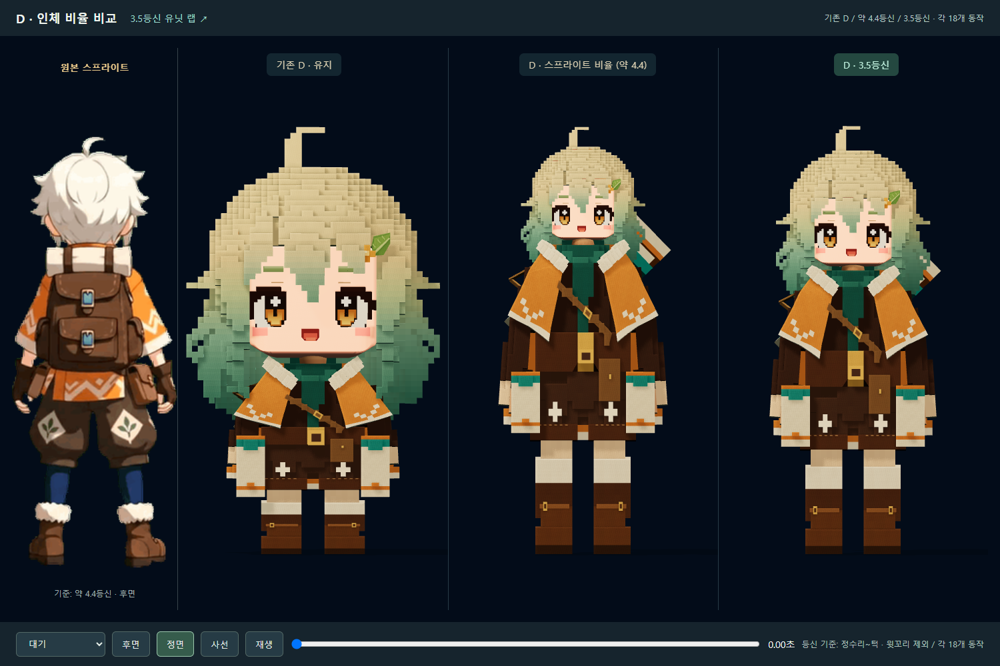
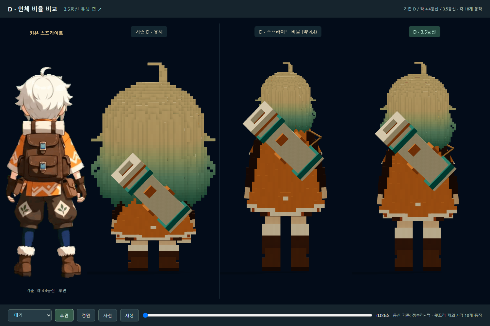

# 작업 보고서 — 20260927 D 스프라이트 비율·3.5등신 추가
작성: Codex · 2026-09-27

## 한 줄
기존 D를 보존하고 스프라이트 비율(약 4.4등신)과 3.5등신 두 버전을 각각 제작했다. 각 18개 동작을 새 골격으로 계산하고 유닛 랩과 세 모델 비교 화면에 등록했다.

## 사용자 지시와 범위
- 첨부한 원본 스프라이트 인체 비율로 D를 하나 더 만들되 기존 D 유지.
- 후속 지시: 3.5등신도 별도 제작.
- 그룩봇 정기 확인은 앞선 사용자 중지 요청에 따라 automation 30을 PAUSED로 변경했다. 이번 제작은 채팅의 직접 지시에 따른다.

## 핵심
| 항목 | 스프라이트 비율 DS | 3.5등신 D35 |
|---|---:|---:|
| 정수리~턱 기준 등신 | 약 4.38 (원본 스프라이트 측정 약 4.42) | 3.50 |
| 기존 D 대비 머리 균일 배율 | 49% | 60.81% |
| 대기 자세 전체 키(윗꼬리 포함) | 1.897m | 1.900m |
| 애니메이션 | 18개 | 18개 |
| 뼈 / 끝머리 뼈 | 48 / 25 | 48 / 25 |
| 삼각형 | 91,770 | 91,770 |
| GLB 크기 | 10,234,048 bytes | 10,230,564 bytes |

- 등신 계산에서 별도로 솟은 윗꼬리 머리는 제외했다.
- 얼굴·눈·표정·머리는 같은 비율로 변환하여 얼굴이 납작해지지 않게 했다.
- 어깨·골반·무릎·발목 위치와 몸통·팔다리 길이를 조정했다. 피부 가중치와 얼굴 모양 키에도 같은 변환을 적용했다.
- 새 팔 길이에 맞춰 손 위치를 다시 풀고 쌍권총·바주카·등 거치·발도·납도 및 발 접지를 다시 계산했다.
- 체형 변환 중 늘어난 버클 전면도 보정했다. 의상 디자인·팔레트·무기 디자인은 D에서 이어받았다.
- 대기·걷기·뛰기·사격2종·던지기·이동 사격/투척·무기 들고 이동·발도/납도4종·깜박임·찡그림·인사·손 흔들기·승리를 포함한다.

## 바꾼 파일
### 신규
- `scripts/unit_lab_d_sprite/build_sprite.py`: D 원본 Blender 파일을 읽어 새 비율 모델과 동작 생성. `--head-units 3.5`로 D35, 기본 실행은 DS.
- `scripts/unit_lab_d_sprite/verify.mjs`: 두 신규 모델의 36개 클립 및 유닛 랩 등록 확인, 스크린샷 저장.
- `data/tools/unit_lab/character/D_sprite/wanderer_D_sprite.glb`, `wanderer_D_sprite.blend`, `metrics.json`, `reference_idle.png`.
- `data/tools/unit_lab/character/D_35/wanderer_D_35.glb`, `wanderer_D_35.blend`, `metrics.json`.
- `wanderer-d-sprite-tool.html`, `src/tools/unitLabDSprite/main.ts`: 원본 스프라이트와 기존 D/DS/D35 비교. 동일 카메라·조명·시간 사용.
- `docs/reports/20260927_작업계획_D스프라이트비율_Codex.md`.
### 연결
- `unit-lab-tool.html`, `src/tools/unitLabTool/main.ts`: DS / D35 선택과 비교 툴 링크 추가. 기존 A/D 선택 유지.
- `docs/status/BOARD.md`: Codex 행의 이번 작업 부분만 갱신. 다른 작업 기록과 다른 에이전트 행 보존.

## 검증
- Blender 5.2.2에서 두 GLB 및 편집 가능한 별도 Blender 파일 생성 성공.
- 변경된 TS 진입점의 strict 타입 검사 통과.
- 최종 Chrome 검사: 두 모델 각 18클립, 각 클립 9시점에서 표본 스킨 정점 좌표 확인. 모두 유한하며 검사 표본에서 지면 아래 정점 없음.
- 모든 클립에 얼굴 모양 키 트랙 3개 유지.
- 유닛 랩 DS→D35→기존 D 선택 확인. 브라우저 오류 0, HTTP 실패 0.
- 정면·후면·사선, 사격·투척·달리기·승리·깜박임 스크린샷 확인.
- 원본 D GLB SHA256 유지: `a1c4dbb4dc97f1a194297c3cdb24ce15c214653b9eeb0d0cd7682bd45415bfe0`. 원본 D 제작 스크립트와 리그 스크립트도 변경하지 않았다.

### 확인 위치
- 3.5등신: http://localhost:5179/unit-lab-tool.html?variant=D35
- 스프라이트 비율: http://localhost:5179/unit-lab-tool.html?variant=DS
- 세 모델 비교: http://localhost:5179/wanderer-d-sprite-tool.html
- 스크린샷·수치: `docs/reports/assets/20260927_D비율비교_Codex/`

## 하지 않은 일 / 한계
- 본편 게임·맵·고양이·기존 A/D 모델 교체, 커밋·푸시 없음.
- 원본 스프라이트의 흰 짧은 머리·배낭·의상을 그대로 복제한 버전이 아니다. 사용자가 요청한 D 디자인의 인체 비율 추가 버전이다.
- 기존 블록 토폴로지를 유지했으므로 폴리곤 수 감소를 주장하지 않는다. 비교 화면은 세 모델을 동시에 띄우며 모바일 성능 검증은 하지 않았다.
- 등신은 기준 자세·정수리/턱 기준이며 움직임과 머리카락 실루엣 때문에 화면상 인상은 달라질 수 있다.

## 막힌 질문
없음. 사용자가 툴에서 기존 D / 약 4.4등신 / 3.5등신을 선택하여 확인할 수 있다.