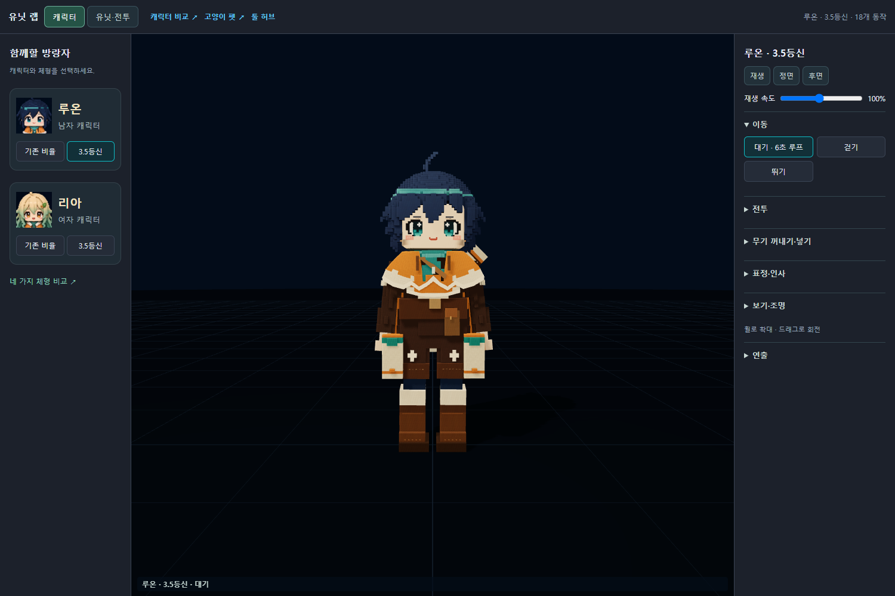
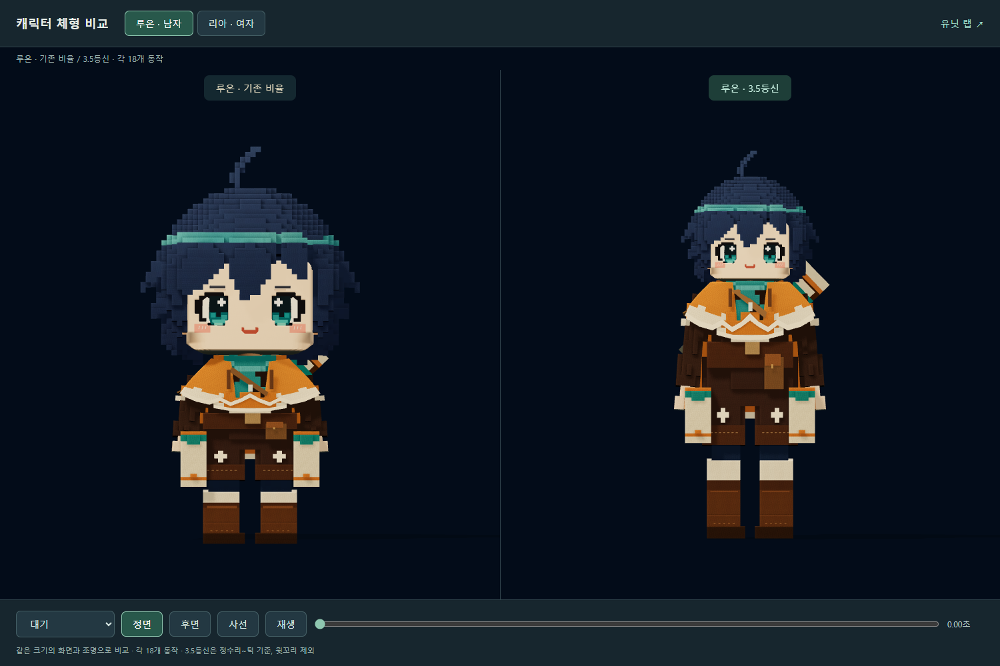
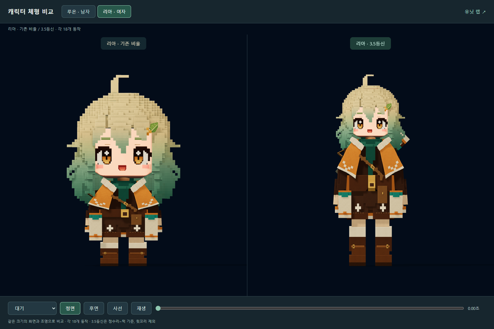

# 작업 보고서 — 20260927 루온·리아 구성 및 유닛 랩 정리
작성: Codex · 2026-09-27

## 한 줄
남자 캐릭터는 **루온**, 여자 캐릭터는 **리아**로 이름을 붙였다. 각각 기존 비율과 3.5등신, 총 네 가지를 활성화하고 미사용 시안은 백업했다. 유닛 랩과 체형 비교 화면을 정리했다.

## 사용자 지시
- 시안 A/D라는 표시 대신 남자·여자 캐릭터 이름 사용.
- 두 캐릭터 모두 기존 비율과 3.5등신만 사용.
- 나머지 시안 백업 및 복잡해진 유닛 툴 정리.
- 이번 작업은 채팅의 직접 지시에 따랐다. 중지한 그룩봇 확인은 재개하지 않았다.

## 활성 구성

| 캐릭터 | 체형 | 선택 ID | 모델 경로 |
|---|---|---|---|
| 루온 · 남자 | 기존 비율 | RUON | data/tools/unit_lab/character/A/wanderer_A.glb |
| 루온 · 남자 | 3.5등신 | RUON_35 | data/tools/unit_lab/character/Ruon_35/ruon_35.glb |
| 리아 · 여자 | 기존 비율 | RIA | data/tools/unit_lab/character/D/wanderer_D.glb |
| 리아 · 여자 | 3.5등신 | RIA_35 | data/tools/unit_lab/character/D_35/wanderer_D_35.glb |

각 18개 동작을 유지한다. 대기·걷기·뛰기·쌍권총·바주카·던지기·이동 사격/투척·무기 들고 이동·발도/납도·깜박임·찡그림·인사·손 흔들기·승리가 포함된다.

## 핵심

### 루온 3.5등신
- 기존 루온 Blender 원본을 읽고 별도 GLB와 편집 가능한 Blender 파일로 제작했다.
- 정수리~턱을 머리 1단위로 계산한 3.50등신. 윗꼬리는 등신 계산에서 제외한다.
- 얼굴·머리·모양 키를 균일 배율 62.83%로 변환했다. 몸통·팔다리·관절 위치는 별도로 조정했다.
- 새 팔 길이에 맞춰 손·무기 위치를 다시 계산했다. 머리 끝 움직임, 얼굴 표정, 총구 FX 연결을 유지한다.
- 검수에서 발견한 약 3.5cm의 발바닥 침범을 수정했다. 원본의 명목 원점 대신 실제 부츠 밑면에서 지지점을 구해 새 모델의 발 접지를 계산한다.
- 46개 뼈 / 끝머리 뼈 23개 / 삼각형 78,830개 / GLB 8,550,804 bytes.
- 대기 자세 전체 높이 약 1.901m (윗꼬리 포함).

### 툴 정리
- 기본 화면은 캐릭터 선택과 한 모델의 동작 확인에 집중했다.
- 왼쪽은 루온·리아 두 카드, 카드별 기존 비율/3.5등신 선택만 표시한다.
- 오른쪽은 이동 / 전투 / 무기 꺼내기·넣기 / 표정·인사 / 보기·조명 그룹을 접어서 사용할 수 있게 했다.
- 일시정지, 정면/후면, 속도 조절을 위에 배치했다. 원본 스프라이트·성능 수치는 필요할 때 켠다.
- 적·건물·소품은 상단 유닛·전투 화면으로 이동하고, 종류별 접기·필터·검색을 제공한다.
- 체형 비교 화면은 루온/리아를 골라 기존 비율과 3.5등신을 나란히 본다. 동일 카메라·조명·동작 시간을 사용한다.
- 이전 스프라이트 비교 URL은 새 체형 비교 화면으로 연결한다. 기존 원본 그림 비교 페이지에도 루온·리아 이름을 적용했다.
- 내부 A/D 파일명과 메시 이름은 그림자·무기 FX·이전 링크 호환을 위해 유지한다.

### 백업
- ZIP: docs/asset_backups/20260927_characters_Codex/unused_variants_and_previous_tool.zip
- 목록: docs/asset_backups/20260927_characters_Codex/manifest.json
- 미사용 캐릭터 파일과 변경 전 툴 등 19파일, ZIP 22,182,736 bytes.
- 파일별 SHA256 기록 및 ZIP CRC 검사 통과.
- 약 4.4등신 스프라이트 비율과 과거 B/C 등은 활성 선택에서 제외했다.
- 삭제로 기존 경로를 깨뜨리지 않도록 호환 원본 파일도 남겨 두었다. 사용 화면의 선택지는 네 가지뿐이다.

## 바꾼 파일

### 모델·제작
- scripts/unit_lab_characters/build_ruon.py
- data/tools/unit_lab/character/Ruon_35/ruon_35.glb
- data/tools/unit_lab/character/Ruon_35/ruon_35.blend
- data/tools/unit_lab/character/Ruon_35/metrics.json

### 툴
- src/tools/unitLabTool/CharacterCatalog.ts
- unit-lab-tool.html / src/tools/unitLabTool/main.ts
- character-compare-tool.html / src/tools/characterCompare/main.ts
- wanderer-d-sprite-tool.html (새 비교 툴로 연결)
- wanderer-a-tool.html / wanderer-d-tool.html (표시 이름)
- src/tools/unitLabA/main.ts / src/tools/unitLabD/main.ts (상태 표시 이름)

### 기록·검증
- scripts/unit_lab_characters/backup.py / organize_tool.py (이번 이전 작업용)
- scripts/unit_lab_characters/verify.mjs
- docs/reports/20260927_작업계획_루온리아_유닛랩정리_Codex.md
- docs/reports/assets/20260927_루온리아_유닛랩정리_Codex/
- docs/status/BOARD.md (Codex 행만)

## 검증
- Blender 5.2.2에서 새 모델 및 18개 동작 내보내기 성공.
- 변경된 TypeScript 진입점 4개 strict 타입 검사 통과.
- Chrome에서 네 선택지 모두 로드·전환·대기 재생·일시정지 확인.
- 각 모델에 18클립, 각 클립에 얼굴 모양 키 트랙 3개 존재.
- 루온 3.5등신 18클립 × 9시점의 표본 스킨 정점: 유한 좌표, 지면 아래 표본 없음.
- 사격·승리 버튼, 후면 총구 FX, 캐릭터↔유닛 전환, 적 필터와 cat 검색 확인.
- 기존 맵의 구역·정화 상태·액터·다시 읽기 컨트롤 보존 확인. 맵 플레이를 새로 검증한 것은 아니다.
- 1500×1000 및 1024×768 화면 확인. 작은 화면 가로 넘침 없음.
- 최종 브라우저 오류 0, HTTP 실패 0. 검증 상세는 checks.json.
- 정면·후면·사격·유닛 화면 스크린샷 12장 저장.
- 기존 남자/여자 원본 GLB SHA256 유지:
  - 루온: 926e63ac54cb7fa68e052be2ba11560b5060da08097c706252e241acfaf73b1b
  - 리아: a1c4dbb4dc97f1a194297c3cdb24ce15c214653b9eeb0d0cd7682bd45415bfe0

## 확인 위치
- [유닛 랩 — 루온 3.5등신](http://localhost:5179/unit-lab-tool.html?character=RUON_35)
- [루온 체형 비교](http://localhost:5179/character-compare-tool.html?family=RUON)
- [리아 체형 비교](http://localhost:5179/character-compare-tool.html?family=RIA)

## 하지 않은 일 / 한계
- 게임 본편·맵·고양이 모델·기존 남녀 원본 모델은 변경하지 않았다. 커밋·푸시하지 않았다.
- 이번 검증은 로컬 Chrome 프리뷰다. 모바일 실기기 성능과 본편 게임 적용은 별도 작업이다.
- 등신은 기준 자세의 정수리/턱 기준이다. 머리카락과 동작에 따른 화면 실루엣은 달라질 수 있다.
- 기존 루온의 원본 바닥 원점은 유지했다. 새 3.5등신에만 실제 발바닥 접지 보정을 적용했다.

## 막힌 질문
없음. 네 가지 캐릭터 구성을 툴에서 선택해 확인할 수 있다.
