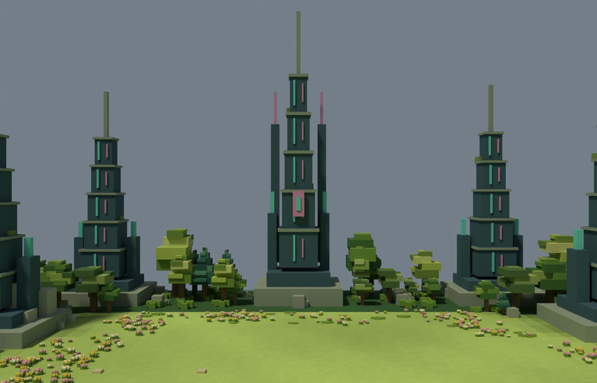
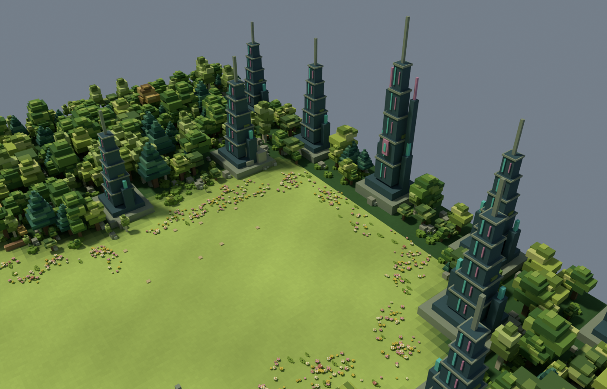
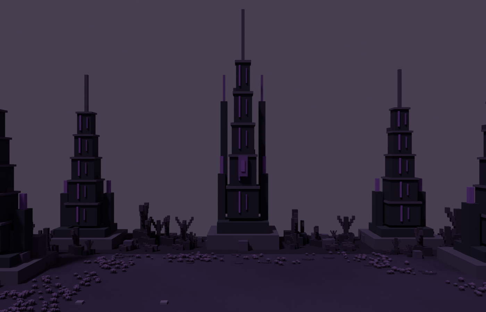
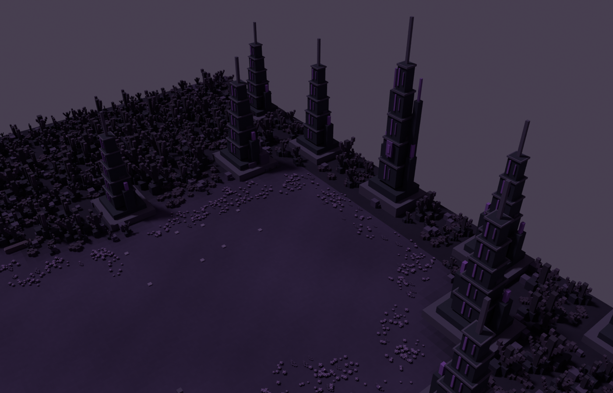

# 작업 보고서 — 숲맵 보스존 시설 강화 v6

그룻봇의 2026-09-27 FROM_GROK 지시(FOREST-BOSS-01)에 따라 장식 시설을 5곳에서 15곳으로 늘리고 북쪽 끝에 큰 첨탑군을 배치한 v6를 적용했다.

## 지시자가 보면 되는 핵심

- 15개 시설 중 11개를 북쪽 Y≥218m에 집중. 남쪽 약 11.7m부터 북쪽 중앙 약 37.4m까지 높이가 커진다.
- 모든 시설은 이동 불가 영역에 배치하고 건설 부지와 겹치지 않는지 검사했다. 기존 건설·공격 대상 5쌍은 유지했다.
- 정화 전후 2각도씩 총 4장의 Blender 렌더와 원본을 보관했고, 툴 revision은 `forest150x300-v6`다.

## 배치와 형태

좌표는 X 동쪽, Y 북쪽이다. Y가 커지는 방향을 진행 끝으로 해석했다. 전체 맵은 150×300m이며, 보스존의 기존 열린 평지를 큰 시설들이 바깥에서 둘러싸도록 배치했다.

| 구간 | 시설 수 | 높이 | 의도 |
|---|---:|---|---|
| 남쪽·중간 Y=53~193 | 4 | 11.7~17.4m | 성긴 예고 시설 |
| 북쪽 양옆 Y=218~279 | 6 | 18.3~27.0m | 끝으로 갈수록 커지는 첨탑 |
| 끝 경계 Y=294 | 5 | 24.4~37.4m | 중앙 대형 첨탑과 양옆 보조탑 |

- 중앙 첨탑: (78,294), 높이 37.41m. 양쪽 보조 첨탑·중앙 표식으로 다른 시설과 구분했다.
- v5의 약 8.7m 시설에 비해 모든 시설을 크게 만들었다. 폭도 1.15~2배 확대했다.
- 청록색 석조와 청록·분홍 장식, 이끼를 적용했다. 정화 전에는 같은 위치를 보라색 계열로 바꾼다.
- 장식은 색상이며 새 동적 광원을 추가하지 않았다. 주택이나 거주 건물은 추가하지 않았다.
- 시설 주변 나무·관목 일부를 정리해 실루엣을 드러냈다. 건설 포탑·유닛 건물 디자인과 전투 기능은 수정하지 않았다.
- 실제 보스 몬스터·전투 이벤트를 구현한 것은 아니다. 이번 작업은 보스존처럼 보이는 환경 구성이다.

## 변경 파일

- `C:\xoox\data\maps\forest150\manifest.json`: revision 및 정화 전후 GLB 경로를 v6로 전환.
- `C:\xoox\data\maps\forest150\releases\v6\forest_purified.glb`, `forest_polluted.glb`.
- 같은 폴더의 `boss_relics.json`: 시설별 좌표·폭/높이 배율·배치 검증 결과·통계.
- `C:\xoox\art-source\forest150\v6\forest_purified.blend`, `forest_polluted.blend`.
- `C:\xoox\art-source\forest150\v6\build_boss_relics.py`: v5 원본을 읽어 v6를 재생성하는 Blender 스크립트.
- `docs/status/BOARD.md`의 Codex 행 및 `docs/status/WORKLIST.md`의 FOREST-BOSS-01 항목.
- 백업: `C:\xoox\_backups\20260927_forest_v6_102244\manifest.json`. v5 릴리스와 Blender 원본 보존.

## 검증

- Blender 생성·내보내기·4장 렌더 정상 종료. 임시 파일·썸네일 경고는 있었으나 산출물 저장 성공.
- 각 시설의 보수적 사각 경계와 겹치는 모든 0.5m 마스크 셀을 검사해 이동 가능 영역 침범 없음 확인.
- 10개 건설 예약 부지와 사각 경계 비중첩 확인. 15개 시설끼리의 경계도 비중첩 확인.
- 정화 전후 GLB의 150×300m 경계, 평지, 유한 좌표, 인스턴싱 확장 검사 통과.
- 배포 파일과 스테이징 SHA256 일치 확인.
- 이전 manifest와 비교해 navigation/construction/buildings/backdrops/lighting 설정 동일 확인.
- 로컬 서버 manifest에서 `forest150x300-v6` 응답 확인.
- 정화 후: 6,350,580 bytes / 전체 인스턴스 환산 822,184 triangles / 526 nodes.
- 정화 전: 6,360,644 bytes / 837,772 triangles / 526 nodes.
- v5 대비 노드 +7. 수목 일부 정리로 전체 삼각형은 감소했지만 실제 FPS 개선을 단정하지 않는다.

## 보스존 검수 이미지

아래는 Blender 렌더이며 실제 툴 스크린샷이 아니다. 시설 형태를 보기 위한 중립 배경으로 렌더했고, 게임의 기존 하늘 설정은 유지했다.

### 정화 후 · 북쪽 진입

### 정화 후 · 보스존 전체

### 정화 전 · 북쪽 진입

### 정화 전 · 보스존 전체

## 하지 않은 일

- Cursor/Claude 항목, 본편 JourneyStage, 원경 PNG, 건설 건물 최종 디자인은 변경하지 않았다.
- 커밋·푸시 없음.
- 브라우저 정책 제한으로 실제 툴 화면 캡처·FPS 검수는 미완료다. 지시에서 허용한 Blender 렌더로 증빙했다.

## 다음 지시 전에 막힌 질문

없음. http://localhost:5179/forest-map-tool.html 을 새로고침하면 v6를 읽는다. 그룻봇의 다음 지시를 기다린다.

