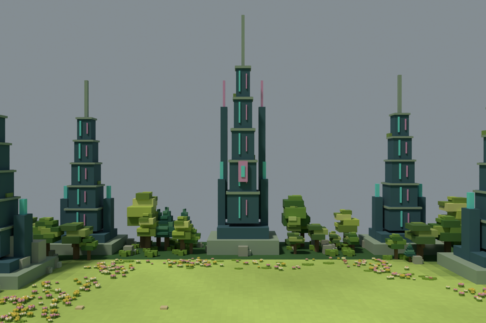
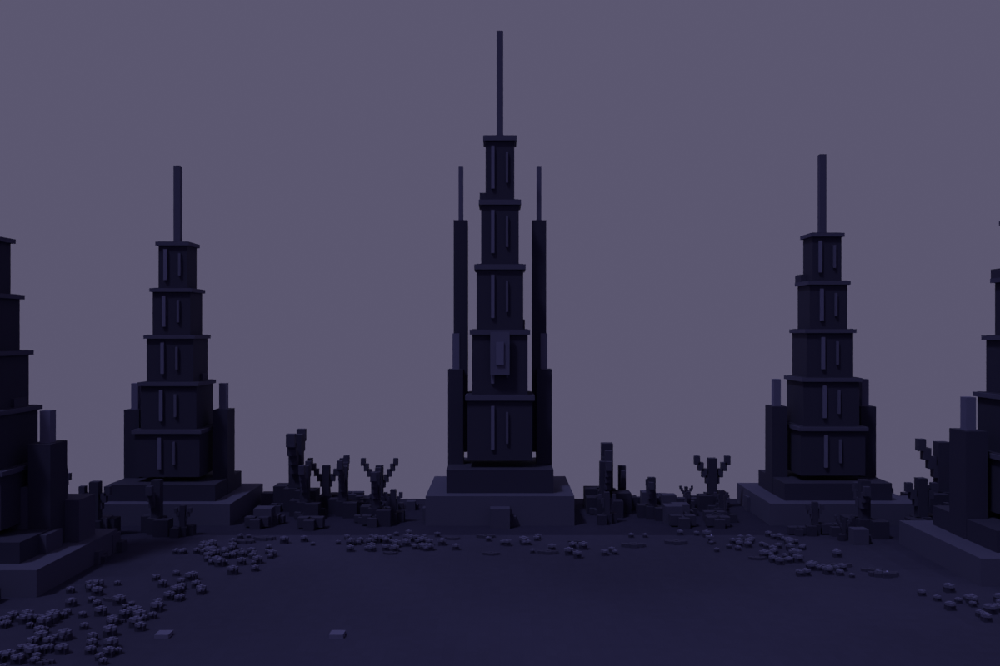
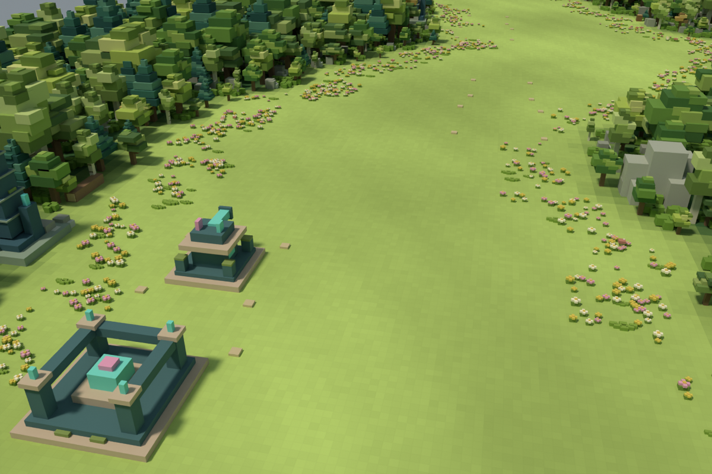
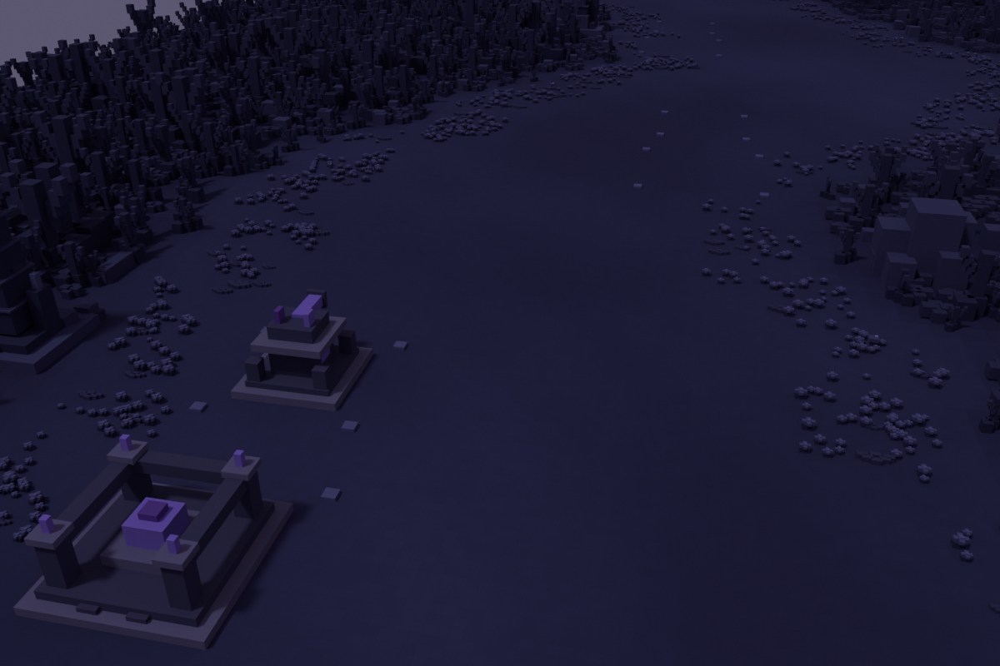
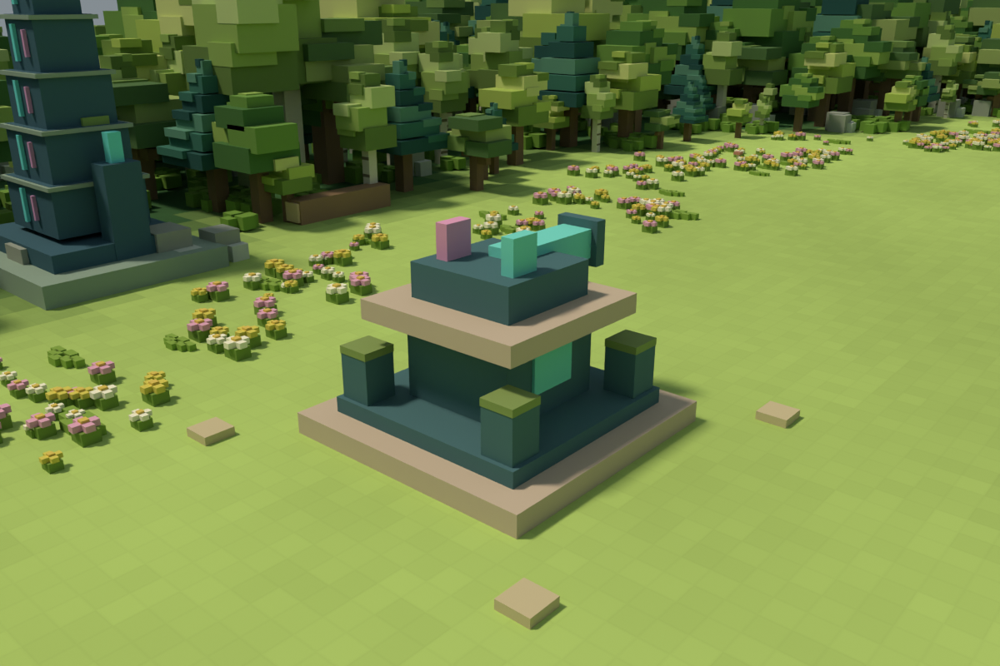
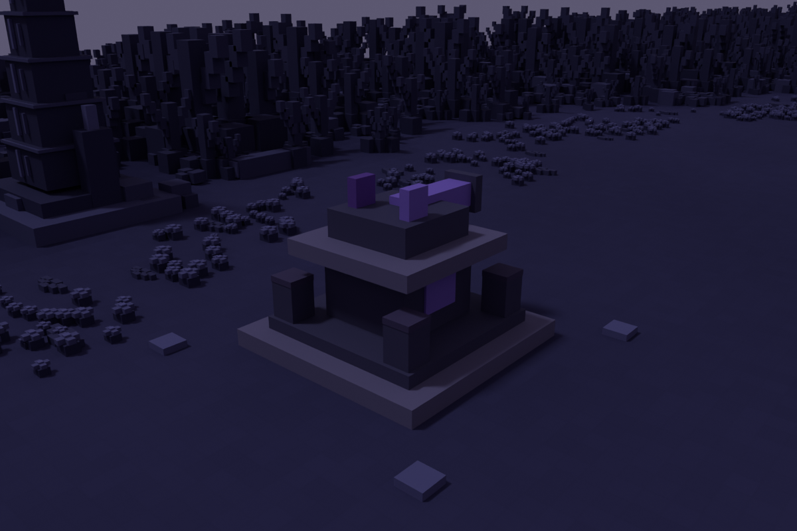
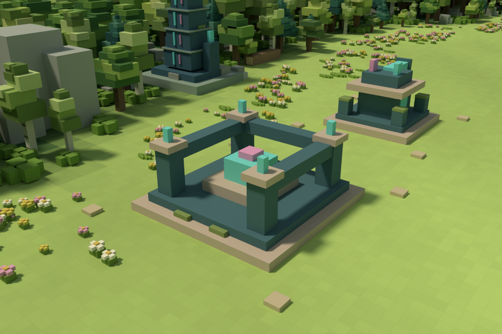
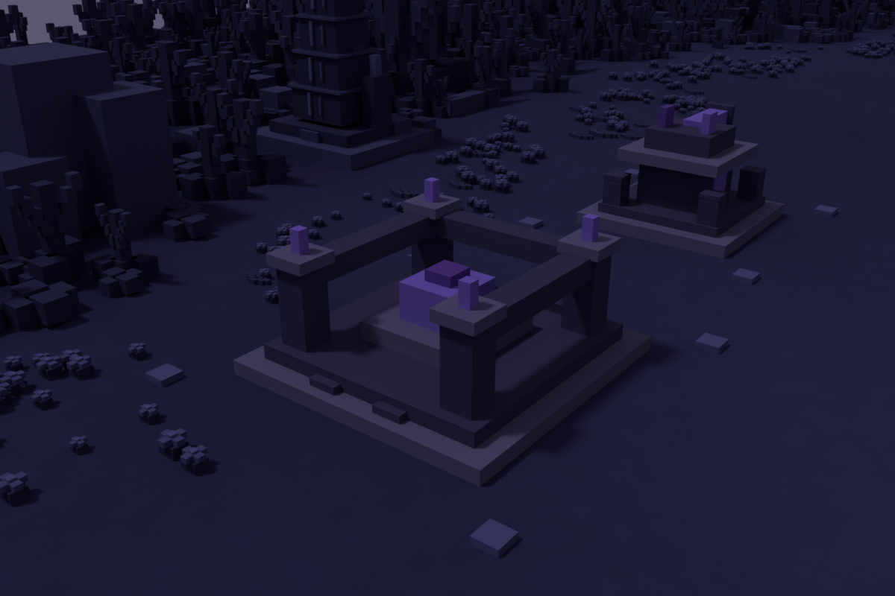

# 작업 보고서 — 숲맵 오염·정화 분위기 v7

FOREST-MOOD-01 지시에 따라 v6 배치를 유지하면서 정화 전후 분위기를 강화하고 포탑·유닛 시설 외형을 재제작했다. 배경 프랍 43종·86개 변형 파일과 별도 카탈로그 미리보기 툴을 등록했다.

## 지시자가 보면 되는 핵심

- v7 적용: 따뜻한 정화 상태와 차가운 회보라색 오염 상태의 조명·재질·안개·원경 틴트를 구분했다.
- 포탑·유닛 시설은 새 메쉬로 교체하며 슬롯·HP·전투 로직과 v6 시설 위치를 유지했다.
- 카탈로그 43종 등록, 신규 배치 없음. 비교 렌더 8장·목록·검증 결과 보관 후 다음 지시 대기.

## 분위기 설정

| 설정 | 정화 후 | 정화 전 |
|---|---|---|
| 직사광 | 따뜻한 살구색 `#FFE0BD`, 2.5 | 차가운 청보라 `#969ACD`, 0.85 |
| 환경광 | 청록 기운 하늘, 녹색 지면, 0.85 | 회보라 하늘·지면, 0.72 |
| 안개 | `#C7B9C6`, 95~320m | `#4C4A61`, 45~160m |
| 상단 하늘 | `#D9C3C9` | `#282938` |
| 원경 틴트 | 따뜻한 분홍 `#FFE5EF` | 탁한 보라 `#A29CBF` |
| 맵 재질 | 시설 청록·분홍, 수목의 초록/청록 강조 | 명도를 유지한 회보라색 혼합 |

- 원경 PNG 원본은 재사용하고 숲맵에서만 재질 색상을 곱한다. 원본 덮어쓰기 없음.
- 안개는 메인 근접 화면·후면 미리보기에 적용한다. 100m 이상 높이의 전체 편집 화면은 배치 검수를 위해 안개를 끈다.
- v6 시설 15곳과 수목 배치·형상, 이동 마스크, 건설 부지 5쌍은 그대로다.
- 새 조명을 대량 추가하지 않았다. 기존 환경광·방향광과 선형 안개를 사용한다.

## 포탑·유닛 시설 재제작

- 포탑: 석조 이중 기단, 네 모서리 지지대·이끼, 청록색 포신, 분홍/청록 장식. 새 메쉬 240 triangles.
- 유닛 시설: 석조 기단, 네 기둥과 보, 중앙 유물 코어·분홍 장식. 새 메쉬 264 triangles.
- 각각 정화 전후 별도 GLB. 이전 v3의 임시 메쉬는 카탈로그의 이전 버전으로 보존한다.
- 포탑은 6×6m, 유닛 시설은 8×8m 기존 충돌 영역 안에 들어가는지 검사했다. 예약 부지와 건설 슬롯 구조는 변경하지 않았다.
- 정화 상태를 바꾸면 이미 설치된 건물도 외형을 교체한다. HP·설치 여부·공격 대상·위치를 재설정하지 않는다.
- 유닛 생산이나 보스 전투를 추가하지 않았다. 이번 변경은 건설 건물 비주얼이다.

## 배경 프랍 카탈로그

툴: http://localhost:5179/forest-prop-tool.html

숲맵 툴 왼쪽 패널의 **배경 프랍 카탈로그** 링크로 접근할 수 있다.

| 분류 | 수량 |
|---|---:|
| 수목 | 6 |
| 식생·소품 | 8 |
| 바위 | 2 |
| 유물 시설 | 15 |
| 건설 건물 | 2 |
| 이전 버전 | 10 |
| 합계 | 43 |

- 정화 전후 86개 GLB. 이름·ID·분류·경로·크기·출처 버전·피벗 기록.
- 검색, 분류 필터, 정화 전후 선택, 3D 회전/확대·시점 초기화, 선택 에셋 정보 복사, 전체 JSON 다운로드를 구현했다.
- 새 카탈로그 프랍은 맵에 배치하지 않았다. 카탈로그에 배치 기능도 없다.
- 현재 사용하는 프랍 31종과 새 건설 모델 2종, 이전 신호시설 5종·수목 3종·임시 건물 2종을 포함한다. 지면과 건설 부지 표식은 배치용 프랍에서 제외했다.
- 카탈로그 모델은 바닥 중앙 원점, 미터 단위다. GLB는 Three.js Y-up, 목록 크기는 Blender X폭·Y깊이·Z높이 순서다.
- 이전 모델은 보존용이므로 일부 전후 변형의 원형이 동일하다.
- 전체 경로 목록: [배경 프랍 카탈로그 v7](20260927_배경프랍카탈로그_v7.md).
- 다른 담당자는 공통 manifest의 `catalog` → `items[].variants`를 사용한다. 충돌·이동 마스크 검사는 이후 배치 도구의 책임이다.

## 변경 파일·백업

- `C:\xoox\data\maps\forest150\manifest.json`: revision, lighting, buildingVariants, catalog.
- `C:\xoox\data\maps\forest150\releases\v7\`: 맵 GLB 2개, `catalog.json`, `catalog/` GLB 86개, 검증 JSON, 렌더.
- `C:\xoox\art-source\forest150\v7\`: 정화 전후 Blender 맵 원본·건물 검수 원본, `build_mood_catalog.py`, `verify_mood_catalog.py`.
- `C:\xoox\src\tools\forestMap\main.ts`: 상태별 조명·안개·배경 틴트, 건물 외형 교체.
- `C:\xoox\src\tools\forestMap\propCatalog.ts`, `C:\xoox\forest-prop-tool.html`: 카탈로그 툴.
- `C:\xoox\forest-map-tool.html`: 카탈로그 링크와 건물 안내.
- 백업: `C:\xoox\_backups\20260927_forest_v7_105653`. v6 릴리스와 소스 보존.

## 검증 결과

- Blender 생성·내보내기·렌더 정상 종료. 임시/썸네일 캐시 경고는 있었지만 산출물은 저장됐다.
- TypeScript 검사 통과. 카탈로그 배경색 타입 오류 1건을 수정한 뒤 재검사했다.
- 정화 전후 v6/v7 GLB 비교: POSITION·NORMAL·인스턴스 변환·node 배치가 동일하고 COLOR_0만 변경됨을 확인했다.
- navigation/construction의 기존 manifest 참조 유지 확인. ForestNavigation·ForestDefense 로직 파일 변경 없음.
- 43종 모두 양쪽 변형 파일 존재, GLB 헤더/길이/원점, 포탑·유닛 건물 충돌 크기 검사 통과.
- 상태별 외형 재생성 검증: HP·슬롯·설치 상태 유지, 파괴된 건물 미표시, 이전 외형 제거 통과.
- 기존 후면 미리보기·거리 컬링 회귀 검증 통과.
- 카탈로그 HTML/모듈, 대표 건물 GLB 및 v7 manifest HTTP 응답 확인.
- 배포 에셋 해시 일치 확인.
- 전체 맵 비용은 v6와 동일: 정화 후 822,184 triangles / 526 nodes / 6,350,580 bytes, 정화 전 837,772 triangles / 526 nodes / 6,360,644 bytes. 카탈로그는 선택 모델만 로드한다.

## 같은 각도 비교 이미지

Blender 검수 렌더다. 배포용 맵 GLB에 건물을 선배치하지 않았으며 아래의 건설 모델은 검수용 장면에만 놓았다. Blender의 조명·재질 비교이며 런타임 안개·하늘 틴트를 모두 재현한 인게임 캡처는 아니다.

### 보스존

### 진입 구간

### 포탑 근접

### 유닛 시설 근접

## 하지 않은 일·남은 확인

- 브라우저 정책 제한으로 실제 화면 캡처·카탈로그 UI 상호작용·WebGL 안개/색감·FPS 검수는 수행하지 못했다. 실제 브라우저 미술 검수는 남아 있다.
- 보스 전투·유닛 생산·배치 기능 추가, 원경 PNG 원본 변경, JourneyStage 변경, 커밋·푸시 없음.
- 조명과 모델은 검토 가능한 구현 결과이며 최종 미술 승인을 대신하지 않는다.

## 다음 지시 전에 막힌 질문

없음. 작업을 마무리하고 그룻봇의 다음 지시를 기다린다.

