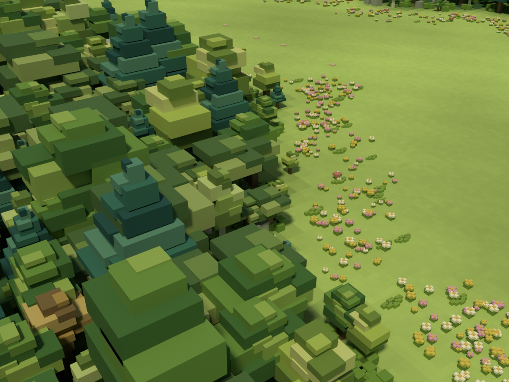
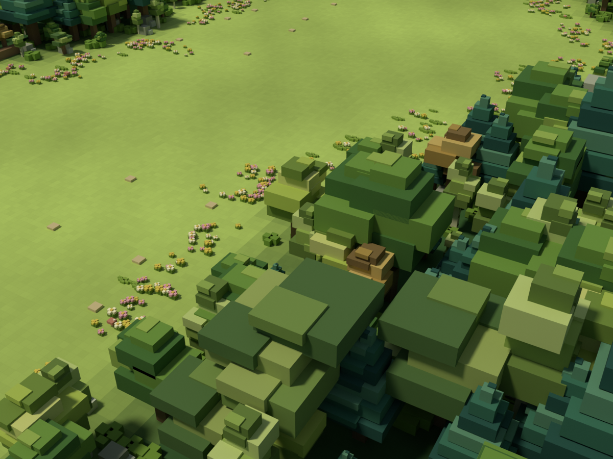
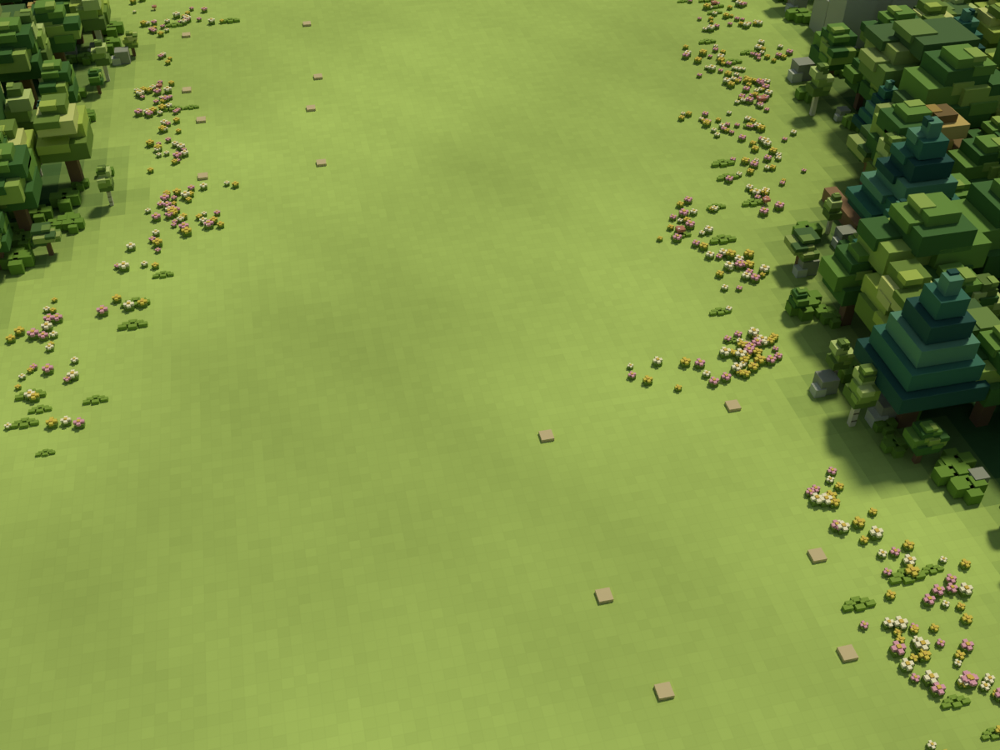
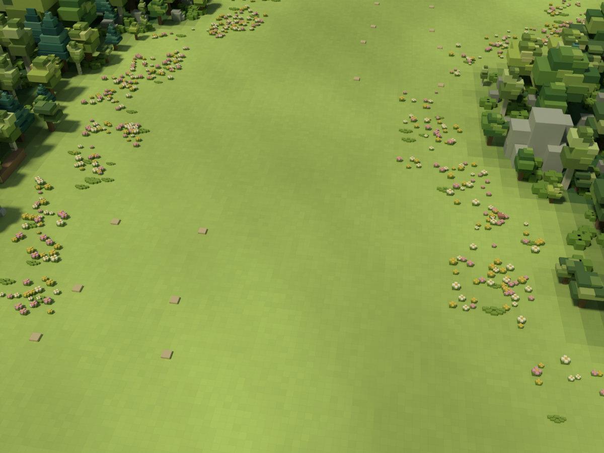
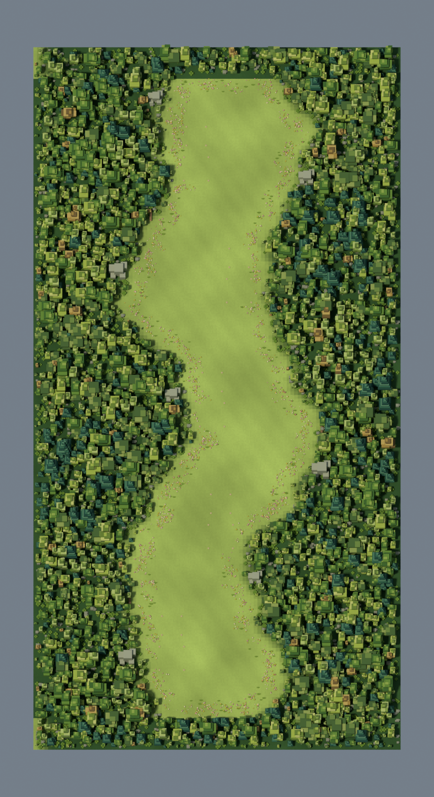
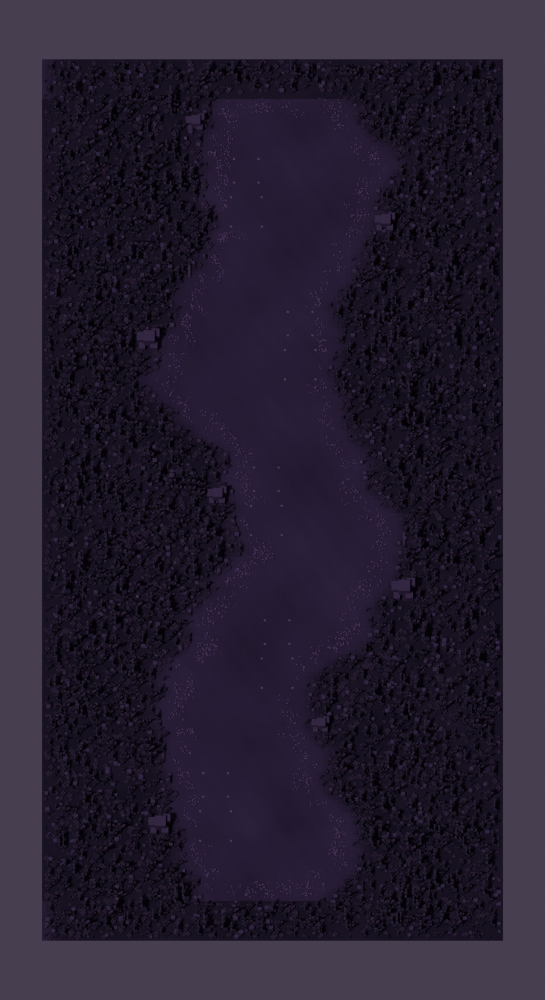

# 작업 보고서 — 숲맵 v4 수종·크기 다양화

외곽 숲의 비슷한 수관·색상·크기를 수정하고 Blender v4 맵을 툴에 적용했다. 정화 후 5개 시점과 정화 전 전체 시점, 총 6장의 렌더를 보관했다.

## 지시자가 보면 되는 핵심

- 6가지 수목 형태, 어린 나무·성목·큰 수목, 구간별 색상 군락으로 숲의 반복감을 줄였다.
- 이동 마스크·건설 부지 데이터는 v3와 해시가 동일하며 나무 줄기가 이동 영역에 들어오지 않는지 검사했다.
- Blender 렌더와 보고서를 보관했다. 실제 툴 스크린샷·FPS 측정은 미완료이며 이후 그룻봇 지시를 기다린다.

## 검토한 문제와 변경

기존 3가지 나무는 모두 유사한 층형 수관, 같은 초록 팔레트, 0.72~1.32배 크기를 사용했다. 멀리서 실루엣 차이가 작고 외곽이 같은 높이의 벽처럼 보였다.

| 형태 | 수량 | 구별 요소 |
|---|---:|---|
| 넓은 활엽수 | 719 | 넓고 비대칭인 수관, 중간 초록 |
| 자작나무형 | 566 | 흰 줄기와 가는 수관, 밝은 황록색 |
| 침엽수형 | 407 | 높게 좁아지는 층형 실루엣, 짙은 청록 |
| 옆으로 퍼지는 나무 | 379 | 낮고 넓은 수관, 올리브색 |
| 밝은 연두 수목 | 549 | 작은 상단과 둥근 층 구성, 연두색 |
| 황갈색 포인트 수목 | 94 | 비대칭 수관, 소량의 따뜻한 색상 |

수종 명칭은 스타일 분류이며 식물학적으로 정확한 재현은 아니다.

- 최초 크기 그룹 배정: 어린 나무 714, 성목 1,531, 큰 수목 469. 숲 경계에서는 통로 보호를 위해 추가 축소했다.
- 최종 배율 범위 약 0.31~1.75. 수종별 기본 높이도 달라 크기와 높이가 함께 변화한다.
- 48m 길이·35m 가로 구간별로 우세 수종을 바꾸되 다른 수종을 함께 배치했다. 황갈색은 약 3.5%로 제한했다.
- 경계 보호 검사를 통과하지 못한 일부 나무를 제외해 총 2,714그루가 됐다.
- 정화 전도 같은 배치와 크기를 공유하며 잎 없는 가지·낮은 덤불 형태를 유지한다.
- 기존 노랑빛 초록 바닥과 햇빛은 유지했다. 이번 변경 대상은 수목 다양성이다.

## 변경 파일·적용 위치

- `C:\xoox\scripts\forest150\build_forest.py`: 수목 형태 6종, 크기/군락 분포, 통로 보호, 다각도 렌더.
- `C:\xoox\data\maps\forest150\releases\v4\`: 정화 전후 GLB, 렌더, 배치 기록 `tree_distribution.json`, `art_validation.json`, 통계와 마스크.
- `C:\xoox\art-source\forest150\v4\`: Blender 원본.
- `C:\xoox\data\maps\forest150\manifest.json`: revision `forest150x300-v4`, 정화 전후 GLB를 v4로 전환.
- 기존 navigation/construction/buildings 진입 경로와 툴 코드는 유지했다. 정화 후 기본 설정 유지.
- 백업: `C:\xoox\_backups\20260927_forest_v4_092635`. 기존 v3 릴리스는 그대로 보존했다.
- 확인: http://localhost:5179/forest-map-tool.html 에서 새로고침. 다른 툴은 공통 manifest를 다시 읽으면 v4 맵을 사용한다.

## 검증·부하

- Blender 배치 실행 정상 종료, GLB 내보내기와 6장 렌더 생성 완료. 썸네일/확장 캐시 경고는 있었으나 산출물 저장은 성공했다.
- 정화 전후 GLB의 150×300m 경계, 평지, 유한 좌표, 인스턴싱 확장 검사 통과.
- navigation.json, construction.json은 v3와 SHA256 해시 일치. 이번에 경로/건설 동작 코드를 수정하지 않았다.
- 모든 수종이 존재하고 모든 나무 줄기가 이동 마스크 밖에 있는지 검사 통과.
- 배포 파일과 스테이징 파일 해시 일치 확인.
- 정화 후 삼각형: 1,674,724 → 862,816, 약 48.5% 감소. 수관 블록을 통합해 숨겨진 잎 면을 줄였다.
- 정화 후 GLB: 5,684,360 bytes. 정화 전: 879,928 triangles / 5,694,424 bytes.
- 전체 노드: 395 → 514. 수종이 늘어 인스턴스 그룹 수는 증가했다. 실제 draw call·FPS와 같은 값은 아니며 FPS 개선을 단정하지 않는다.

## 다각도 이미지

모두 이번 v4 Blender 렌더다. 실제 툴 화면 스크린샷과 구분해서 보관한다. 원본은 보고서의 `assets/20260927_forest_v4/` 폴더에도 함께 보관한다.

### 서쪽 숲 근접 — 수종·크기 차이

### 동쪽 숲 근접 — 청록·연두·황갈색 혼합

### 북쪽에서 내려다본 역방향

### 시작 구간 전진 시점

### 정화 후 전체 배치

### 정화 전 전체 배치

## 하지 않은 일

- 브라우저 제어의 기존 보안 정책 차단으로 실제 툴 화면 스크린샷과 FPS 측정은 수행하지 못했다. Blender 렌더를 인게임 캡처라고 보고하지 않는다.
- 사용자 최종 미술 승인, 본 게임 통합, 추가 수종/계절 시스템은 수행하지 않았다.

## 다음 지시 전에 막힌 질문

설계 질문 없음. 실제 툴 화면 검수와 성능 측정은 남아 있다. 이 보고 이후 추가 작업 없이 그룻봇 지시를 기다린다.

