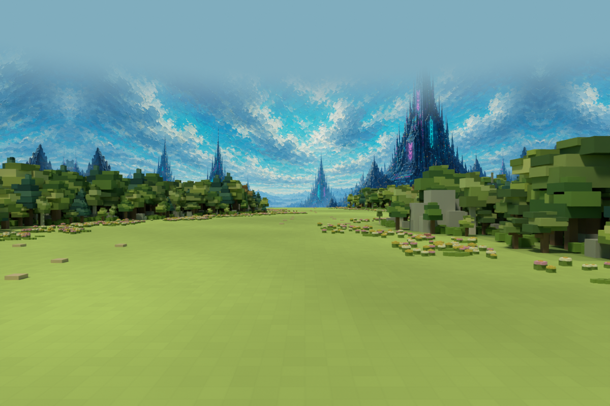
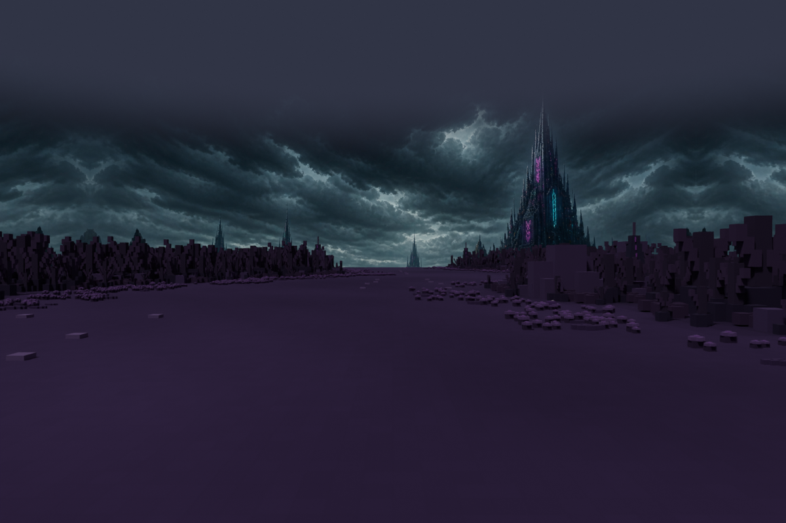
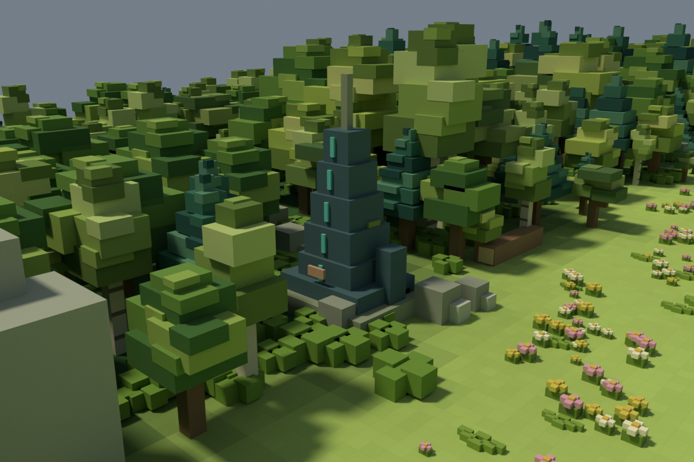
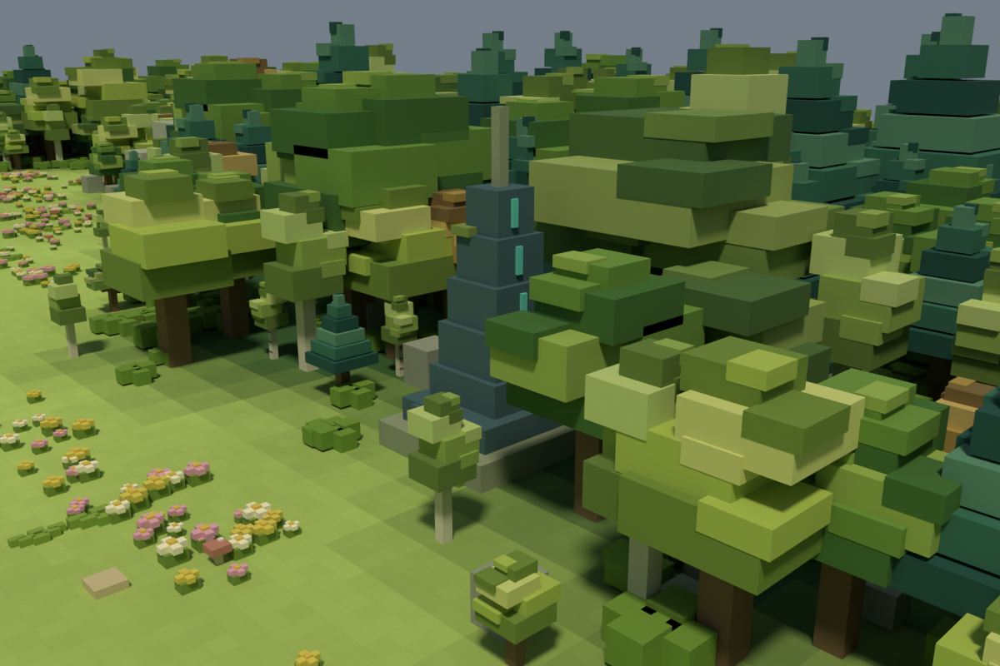
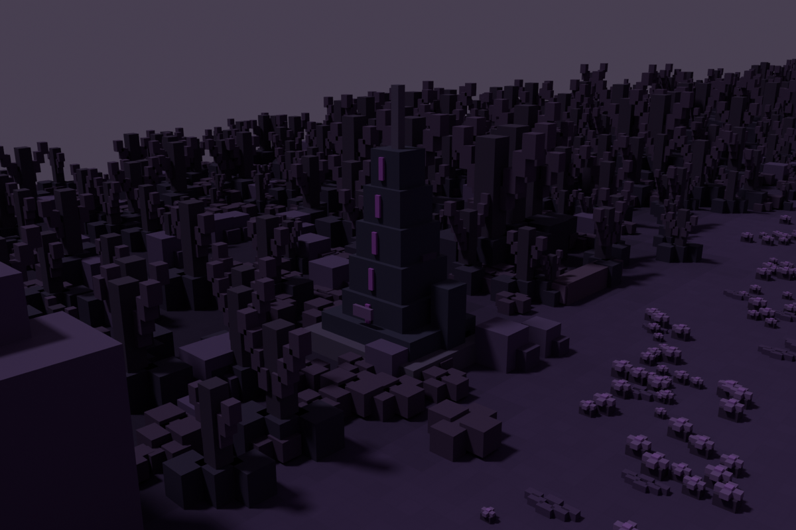
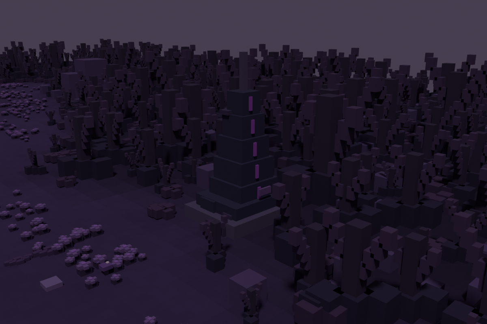

# 작업 보고서 — 숲맵 v5 로비 분위기 연결

로비와 인게임 배경 자료를 검토해 기존 첨탑 원경을 재사용하고, 숲 가장자리에 Blender 옛 신호시설 5곳을 추가했다. v5로 툴 적용 완료, 실제 브라우저 미술 검수는 남아 있다.

## 지시자가 보면 되는 핵심

- 밝은 블록 산 대신 로비의 청록·분홍 첨탑 원경을 적용하고 이미지 늘어짐과 상단 경계를 보정했다.
- 숲의 이동 불가 영역에 이끼 낀 신호시설 5곳을 추가해 가까운 맵과 먼 건축물을 연결했다.
- 정화 전후 근접 4장·분위기 2장, 총 6개 Blender 렌더 및 보고서를 보관했다.

## 자료 검토와 계획

확인한 자료:

- `data/ui/lobby/lobby_hub_after.png`: 짙은 청록색 첨탑, 청록·분홍 장식, 따뜻한 빛이 섞인 하늘.
- `data/ui/lobby/lobby_hub_before.png`: 같은 건축물과 차가운 어두운 분위기.
- `data/art/sky/horizon_mountains_purified.png`: 인게임 JourneyStage3D가 사용하는 로비 계열 첨탑 원경.
- `data/art/props/sticker/prop_sticker_building.png`: 따뜻한 목재 건물. 이번 숲은 사람이 살지 않는 장소이므로 주택을 추가하지 않았다.

실행 방향: 기존 밝은 숲을 유지하면서 **가까운 이끼 낀 시설 → 나무 경계 → 먼 첨탑**으로 연결한다. 새 마을을 만들지 않고 이전 시설의 흔적만 둔다. 정화 전후는 같은 위치를 공유한다.

## 실행한 변경

### 배경

- 기존 로비 계열 `horizon_mountains_purified/polluted.png` 사용. 원본 이미지 파일을 덮어쓰지 않았다.
- 이전 420m 반경·360m 높이에서 원본 2:1 이미지가 원통 한 바퀴에 늘어나는 비율 문제를 확인했다.
- 최종 설정: 반경 190m, 높이 100m, 상단 65m, 수평 6회 미러 반복. 한 구간의 물리 비율은 약 1.99:1로 원본에 가깝다.
- 상단 30%는 상태별 하늘색으로 부드럽게 합성한다. 카메라를 올렸을 때 원통 상단의 경계를 줄인다.
- 이미지가 반복되는 부분은 미러 반복을 사용한다. 완전히 고유한 360도 파노라마를 새로 그린 것은 아니므로 반복 패턴은 존재한다.
- 최초 분위기 렌더에서 첨탑이 거대한 벽처럼 보이는 문제를 발견해 원경 높이를 낮추고 재렌더했다.
- 원통은 메인/후면 카메라의 수평 위치를 따라가며 정화 상태와 함께 전환된다.

### 숲의 시설

- 짙은 청록색 계단형 석조 신호탑, 옆의 부서진 기둥, 작은 금속 표식, 이끼를 블록 형태로 제작했다.
- 정화 후에는 청록색 장식, 정화 전에는 보라색 장식을 사용한다. 발광색을 연상시키는 재질 색상이며 실제 동적 광원은 추가하지 않았다.
- 좌표(m): (38,53), (109.5,100), (57,151), (99.5,201), (49.5,259).
- 각 위치 주변 8×8m를 0.5m 간격으로 검사해 전부 이동 불가 영역 안에 배치했다. 시설 주변 수목 일부만 정리했다.
- 이 시설은 장식이다. 건설·공격 대상 5쌍을 대체하거나 추가하지 않는다.

## 변경 파일·백업

- `C:\xoox\data\maps\forest150\manifest.json`: revision `forest150x300-v5`, 맵 GLB 및 원경 설정.
- `C:\xoox\data\maps\forest150\releases\v5\`: 정화 전후 GLB, `relics.json`, 렌더.
- `C:\xoox\art-source\forest150\v5\`: Blender 원본과 추가 시설 제작 스크립트.
- `C:\xoox\src\maps\blockMap\BlockMapView.ts`: 반복 비율·미러 반복·상단 하늘색 합성. 새 설정을 사용하지 않는 기존 맵은 기본 동작 유지.
- `C:\xoox\src\tools\forestMap\main.ts`: 배경 설정 타입 확장.
- 백업: `C:\xoox\_backups\20260927_forest_v5_095902`. v4 릴리스는 보존했다.

## 검증과 부하

- Blender 생성·내보내기·렌더 정상 종료. 썸네일 캐시 경고는 있었으나 산출물 저장 성공.
- 정화 전후 GLB 경계 150×300m, 평지, 유한 좌표, 인스턴싱 검사 통과.
- TypeScript 검사와 기존 미리보기·컬링 회귀 검증 통과.
- 이동 마스크와 건설 부지는 기존 v3 파일 경로를 유지한다. 전투 로직 변경 없음.
- 정화 후 GLB: 5,830,856 bytes / 전체 인스턴스 환산 861,052 triangles / 519 nodes.
- 정화 전 GLB: 5,840,920 bytes / 878,152 triangles / 519 nodes.
- v4 대비 노드 5개 증가. 시설 자리 수목을 줄여 전체 삼각형은 소폭 감소했다. 배경은 정적 텍스처와 한 원통으로 표시하며 추가 동적 조명 없음.
- 실제 FPS는 측정하지 않았다. 노드 수와 실제 draw call은 동일한 값이 아니다.

## Blender 검수 이미지

아래는 실제 Blender 렌더다. 인게임 스크린샷이 아니다. 분위기 렌더는 게임과 같은 배경 크기·높이·반복·상단 합성 방향으로 구성했지만 엔진 조명과 텍스처 처리가 완전히 같지는 않다.

### 정화 후 후면 높이 분위기

### 정화 전 후면 높이 분위기

### 남쪽 시설 정화 후

### 중간 시설 정화 후

### 남쪽 시설 정화 전

### 중간 시설 정화 전

## 하지 않은 일·남은 확인

- 기존 브라우저 보안 정책 제한으로 실제 툴 화면 캡처·GPU 셰이더 실행·FPS 검수는 수행하지 못했다. 셰이더 삽입 지점은 설치된 Three.js 소스에서 확인했다.
- 참고 원경의 회화적인 질감과 가까운 블록 숲의 차이는 남아 있다. 새로운 원경 이미지를 제작한 것은 아니며 사용자 검수를 위한 연결안이다.
- 기존 주택이나 로비 전체를 맵에 복제하지 않았다. 건설 건물 최종 디자인은 아직 미정이다.

## 다음 지시 전에 막힌 질문

없음. 툴 새로고침으로 확인 가능: http://localhost:5179/forest-map-tool.html

30분 그룻봇 지시 확인 자동화는 유지하며 새 맵 지시를 기다린다.

