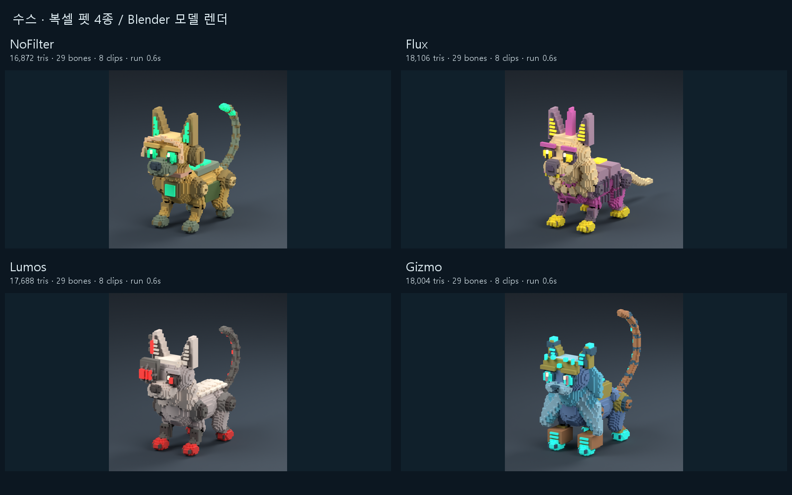
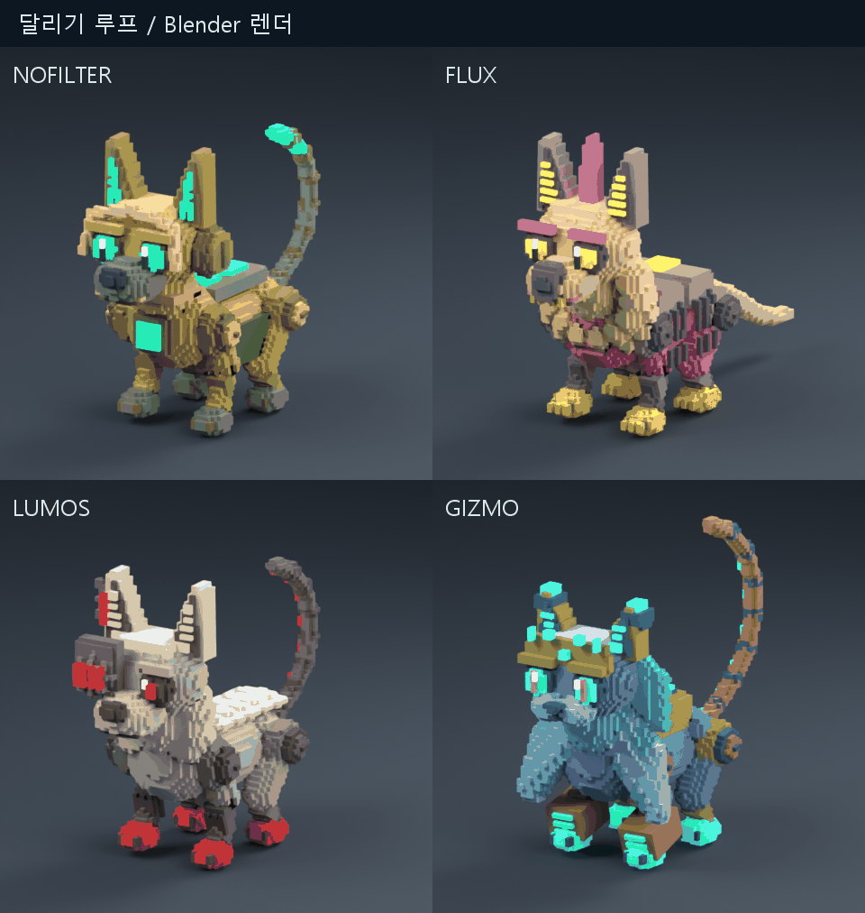

# 작업 보고서 — 초기 디펜스 3형태와 복셀 펫 4종 제작 정리

작성: Codex(아스트라) · 2026-10-04  
범위: 사용자 직접 승인한 디펜스 구현 후 추가 펫 4종까지. 원본 `C:\xoox`에서 작업.

## 한 줄

디펜스 세 형태의 코드와 펫 네 마리의 모델·리깅·8개 동작·선택 툴을 제작하고 CLI 검증 및 배포 빌드를 통과했다. **실제 웹 툴의 화면·조작 검증과 스크린샷 촬영은 브라우저 접근 거부로 대기 중**이다. 아래 이미지는 Blender 모델 렌더다.

## 바꾼 파일

### 디펜스

- 신규 `src/tools/forestPlay/DefenseSession.ts`, `DefensePreview.ts`: 세 관찰 모드의 시간·스폰·경로·공격·붕괴와 화면 모듈.
- 기존 `src/tools/forestPlay/main.ts`: 새 모듈 연결, 진입 시 캐릭터/기존 프리뷰 숨김, 프레임·카메라 연결. 기존 디버그 API 콜백의 암시적 any 26곳에 타입 명시.
- 신규 `scripts/verify_defense_modes.mjs`: 실제 숲 마스크·배치 기반 로직 검증.
- 세부 보고: `docs/reports/20261004_작업보고서_디펜스3형태_Codex.md`.
- 원본 백업·변경 해시·로직 결과: `docs/reports/assets/20261004_디펜스3형태_Codex/`.

### 펫 모델·툴

- 신규 `scripts/unit_lab_pets4/build_pets4.py`: 복셀 형상·그리디 메시·29본·IK·8클립·GLB/Blender 내보내기·모델 검증.
- 신규 `scripts/unit_lab_pets4/render_motion.py`, `compose_review.py`: 달리기 프레임 렌더 및 비교판/GIF 구성.
- 신규 `data/tools/unit_lab/pets/{nofilter,flux,lumos,gizmo}/`: 각 GLB·manifest·사용자 원본 reference.png·편집용 source/*.blend. Blender의 .blend1 백업도 보존.
- 신규 `data/tools/unit_lab/pets/pets4_catalog.json`: 네 모델의 위치·이름·클립·용량.
- 신규 `pet-pack-tool.html`, `src/tools/petPack/main.ts`: 네 신규 펫과 기존 BCAT 선택, 원본 비교, 카메라, 타임라인, 걷기/달리기, 앉기↔서기 연결, 눈 레이저.
- 신규 `scripts/verify_pets4.mjs`: 내보낸 GLB를 Three GLTFLoader/AnimationMixer로 다시 읽어 검사.
- 신규 `scripts/verify_defense_pet_build.mjs`: 두 툴을 별도 production-check 폴더에 빌드.
- 기존 `vite.config.ts`: forest-play와 pet-pack 빌드 진입점 추가.
- 기존 `unit-lab-tool.html`: 헤더의 펫 링크를 새 선택 툴로 연결. 기존 BCAT 툴은 새 툴에서도 열 수 있다.
- 마지막 두 기존 파일의 백업·전후 해시: 펫 assets의 `source_before/`, `integration_changes.json`.

### 문서

- 계획: `docs/reports/20261004_작업계획_디펜스3형태와펫4종_Codex.md`.
- 재현 가능한 제작 방법·툴 위치·남은 확인: `docs/handoff/20261004_디펜스와펫4종_제작방법_Codex.md`.
- BOARD: Codex 자기 행만 갱신.

## 핵심

### 디펜스 세 형태

같은 북→남 길(현재 경로 약 258.25m), 포탑 5·방어물 4·남쪽 본진 1. 시설은 실제 적 공격으로 HP가 줄고 무너진다. 시간을 흘려 HP를 깎지 않는다. 캐릭터 없는 초기 장면이므로 시간 종료는 관찰 완료이며 승패 판정을 추가하지 않았다.

| 형태 | 시간 | CLI 확인 |
|---|---:|---|
| 타워 디펜스 | 45초 | 자동 포탑 공격, 적 공격/붕괴, 정확한 종료 |
| 웨이브 디펜스 | 70초 | 20초 × 3 + 5초 휴지 × 2, 휴지 구간 스폰 중단 |
| 기지 방어 | 60초 | 본진까지 공격 진행, 정확한 종료 |

정지 시 시간·스폰·공격과 시각 동작을 멈추고, 다시 보기 시 새 세션을 만든다. CLI에서 중복 붕괴 없음, 시간 자체의 피해 없음, 정지, 종료 후 시간 정지를 통과했다. 관찰용 공격·HP 값이므로 본게임 밸런스 확정으로 해석하지 않는다. CLI 결과와 웹 실행 확인은 구분했다.

### 네 펫의 외형

사용자 제공 네 그림의 특징을 직접 설계했다. 자동 이미지→3D 변환이나 외부 모델 다운로드를 사용하지 않았다. BCAT 생성 방법을 참고하되 기존 고양이 파일은 수정하지 않았다.

| 모델 | 반영한 특징 | 삼각형 | GLB |
|---|---|---:|---:|
| NoFilter | 황금 몸체·민트 눈/귀·회색 주둥이·복숭아 바이저·기계 관절 | 16,872 | 2.04 MiB |
| Flux | 크림 이마/갈기·분홍 장갑·노란 귀 슬랫/발톱·측면 배선 | 18,106 | 2.17 MiB |
| Lumos | 밝은 털·비대칭 기계 얼굴·붉은 슬롯/발·금속 앞다리 | 17,688 | 2.13 MiB |
| Gizmo | 고양이 얼굴·청록 긴 갈기·황동 이마·분홍 눈동자·기계 꼬리 | 18,004 | 2.16 MiB |

그림에 없는 후면과 관절은 해당 그림의 배색·장비를 이어서 설계했다. 단일 원본 그림과 모든 각도에서 똑같다고 주장하지 않는다. NoFilter는 파일명을 따른 임시 표시 이름이다.

### 가장 중요한 제작 방법

0.02m 본별 격자에 몸·귀·얼굴·털·장비를 채우고, 내부 면을 제거한 뒤 같은 색의 노출 면을 직사각형으로 합쳤다. 한 스킨 메시, 29본, 불투명/발광 두 재질이다. 수만 개의 큐브 Object를 따로 생성하거나 프레임마다 복셀화하지 않는다.

절대 관절 변형 행렬에서 본 basis를 계산하고, 다리는 두 관절 IK를 사용한다. 앉기·서기는 pelvis와 뒷발 이동을 부드럽게 연결한다. 귀·꼬리 끝에 작은 움직임과 위상차를 넣었다. 30fps 키를 본 위치·쿼터니언·스케일로 굽고 클립별 NLA track을 GLB로 내보냈다. 세부 함수와 명령은 인계 문서에 있다.

모든 신규 펫: `idle_stand`, `idle_sit`, `idle_look`, `walk`, `run`, `attack_laser`, `stand_up`, `sit_down` 8개. 걷기 1초·달리기 0.6초, 측정한 앞발 보폭은 약 0.132m·0.230m다. 앉기↔서기 전환은 1.1초. 기존 BCAT에 없는 달리기는 그 모델 선택에서 비활성화한다.

달리기는 제자리 클립이다. manifest의 이동 속도는 향후 게임 연결 기준 제안이며 본편 이동 코드는 이번에 넣지 않았다. 모바일 FPS·다수 펫 동시 부하는 아직 측정하지 않았다.

### 검증과 고친 문제

- 최종 TypeScript 검사와 두 툴의 production build: 통과.
- 네 GLB를 실제 툴과 같은 GLTFLoader로 읽음: 8클립·29본·재질 2·스킨 가중치 합 1·삼각형 수·원본/Blender 파일 존재 통과.
- 루프 양 끝 본 행렬 차이 0. 앉기↔서기 endpoint 차이 0.
- 보폭에 비해 다리가 모자라 접합이 벌어지지 않도록 휴지 관절을 굽힌 구조로 수정. 최대 접합 오차 약 0.00000012m.
- Flux 앉은 꼬리가 바닥 아래로 내려가는 문제를 export 재검증에서 발견. 옆으로 눕는 방향과 최저 높이를 조정해 재생성.
- Blender 샘플 포즈의 최저 점은 수치 오차 수준. 내보낸 클립 보간에서 최저 y 약 -0.00061m(0.61mm), 바닥 허용 오차 0.01m 내 통과.
- 달리기 8프레임씩 32장 렌더. 프레임 간 이미지 변화 확인 후 0.6초 GIF 구성.
- 기록: `export_checks.json`, `metrics.json`, `motion_checks.json`, `asset_inventory.json`, 빌드/렌더 로그.

## 확인 위치와 이미지

- 디펜스: <http://localhost:5179/forest-play-tool.html?defense=tower> — 패널에서 세 모드를 선택.
- 펫: <http://localhost:5179/pet-pack-tool.html> — 네 신규 펫과 기존 BCAT 선택.
- 원본 비교: `docs/reports/assets/20261004_펫4종_Codex/reference_comparison.png`.
- 동작 단계: 같은 폴더 `pose_comparison.png`.
- 달리기: 같은 폴더 `run_loop.gif`.

**다음 이미지는 Blender 렌더이며 웹 툴 스크린샷이 아니다.**

## 하지 않은 일

기존 캐릭터·BCAT GLB 및 숲 맵/mask/catalog GLB 수정, 본게임·필러·자원·강화·승패 연결, 다른 에이전트 상태 행 변경, CodexPack 작업, 커밋·푸시를 하지 않았다. 추가 게임 기능으로 범위를 늘리지 않았다.

## 막힌 질문·남은 확인

브라우저 도구가 로컬 `http://127.0.0.1:5179` 접근을 거부했다. 이 대화에서 재허용을 요청했으며 아직 답이 없다. 다른 주소/브라우저/자동화 경로로 우회하지 않았다.

남은 것은 실제 웹에서 디펜스 세 모드 로딩·조작·종료/복귀, 펫 선택·카메라·전환·달리기·눈 FX를 확인하고 **실제 툴 스크린샷**을 보충하는 일이다. 이를 완료한 것으로 표시하지 않았다. 제작물·소스·렌더·CLI 검증 자료는 모두 저장했으며 Codex 상태는 대기다.
