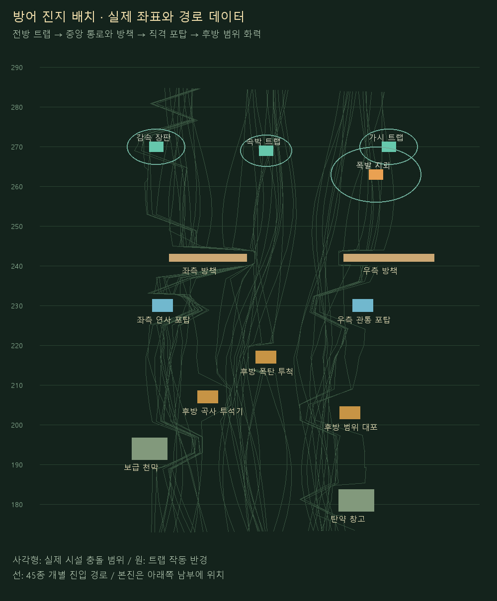
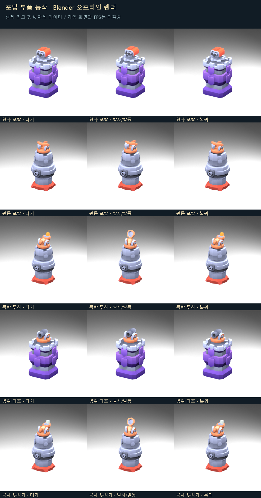
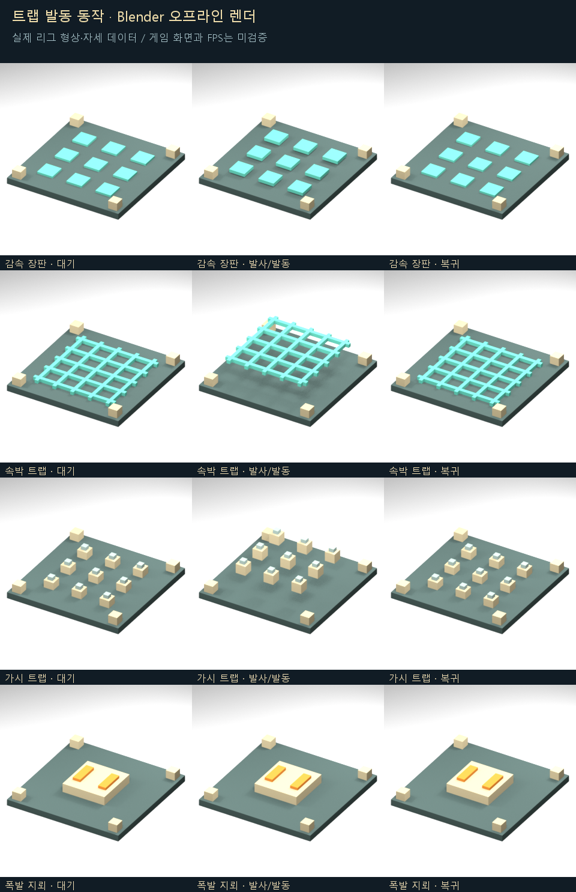

# 작업 보고서 — 방어 진지·직격/범위 공격·트랩 구분 (DEF15-03)

작성: Codex(아스트라)
날짜: 2026-10-04 21:00 KST

## 한 줄

빠른 한 발 직격 처치와 느린 지점 범위 공격을 분리하고, 트랩 4종·부품 애니메이션·진지 배치·툴 밸런스 조정 패널을 구현했다. 3모드의 15분 시뮬레이션에서 적 누적과 본진 생존을 검증했다.

## 바꾼 파일

- `src/tools/forestPlay/DefenseBalance.ts`
- `src/tools/forestPlay/DefenseSession.ts`
- `src/tools/forestPlay/DefensePreview.ts`
- `src/tools/forestPlay/DefenseOutpost.ts`
- `src/tools/forestPlay/DefenseFacilityRig.ts`
- `src/tools/forestPlay/DefenseBalancePanel.ts`
- `data/tools/unit_lab/defense_balance.json`
- `data/tools/unit_lab/defense_traps.json`
- `data/tools/unit_lab/defense_outpost.json`
- `scripts/verify_defense_15min.mjs`
- `scripts/verify_defense_15min_build.mjs`
- `scripts/verify_defense_roles.mjs`
- `scripts/verify_defense_facilities.mjs`

- 계획서: `docs/reports/20261004_작업계획서_방어진지와공격역할_Codex.md`
- 검증·렌더·착수 전 백업·해시: `docs/reports/assets/20261004_방어진지와시설동작_Codex/`
- 상태판은 Codex 행만 갱신.

## 하지 않은 일

- 캐릭터·펫·원본 GLB·몬스터 45종 리소스와 개별 설정·원본 숲 맵 파일을 변경하지 않았다.
- 다른 에이전트 행, CodexPack 복사본, 커밋·푸시에 손대지 않았다.
- 승패·경제·설치 구매·난이도 성장 등 전체 게임 규칙은 이번 범위에 포함하지 않았다. 현재 장면은 기존 방어 관찰 툴이다.

## 핵심

### 1. 공격 역할과 실제 피해 판정

| 시설 | 방식 | 피해 | 공격 간격 | 사거리 | 범위 반경 | 준비 |
|---|---|---:|---:|---:|---:|---:|
| 연사 포탑 | 직격 | 600 | 0.45초 | 40m | 0m | 0초 |
| 폭탄 투척 | 지점 범위 | 600 | 2.6초 | 60m | 6m | 0.22초 |
| 범위 대포 | 지점 범위 | 650 | 3.0초 | 75m | 7m | 0.18초 |
| 관통 포탑 | 직격 | 760 | 0.5초 | 32m | 0m | 0초 |
| 곡사 투석기 | 지점 범위 | 720 | 4.2초 | 80m | 9m | 0.55초 |

- 연사 포탑: 한 주기 최대 3발, 탄 간격 0.08초. 유효 대상이 없으면 낭비 탄을 강제로 발사하지 않는다.
- 관통 포탑: 주 목표 직격 + 같은 탄도에 있는 추가 2대상까지 관통, 추가 피해 비율 85%.
- 직격 기본 피해는 **몬스터 45종 × 직격 2종 = 90개 사례**에서 갑옷을 적용한 첫 명중 처치를 검증했다. 툴에서 피해를 낮추면 여러 발이 필요해진다.
- 투석기·폭탄·대포는 준비 시점에 이동을 예측한 **바닥의 고정 좌표**를 지정한다. 탄이 목표 개체를 추적하거나 개체 ID만으로 피해를 주지 않는다. 적이 벗어나면 빗나간다.
- 착탄 반경 안의 살아 있는 적에만 피해. 중심 100% → 가장자리 55%의 선형 감소 후 개별 갑옷 적용. 범위 밖은 0.
- 발사 준비가 길고 간격을 짧게 편집해도 같은 시설의 준비 동작이 중첩되지 않는다.
- 직격의 진행 중 예상 피해를 목표 선정에 반영하여 이미 처치될 적에 불필요한 직격 탄이 몰리지 않게 했다.

### 2. 트랩 4종

| 종류 | 실제 능력 | 작동 반경 | 재사용 | 최대 대상 |
|---|---|---:|---:|---:|
| 감속 장판 | 속도 45%, 3.2초 | 4.5m | 1.2초 | 12마리 |
| 속박 트랩 | 이동·공격 정지 1.2초 | 4.0m | 3.0초 | 3마리 |
| 가시 트랩 | 반복 피해 110 | 4.5m | 0.55초 | 12마리 |
| 폭발 지뢰 | 범위 폭발 650 (가장자리 감소) | 7.0m | 8.0초 | 16마리 |

- 감속은 지속 시간 뒤 정상 속도로 돌아간다. 속박은 이동과 실제 시설 공격을 모두 정지시킨다.
- 가시는 범위에 머무는 동안 재사용 간격마다 피해를 준다. 일시 디버프를 붙이는 DOT 방식이 아니라 장판 안의 반복 피해다.
- 지뢰는 범위 폭발 후 8초 대기하는 재사용형 트랩. 일회용 소모품은 아니다.
- 네 효과가 종료·재사용되고 실제 시나리오에서 전부 발동하는 것을 검사했다.

### 3. 실제 방어 진지 배치

전방 트랩 → 좌우 방책과 중앙 통로 → 양옆 직격 포탑 → 후방 범위 포탑과 보급 시설 → 남쪽 본진.

| 시설 | 좌표 x, 북쪽 y | 충돌 범위 |
|---|---|---|
| 좌측 연사 포탑 | 59, 230 | 3.2 × 3.2m |
| 후방 폭탄 투척 | 75, 217 | 3.2 × 3.2m |
| 후방 범위 대포 | 88, 203 | 3.2 × 3.2m |
| 후방 곡사 투석기 | 66, 207 | 3.2 × 3.2m |
| 우측 관통 포탑 | 90, 230 | 3.2 × 3.2m |
| 좌측 방책 | 66, 242 | 12 × 1.8m |
| 우측 방책 | 94, 242 | 14 × 1.8m |
| 보급 천막 | 57, 194 | 5.5 × 5.5m |
| 탄약 창고 | 89, 181 | 5.5 × 5.5m |

- 네 트랩: 감속 (58,270), 속박 (75,269), 가시 (94,270), 지뢰 (92,263).
- 복제한 내비게이션에 시설 충돌을 추가했다. 원본 맵은 보존한다.
- 방책 붕괴 시 해당 추가 충돌이 제거되고, 다시 시작하면 시설 충돌이 복구된다. 기존 지형 장애물은 유지된다.
- 45종 개별 진입 경로, 2~3종 혼합 무리, 종류별 속도·체력·갑옷·공격 설정과 서로 떨어져 이동하는 규칙은 유지한다.

### 4. 포탑·트랩 동작과 FX

- 기존 합쳐진 포탑 카탈로그 GLB에는 움직일 부품 축이 없다. 원본 Kenney 부품을 따로 조립하여 회전 베이스·포신·투석기 팔을 연결했다.
- 실제 총구/투석기 컵의 월드 좌표에서 탄을 생성한다. 목표 방향 베이스 회전, 직격 포신 반동, 곡사 준비·팔 상승·발사·복귀·탄 재장전.
- 실제 투석기 컵은 로컬 -Z에 있다. +X 회전으로 컵이 올라가는지 원본 GLB 노드·정점으로 확인했다.
- 직격은 빠른 예광 탄, 범위는 포물선 탄·착탄 반경 표시·큰 폭발 큐브 FX.
- 감속 패널 미세 상승과 발광, 속박 격자 상승, 가시 상승·복귀, 지뢰 발광 및 폭발 FX. UI에 시설 상태와 트랩 재사용·발동 횟수를 표시한다.
- 아래 이미지는 실제 리그의 정점과 변환을 내보내 **Blender에서 렌더한 동작 자료**다. 게임 스크린샷이 아니다. 지뢰 폭발 입자·실시간 발광은 이 형상 렌더에 포함하지 않았다.

### 5. 툴 밸런스 조정 기능

[실행 링크](http://localhost:5179/forest-play-tool.html?defense=tower&revision=DEF15-03)

오른쪽 **공격·트랩 밸런스 설정**을 열고 시설/트랩 선택 → 숫자 편집 → **변경 적용**. 적용하면 현재 모드를 처음부터 다시 재생한다. **기본값**은 기본 밸런스로 재시작한다.

- 공통 공격: 피해·공격 간격·사거리·탄속.
- 직격: 연사 수·연사 탄 간격·추가 관통 수.
- 범위: 폭발 반경·발사 준비 시간·가장자리 피해 비율.
- 트랩: 반경·재사용·최대 대상 수·피해 또는 지속 시간·감속 비율.
- 입력 범위와 유한 숫자 검사를 적용했다. 편집 결과는 현재 페이지 내 재생 설정이며 JSON을 덮어쓰지 않고, 페이지 새로고침 시 기본값으로 돌아간다.

### 6. 검증 결과

| 모드 | 시간 | 등장 | 생성 / 처치 | 최대 / 종료 생존 적 | 본진 HP | 최소 간격 |
|---|---:|---:|---:|---:|---:|---:|
| 타워 | 900초 | 45종 | 1093 / 1081 | 12 / 12 | 10000 | 2.978m |
| 웨이브 | 940초 | 45종 | 1093 / 1081 | 12 / 12 | 10000 | 2.978m |
| 기지 | 900초 | 45종 | 1148 / 1139 | 13 / 9 | 10000 | 2.941m |

- 기존 DEF15-02에서는 세 모드 모두 생존 적 72마리까지 누적됐다. 현재는 최대 12~13마리, 종료 9~12마리이며 초기 3분 처치율 97.6% 이상이다.
- 종료 생존 적은 시계가 멈출 때 이동 중인 마지막 무리다. 종료와 동시에 모든 적을 삭제하거나 처치 처리하지 않는다.
- 다섯 포탑 모두 발사, 네 트랩 모두 발동. 모든 모드의 시설 10개와 본진 생존, 내비게이션 이탈 0.
- 공격 역할 검사: 90개 첫 명중 처치, 범위 다수 피해·중심/가장자리 차이·회피 성공·고정 착탄점, 속박의 공격 중지, 설정 값의 실제 피해 반영, 준비 중첩 방지, 방책 충돌 해제/재시작 복구.
- 부품 검사: 포탑 5종의 방향 축·반동/컵 상승·복귀, 트랩 4종의 발동/복귀.
- `tsc --noEmit` 및 숲 툴 전용 Vite 빌드 통과. 기존 GLTFLoader 정적/동적 import 중복, 500kB 이상 청크 경고가 남는다.
- 검증 재실행: `node scripts/verify_defense_15min.mjs`, `node scripts/verify_defense_roles.mjs`, `node scripts/verify_defense_facilities.mjs`, `node scripts/verify_defense_15min_build.mjs`.
- 근거 JSON: `logic_checks.json`, `attack_role_checks.json`, `facility_animation_checks.json`, `entry_routes.json`.

## 막힌 질문·확인 한계

- 브라우저 접근이 자동 승인 검토에서 거절되어 우회하지 않았다. **실제 브라우저 화면·조작 패널·실시간 FPS는 미검증**이다. 로컬 서버 5179 실행과 컴파일/시뮬레이션은 확인했다.
- 이 기본값은 사용자가 요청한 강한 방어 기준이다. 시뮬레이션에서 15분 동안 시설이 무너지지 않는 수준이며, 상용 난이도와 승패 조건의 확정은 별도 작업이다.
- 범위 공격은 고정 착탄점이므로 선행 탄·트랩에 의해 적이 먼저 죽거나 범위를 벗어나면 빈 곳에 폭발할 수 있다. 의도된 판정이며 피해를 개체에 강제로 붙이지 않는다.
